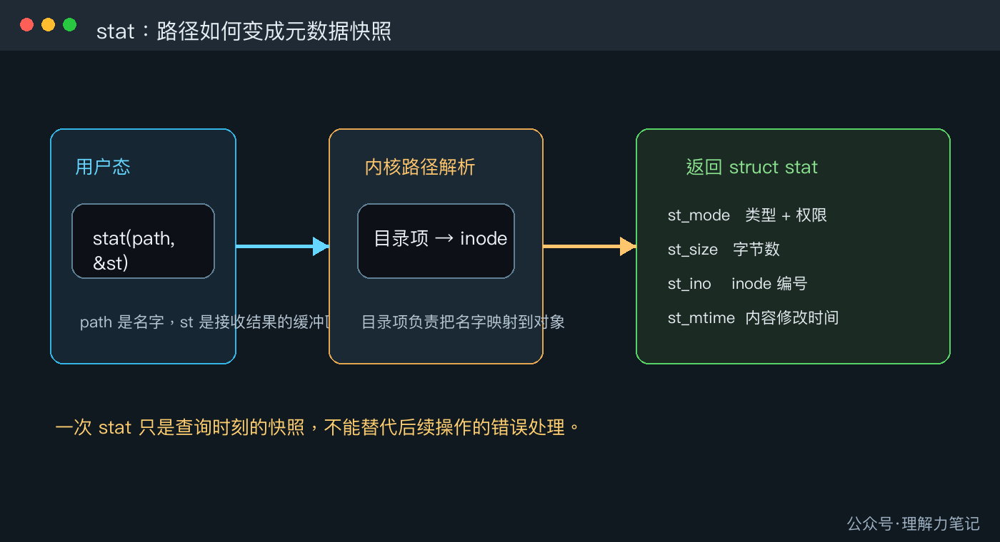
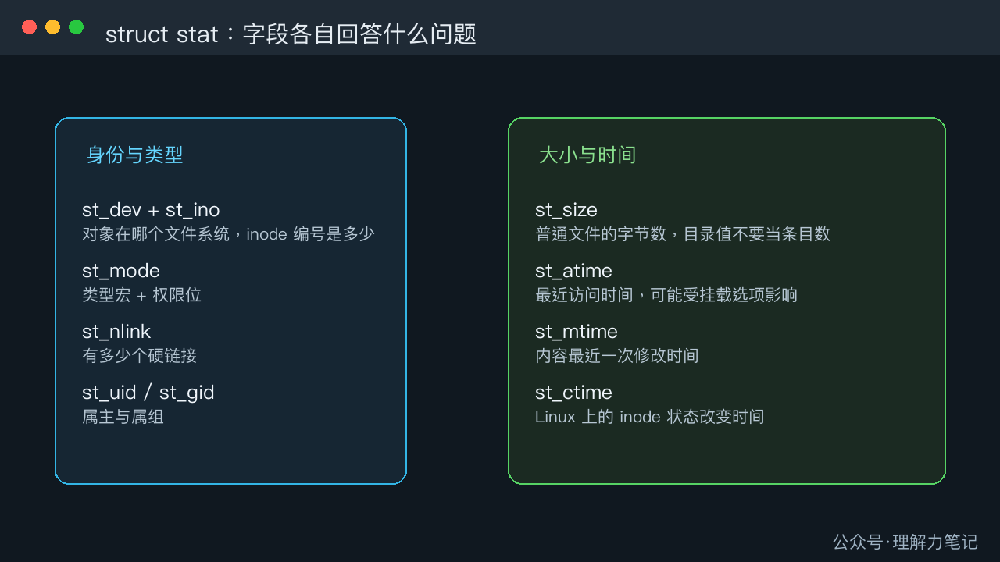

# 用 `stat` 看懂文件类型、大小和 inode

> **结论：** 路径只是名字，真正描述文件状态的是 `struct stat`。调用 `stat(path, &st)` 成功后，可以从 `st_mode` 判断类型，从 `st_size` 读取大小，从 `st_ino` 读取 inode 编号，再按需读取硬链接数、属主和时间字段。`stat` 返回的是查询时刻的快照，不能替代后续操作的错误处理。


**这篇文章怎么读？**

无论你为什么点进来，都能各取所需。只解决手头问题，看第一章就够；想彻底搞懂，再往下读。

| 你是谁 | 看哪一章 | 会得到什么 |
| --- | --- | --- |
| 搜索者 / 被推荐者 | 第一章 · 先解决问题 | 最快的答案（知其然） |
| 学习者 | 第二章 · 机制解释 | 底层的来龙去脉（知其所以然） |
| 编程者 | 第三章 · 工程使用 | 正确、能直接用的写法 |
| 求职者 | 第四章 · 面试提炼 | 会怎么问、怎么答（按需） |

---

你在写文件管理器、日志巡检工具或安装脚本时，通常先拿到一个路径，然后要回答几个问题：它是普通文件还是目录？有多大？属于哪个 inode？最近什么时候改过？这些信息不需要把文件内容读一遍，`stat` 就是专门做这件事的接口。

## 第一章 · 先解决问题：`stat` 把路径变成一份元数据快照

最短的用法是声明一个 `struct stat`，调用 `stat`，检查返回值，再读取字段。下面的实验同时查询普通文件和目录，避免把目录的大小误认为目录项数量。

### 最小实验

```c
#define _POSIX_C_SOURCE 200809L

#include <errno.h>
#include <fcntl.h>
#include <stdio.h>
#include <stdlib.h>
#include <string.h>
#include <sys/stat.h>
#include <unistd.h>

static const char *file_type(mode_t mode)
{
    if (S_ISREG(mode)) return "regular";
    if (S_ISDIR(mode)) return "directory";
    if (S_ISLNK(mode)) return "symlink";
    if (S_ISCHR(mode)) return "char-device";
    if (S_ISBLK(mode)) return "block-device";
    if (S_ISFIFO(mode)) return "fifo";
    if (S_ISSOCK(mode)) return "socket";
    return "unknown";
}

static int write_all(int fd, const char *data, size_t length)
{
    size_t written = 0;

    while (written < length) {
        ssize_t n = write(fd, data + written, length - written);
        if (n < 0) {
            if (errno == EINTR) continue;
            return -1;
        }
        if (n == 0) {
            errno = EIO;
            return -1;
        }
        written += (size_t)n;
    }
    return 0;
}

static int print_stat(const char *path)
{
    struct stat st;

    if (stat(path, &st) == -1) {
        fprintf(stderr, "stat %s: %s\n", path, strerror(errno));
        return -1;
    }

    printf("%s: type=%s size=%lld inode=%llu nlink=%llu mode=%#o\n",
           path,
           file_type(st.st_mode),
           (long long)st.st_size,
           (unsigned long long)st.st_ino,
           (unsigned long long)st.st_nlink,
           (unsigned int)(st.st_mode & 07777));
    return 0;
}

int main(void)
{
    const char *file_path = "stat_demo_file.tmp";
    const char *dir_path = "stat_demo_dir.tmp";
    const char payload[] = "hello\n";
    int fd = -1;
    int status = EXIT_FAILURE;

    if (unlink(file_path) == -1 && errno != ENOENT) {
        fprintf(stderr, "unlink %s: %s\n", file_path, strerror(errno));
        return EXIT_FAILURE;
    }
    if (rmdir(dir_path) == -1 && errno != ENOENT) {
        fprintf(stderr, "rmdir %s: %s\n", dir_path, strerror(errno));
        return EXIT_FAILURE;
    }

    fd = open(file_path, O_WRONLY | O_CREAT | O_EXCL, 0640);
    if (fd == -1) {
        fprintf(stderr, "open %s: %s\n", file_path, strerror(errno));
        goto cleanup;
    }
    if (write_all(fd, payload, sizeof(payload) - 1U) == -1) {
        fprintf(stderr, "write %s: %s\n", file_path, strerror(errno));
        goto cleanup;
    }
    if (close(fd) == -1) {
        fprintf(stderr, "close %s: %s\n", file_path, strerror(errno));
        fd = -1;
        goto cleanup;
    }
    fd = -1;

    if (print_stat(file_path) == -1) goto cleanup;

    if (mkdir(dir_path, 0750) == -1) {
        fprintf(stderr, "mkdir %s: %s\n", dir_path, strerror(errno));
        goto cleanup;
    }
    if (print_stat(dir_path) == -1) goto cleanup;

    status = EXIT_SUCCESS;

cleanup:
    if (fd != -1 && close(fd) == -1) {
        fprintf(stderr, "close %s: %s\n", file_path, strerror(errno));
        status = EXIT_FAILURE;
    }
    if (unlink(file_path) == -1 && errno != ENOENT) {
        fprintf(stderr, "unlink %s: %s\n", file_path, strerror(errno));
        status = EXIT_FAILURE;
    }
    if (rmdir(dir_path) == -1 && errno != ENOENT) {
        fprintf(stderr, "rmdir %s: %s\n", dir_path, strerror(errno));
        status = EXIT_FAILURE;
    }
    return status;
}
```

### 编译与运行

环境是 macOS Darwin 23.6.0、Apple clang 16.0.0，编译时打开严格警告：

```sh
cc -std=c17 -Wall -Wextra -Wpedantic -Wconversion -Wshadow -O0 -g stat_demo.c -o stat_demo
./stat_demo
```

### 实际结果

```text
stat_demo_file.tmp: type=regular size=6 inode=65986394 nlink=1 mode=0640
stat_demo_dir.tmp: type=directory size=64 inode=65986395 nlink=2 mode=0750
```

inode 编号和目录的 `size` 会随文件系统变化。稳定的观察结果是：`hello\n` 占 6 个字节，普通文件有 1 个硬链接；目录也有自己的 inode，目录大小不是“里面有几个文件”。

常见错误有三个。第一，把 `st_mode` 整数直接和 `S_IFREG` 比较，正确做法是调用 `S_ISREG(st.st_mode)`。第二，把 `st_size` 当成任何对象都通用的“内容长度”，目录和设备文件要按各自语义解释。第三，`stat` 失败后仍读取 `st`，失败路径上的结构体内容不能使用。

## 第二章 · 从操作系统视角理解：路径先找到 inode，`stat` 再复制元数据

文件名本身不是文件对象。文件系统先在父目录的目录项中查找名字，目录项把名字映射到 inode；inode 保存类型、权限、大小、链接数和时间等元数据。`stat` 将这份状态复制到用户空间的 `struct stat` 中。



### `struct stat` 里的字段各自回答一个问题



- `st_mode` 同时包含文件类型和权限位。类型判断用 `S_ISREG`、`S_ISDIR` 等宏，权限位可用 `st_mode & 07777` 取出，但权限位的完整含义放到后续篇目展开。
- `st_size` 对普通文件表示字节数。符号链接的值是链接文本长度，目录的值是目录对象在该文件系统中的大小，不能当作子项计数。
- `st_ino` 是 inode 编号，只在所属文件系统内保证唯一。跨挂载点比较对象时，还要结合 `st_dev`。
- `st_nlink` 是硬链接数。多个目录项可以指向同一个 inode，所以文件名数量和 inode 数量不是一回事。
- `st_atime`、`st_mtime`、`st_ctime` 都是时间字段。在 Linux 语境下，`mtime` 表示内容修改时间，`ctime` 表示 inode 状态改变时间，后者不是创建时间。访问时间还可能受 `relatime`、`noatime` 等挂载选项影响。

`stat`、`fstat` 和 `fstatat` 的区别在于定位对象的方式：`stat` 根据路径，`fstat` 根据已经打开的 fd，`fstatat` 还能把相对路径锚定在目录 fd 上。本篇先聚焦最常见的 `stat`；符号链接自身和目标的差异留给下一篇 `stat` 与 `lstat`。

还有一个容易忽略的边界：查询过程中另一个进程可能正在修改文件。Linux 手册明确提醒，`stat` 返回结构体的不同字段可能来自执行期间的不同瞬间。因此，看到“文件存在”不等于下一行 `open` 一定成功，看到某个权限也不等于后续操作不会被拒绝。

## 第三章 · 工程上怎么使用：把 `stat` 当查询，不当授权

### 返回值和错误路径

`stat` 成功返回 0，失败返回 -1，只有失败后才读取 `errno`。常见错误包括：路径组件不存在时的 `ENOENT`，目录搜索权限不足时的 `EACCES`，路径中间某一项不是目录时的 `ENOTDIR`。日志里应同时记录路径和错误信息，避免只输出一个模糊的“失败”。

### 选择合适的接口

只需要根据路径展示信息时用 `stat`。已经打开文件并希望查询“这个 fd 当前指向的对象”时用 `fstat`，这样不会再次依赖一条可能变化的路径。需要在固定目录下处理相对名称时，使用 `openat`、`fstatat` 等 `*at` 接口，把路径基准绑定到目录 fd。Linux 专属的 `statx` 能请求更细的字段，但不属于 POSIX，不能直接当成可移植替代品。

### 资源和竞态

`stat` 自己不返回 fd，不需要关闭资源，但它也不会锁住文件。不要写成“先 `stat` 判断是普通文件，再 `open` 并假设对象没有变化”的安全检查。对安全敏感的操作，应让真正执行操作的接口承担检查，并在操作返回后处理错误；后续的 `openat`、`O_NOFOLLOW` 和 Linux `openat2` 会专门讨论这类路径竞态。

一个可复用的读取框架如下：

```c
int describe(const char *path)
{
    struct stat st;

    if (stat(path, &st) == -1) {
        fprintf(stderr, "stat %s: %s\n", path, strerror(errno));
        return -1;
    }

    if (S_ISREG(st.st_mode)) {
        printf("regular file: %lld bytes\n", (long long)st.st_size);
    } else if (S_ISDIR(st.st_mode)) {
        puts("directory");
    } else {
        puts("other file type");
    }
    return 0;
}
```

这个函数只负责描述查询结果，不在里面顺手 `open`、删除或修改路径，调用方可以根据返回值决定下一步，并对下一步操作再次检查错误。

## 第四章 · 面试提炼

### 简短回答

`stat` 根据路径读取文件状态，结果写进 `struct stat`。`st_mode` 用类型宏判断文件类型，`st_size` 是大小，`st_ino` 是所属文件系统内的 inode 编号，调用失败返回 -1 并设置 `errno`。它给的是快照，不是对后续操作的保证。

### 常见追问

**`stat` 会读取整个文件吗？** 不会。它读取文件系统维护的元数据，不需要扫描普通文件内容。

**`st_ctime` 是创建时间吗？** 在 Linux 上不是，它表示 inode 状态改变时间。创建时间需要平台或文件系统提供的额外接口，不能用 `st_ctime` 代替。

**为什么不能直接比较 `st_mode`？** 因为 `st_mode` 同时放了类型和权限位，应使用 `S_ISREG`、`S_ISDIR` 等宏提取类型语义。

## 参考资料

- [POSIX `stat`, `lstat`, `fstatat`](https://pubs.opengroup.org/onlinepubs/9699919799/functions/stat.html)
- [Linux `stat(2)`](https://man7.org/linux/man-pages/man2/stat.2.html)
- [Linux `inode(7)`](https://man7.org/linux/man-pages/man7/inode.7.html)
- [Linux `statx(2)`](https://man7.org/linux/man-pages/man2/statx.2.html)

## 往期回顾

[C 语言·Linux 系统编程·文件与目录·选题预告](https://mp.weixin.qq.com/s/gz_j5CZMWcnXFcqblTCtGw)

> 转载说明：本文用于技术学习与交流，转载请保留原文与出处。
