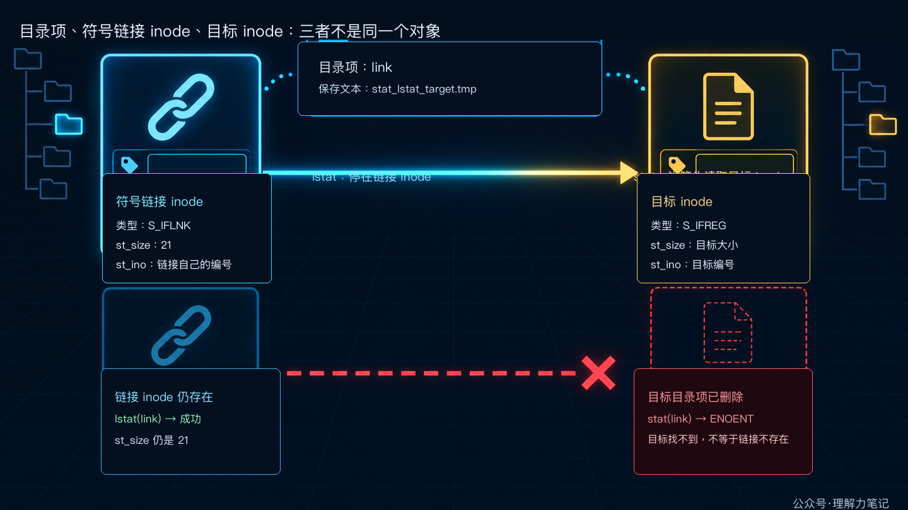

# 符号链接的真相：`stat` 和 `lstat` 差在哪

> **结论：** `stat(path, &st)` 默认跟随最后一个路径分量的符号链接，返回目标对象的元数据；`lstat(path, &st)` 停在链接自身，返回 `S_IFLNK` 对应的状态。目标不存在时，`stat` 往往失败，`lstat` 仍能告诉你“这里有一条链接”。


你在清理临时目录、扫描配置文件或写文件管理器时，会遇到一个看起来像文件、实际只是“指向别处”的路径。此时调用 `stat`，得到的可能是目标文件；调用 `lstat`，得到的才是符号链接本身。两个函数名字只差一个字母，查询对象却不同。

## 第一章 · 先解决问题：看目标用 `stat`，看链接用 `lstat`

### 最短判断

- 想知道**链接最终指向的对象**是什么，用 `stat(path, &st)`。
- 想知道**最后一个路径分量本身是不是链接**，用 `lstat(path, &st)`。
- 想检查链接是否悬空，也用 `lstat`；`stat` 失败时还要看 `errno`，不能直接把它当成“链接不存在”。

下面的实验创建 `stat_lstat_target.tmp` 和一条指向它的相对链接。第一次查询时目标存在，第二次查询前删除目标，专门观察悬空链接。

### 最小实验

```c
#define _POSIX_C_SOURCE 200809L

#include <errno.h>
#include <fcntl.h>
#include <inttypes.h>
#include <stdio.h>
#include <stdlib.h>
#include <string.h>
#include <sys/stat.h>
#include <unistd.h>

static const char *file_type(mode_t mode)
{
    if (S_ISREG(mode)) return "regular";
    if (S_ISDIR(mode)) return "directory";
    if (S_ISLNK(mode)) return "symlink";
    return "other";
}

static int write_all(int fd, const char *data, size_t length)
{
    size_t written = 0U;

    while (written < length) {
        ssize_t n = write(fd, data + written, length - written);
        if (n < 0) {
            if (errno == EINTR) continue;
            return -1;
        }
        if (n == 0) {
            errno = EIO;
            return -1;
        }
        written += (size_t)n;
    }
    return 0;
}

static int print_status(const char *label, const struct stat *st)
{
    printf("%s: type=%s size=%" PRIdMAX " inode=%" PRIuMAX "\n",
           label,
           file_type(st->st_mode),
           (intmax_t)st->st_size,
           (uintmax_t)st->st_ino);
    return 0;
}

static int query_stat(const char *label, const char *path, int follow)
{
    struct stat st;
    int result;

    errno = 0;
    result = follow ? stat(path, &st) : lstat(path, &st);
    if (result == -1) {
        printf("%s: %s errno=%d (%s)\n",
               label, follow ? "stat" : "lstat", errno, strerror(errno));
        return -1;
    }
    return print_status(label, &st);
}

int main(void)
{
    const char *target = "stat_lstat_target.tmp";
    const char *link = "stat_lstat_link.tmp";
    const char payload[] = "target data\n";
    int fd = -1;
    int status = EXIT_FAILURE;

    if (unlink(link) == -1 && errno != ENOENT) {
        fprintf(stderr, "unlink %s: %s\n", link, strerror(errno));
        return EXIT_FAILURE;
    }
    if (unlink(target) == -1 && errno != ENOENT) {
        fprintf(stderr, "unlink %s: %s\n", target, strerror(errno));
        return EXIT_FAILURE;
    }

    fd = open(target, O_WRONLY | O_CREAT | O_EXCL, 0640);
    if (fd == -1) {
        fprintf(stderr, "open %s: %s\n", target, strerror(errno));
        goto cleanup;
    }
    if (write_all(fd, payload, sizeof(payload) - 1U) == -1) {
        fprintf(stderr, "write %s: %s\n", target, strerror(errno));
        goto cleanup;
    }
    if (close(fd) == -1) {
        fprintf(stderr, "close %s: %s\n", target, strerror(errno));
        fd = -1;
        goto cleanup;
    }
    fd = -1;

    if (symlink(target, link) == -1) {
        fprintf(stderr, "symlink %s -> %s: %s\n",
                link, target, strerror(errno));
        goto cleanup;
    }

    if (query_stat("target via stat", target, 1) == -1) goto cleanup;
    if (query_stat("link via stat", link, 1) == -1) goto cleanup;
    if (query_stat("link via lstat", link, 0) == -1) goto cleanup;

    if (unlink(target) == -1) {
        fprintf(stderr, "unlink %s: %s\n", target, strerror(errno));
        goto cleanup;
    }

    (void)query_stat("broken link via stat", link, 1);
    (void)query_stat("broken link via lstat", link, 0);
    status = EXIT_SUCCESS;

cleanup:
    if (fd != -1 && close(fd) == -1) {
        fprintf(stderr, "close %s: %s\n", target, strerror(errno));
        status = EXIT_FAILURE;
    }
    if (unlink(link) == -1 && errno != ENOENT) {
        fprintf(stderr, "cleanup unlink %s: %s\n", link, strerror(errno));
        status = EXIT_FAILURE;
    }
    if (unlink(target) == -1 && errno != ENOENT) {
        fprintf(stderr, "cleanup unlink %s: %s\n", target, strerror(errno));
        status = EXIT_FAILURE;
    }
    return status;
}
```

### 编译与运行

环境是 macOS Darwin 23.6.0、Apple clang 16.0.0，编译时打开严格警告：

```sh
cc -std=c17 -Wall -Wextra -Wpedantic -Wconversion -Wshadow -O0 -g stat_lstat_demo.c -o stat_lstat_demo
./stat_lstat_demo
```

实际输出如下，inode 数字会随文件系统和运行时间变化：

```text
target via stat: type=regular size=12 inode=65999465
link via stat: type=regular size=12 inode=65999465
link via lstat: type=symlink size=21 inode=65999466
broken link via stat: stat errno=2 (No such file or directory)
broken link via lstat: type=symlink size=21 inode=65999466
```

前三行说明：对同一个链接路径，`stat` 报告目标是普通文件、大小 12 字节，`lstat` 报告路径本身是符号链接，大小 21 字节。21 是链接里保存的文本 `stat_lstat_target.tmp` 的长度，不是目标文件的大小。

删除目标后，链接目录项并没有一起消失。`stat` 继续解析时找不到目标，于是返回 `-1` 和 `ENOENT`；`lstat` 不需要目标存在，所以仍能成功。要判断“链接是否悬空”，这正是最直接的办法。

## 第二章 · 从操作系统视角解释：路径解析在最后一步分叉

先把一次查询拆成几个动作。下面的图画的是 Linux 文件系统的语义路径；不同 libc 可能选择不同的系统调用入口，但对象之间的关系相同。

1. **用户态程序**把路径字符串（例如 `link`）和 `struct stat` 的地址传给 `stat` 或 `lstat`。
2. **系统调用入口**把请求交给内核。内核拿到的是“要解析的路径”和“结果写回哪里”。
3. **VFS 路径解析**从当前目录或根目录开始，逐个查找路径组件。每个名字先对应到一个目录项（`dentry`）。
4. **目录项指向 inode**。普通文件的 inode 直接描述文件；符号链接的 inode 保存一段目标路径文本。
5. **查询结果回到用户态**。内核把选中的 inode 字段写入用户提供的 `struct stat`，程序再读取 `st_mode`、`st_size` 和 `st_ino`。

在 Linux 内核实现里，路径查找还会用 `nameidata` 保存解析状态，当前路径位置通常由 `struct path` 表示，它把 `dentry` 和挂载点放在一起。这些是 Linux 的实现细节，不是 POSIX 应用程序可以直接依赖的接口；把它们放在 VFS 层，是为了说明“路径字符串怎样走到 inode”。


图中间的分叉只发生在**最后一个路径组件**。以 `link` 为例，前面的目录解析对两个函数相同：先找到名字为 `link` 的目录项，再看它指向的 inode 是什么。

- 调用 `stat("link", &st)` 时，内核继续读取符号链接 inode 里的目标路径，找到 `target` 的目录项和目标 inode。写回 `struct stat` 的类型、大小和 inode 编号都属于目标，所以看到的是 `regular` 和目标文件大小。
- 调用 `lstat("link", &st)` 时，内核在最后一个目录项停下，不读取它指向的目标。写回的是符号链接 inode，所以 `S_ISLNK(st.st_mode)` 为真，`st_size` 是链接文本的长度。

`dentry` 可以先理解成“路径组件的名字和 inode 之间的连接”。它和 inode 不是同一个对象：目录项回答“这个名字指向谁”，inode 回答“这个对象有哪些元数据”。把这两个层次分开，`stat` 和 `lstat` 的差异就不会变成一句难记的口诀。



上图还展示了一个容易误判的情况：相对符号链接保存的是文本 `stat_lstat_target.tmp`，这段文本相对于链接所在目录解析。链接自身有自己的 inode，目标文件也有自己的 inode；两者的 `st_ino`、类型和大小本来就可以不同。

“只对最后一个组件停止”也有实际含义。路径 `dir/link/file` 中，如果 `dir` 或中间的 `link` 是符号链接，`lstat` 仍需跟随它们才能继续找到最后的 `file`；它只改变最后一步的处理方式。这个边界正是 `lstat` 与“整条路径都不跟随”的区别。

### 悬空链接为什么还在

删除目标文件只会删除目标目录中的那条目录项，不会改写链接 inode 里保存的文本。于是链接仍然存在，但沿着文本解析时找不到目标。

此时 `stat(link, &st)` 需要完成目标解析，会返回 `-1` 和 `ENOENT`；`lstat(link, &st)` 只查询链接自己的 inode，仍会返回成功。文件管理器要显示“断开的链接”，通常先用 `lstat` 确认目录项本身存在，再决定是否读取目标。

## 第三章 · 工程上怎么使用：查询对象要和后续动作对齐

### 选择接口的三个场景

1. **展示目标文件信息。** 例如显示链接最终指向的大小、类型或修改时间，用 `stat`。
2. **管理链接本身。** 例如清理悬空链接、判断目录项是不是链接、统计链接文本长度，用 `lstat`。
3. **已经有目录 fd，又要控制是否跟随。** POSIX `fstatat` 可以配合 `AT_SYMLINK_NOFOLLOW` 查询最后一个链接自身；Linux 还提供 `openat2` 等更强的路径约束，但它们不是本篇示例的可移植替代品。

### 返回值和错误处理

两个函数成功返回 `0`，失败返回 `-1`；只有失败后才读取 `errno`。`stat` 遇到悬空链接时常见的是 `ENOENT`，但路径前缀没有搜索权限可能是 `EACCES`，路径中间某一项不是目录可能是 `ENOTDIR`。错误日志要带上调用的接口和路径，避免把“目标不存在”误报成“链接不存在”。

```c
int describe_link(const char *path)
{
    struct stat st;

    if (lstat(path, &st) == -1) {
        fprintf(stderr, "lstat %s: %s\n", path, strerror(errno));
        return -1;
    }

    if (S_ISLNK(st.st_mode)) {
        printf("%s is a symbolic link\n", path);
    } else {
        printf("%s is not a symbolic link\n", path);
    }
    return 0;
}
```

`st_mode` 同时包含类型和权限相关位，判断链接类型要用 `S_ISLNK`。不要把符号链接的模式位当成普通文件的 `rwx` 权限来解释；POSIX 对链接的权限位没有普通文件那样的稳定语义。

### `lstat` 不是安全检查

`lstat` 解决的是“这次查询看见谁”的问题，不会把目录项锁住。另一个进程可以在查询后立刻替换链接目标，所以“先 `lstat` 确认是普通文件，再 `open`”仍然存在检查与使用之间的竞态。安全敏感的路径操作要让真正的打开接口承担约束，并在操作返回后处理错误；后续的 `openat`、`O_NOFOLLOW` 和 Linux `openat2` 会专门讨论这个问题。

## 第四章 · 面试提炼

### 简短回答

`stat` 默认跟随符号链接，返回目标文件的状态；`lstat` 不跟随最后一个路径分量，返回链接自身的状态。判断目标是否存在可以用 `stat`，判断路径本身是不是链接或是否为悬空链接用 `lstat`。对链接自身，`st_size` 是目标路径文本长度。

### 常见追问

**`lstat` 会让整条路径都不跟随吗？** 不会。它只改变最后一个路径分量的处理方式，中间组件仍要继续解析。

**删除目标后，为什么 `lstat` 还能成功？** 目标和链接是两个目录项。删除目标只删目标目录项，链接自己的 inode 和路径文本仍在。

**能不能用 `stat` 返回 `ENOENT` 就断定链接不存在？** 不能。它也可能表示链接存在但目标不存在。要区分这两种情况，先用 `lstat` 查询链接自身，再按需要处理目标。

## 参考资料

- [POSIX `stat`, `lstat`, `fstatat`](https://pubs.opengroup.org/onlinepubs/9699919799/functions/stat.html)
- [Linux `stat(2)`](https://man7.org/linux/man-pages/man2/stat.2.html)
- [Linux `inode(7)`](https://man7.org/linux/man-pages/man7/inode.7.html)
- [POSIX `<sys/stat.h>`](https://pubs.opengroup.org/onlinepubs/9699919799/basedefs/sys_stat.h.html)

## 往期回顾

[C 语言·Linux 系统编程·文件与目录·选题预告](https://mp.weixin.qq.com/s/gz_j5CZMWcnXFcqblTCtGw)

> 转载说明：本文用于技术学习与交流，转载请保留原文与出处。
