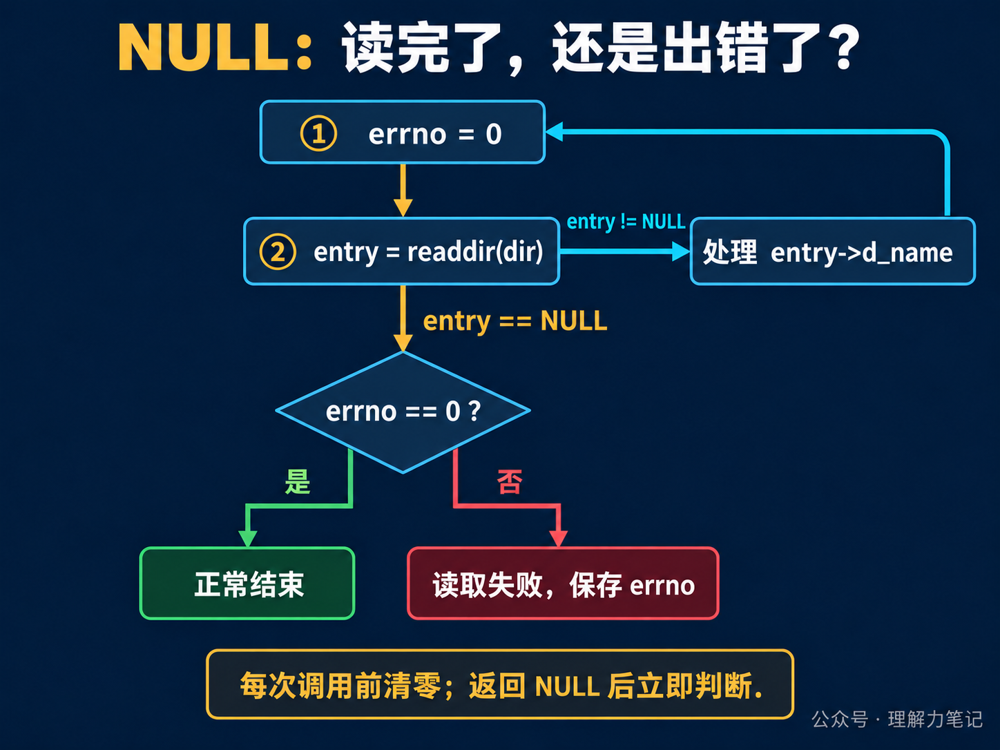
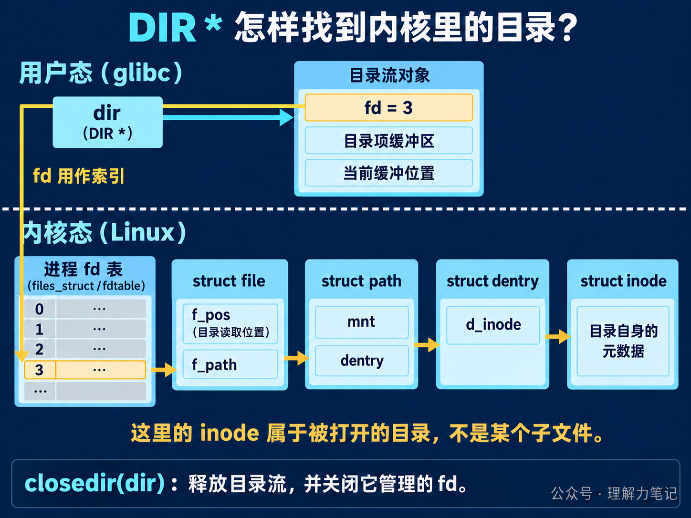

# `readdir` 返回 NULL：读完了，还是出错了？


循环调用 `readdir`，拿到名字就打印，返回 `NULL` 就退出。这样写能列出文件，但程序可能只读了一半，就把读取失败当成了正常结束。

> **结论：** POSIX `readdir` 用 `NULL` 同时表示“目录读完”和“读取失败”。每次调用前将 `errno` 清零；返回 `NULL` 后立即检查：`errno == 0` 才是正常结束，否则保存错误并报告。无论读完还是中途退出，已经打开的目录流都要用 `closedir` 关闭。

**这篇文章怎么读？**

只想写对遍历循环，看第一章；想知道它怎样从内核拿到名字，接着看第二章。

| 你是谁 | 看哪一章 | 会得到什么 |
| --- | --- | --- |
| 搜索者 / 被推荐者 | 第一章 · 先解决问题 | 能运行的遍历循环与错误判断 |
| 学习者 | 第二章 · 机制解释 | `DIR *`、fd、内核目录对象与缓冲区的关系 |
| 编程者 | 第三章 · 工程使用 | 名字如何保存、资源怎么关闭、并发边界 |
| 求职者 | 第四章 · 面试提炼 | 说清 `NULL` 的两种含义与缓冲机制 |

## 第一章 · 先解决问题：每次读取前清零，返回 NULL 后立即判断

`opendir(path)` 打开一个**目录流**：可以逐项读取目录内容的遍历状态。它返回 `DIR *`。把这个指针交给 `readdir`，每次成功会得到一个 `struct dirent *`，其中 `d_name` 就是这一项的名字。

下面的程序只列一层目录，不进入子目录。它跳过 `.` 和 `..`，保留 `.hidden` 这样的隐藏文件，也会列出符号链接的名字。

### 最小实验

保存为 `list_dir.c`：

```c
#define _POSIX_C_SOURCE 200809L

#include <dirent.h>
#include <errno.h>
#include <stdio.h>
#include <stdlib.h>
#include <string.h>

int main(int argc, char **argv)
{
    if (argc != 2) {
        fprintf(stderr, "usage: %s DIRECTORY\n", argv[0]);
        return EXIT_FAILURE;
    }

    DIR *dir = opendir(argv[1]);
    if (dir == NULL) {
        int saved = errno;
        fprintf(stderr, "opendir %s: %s\n", argv[1], strerror(saved));
        return EXIT_FAILURE;
    }

    int status = EXIT_SUCCESS;
    for (;;) {
        errno = 0;
        struct dirent *entry = readdir(dir);
        if (entry == NULL) {
            int saved = errno;
            if (saved != 0) {
                fprintf(stderr, "readdir %s: %s\n",
                        argv[1], strerror(saved));
                status = EXIT_FAILURE;
            }
            break;
        }

        if (strcmp(entry->d_name, ".") == 0 ||
            strcmp(entry->d_name, "..") == 0) {
            continue;
        }
        if (printf("%s\n", entry->d_name) < 0) {
            int saved = errno;
            fprintf(stderr, "output: %s\n", strerror(saved));
            status = EXIT_FAILURE;
            break;
        }
    }

    if (closedir(dir) == -1) {
        int saved = errno;
        fprintf(stderr, "closedir %s: %s\n", argv[1], strerror(saved));
        status = EXIT_FAILURE;
    }
    if (fflush(stdout) == EOF) {
        int saved = errno;
        fprintf(stderr, "flush output: %s\n", strerror(saved));
        status = EXIT_FAILURE;
    }
    return status;
}
```

这里把 `errno = 0` 放在循环内部，紧挨着 `readdir`。处理上一项时，日志、文件检查等操作可能留下错误码；而 `readdir` 正常读到末尾时不会替你清掉它。只在循环外清零一次，后面就可能把旧错误当成本次读取错误。



返回非空指针时，处理这条记录；只有返回 `NULL`，才用 `errno` 区分结束与错误。先保存错误码，再打印日志和关闭目录，避免清理操作改变它。

### 编译、运行与实际结果

本次在 macOS Darwin 23.6.0、Apple clang 16.0.0 上运行。示例使用 POSIX 接口；第二章的 Linux/glibc 机制另按源码核对，没有把它当成本机系统调用跟踪结果。

在保存了 `list_dir.c` 的目录执行以下命令。样本放入新建的临时目录，不覆盖已有文件：

```sh
work_dir=$(mktemp -d)
cp list_dir.c "$work_dir/"
cd "$work_dir"
cc -std=c17 -Wall -Wextra -Wpedantic -Wconversion -Wshadow -O0 -g list_dir.c -o list_dir
mkdir sample empty sample/subdir
printf 'hello\n' > sample/a.txt
touch sample/.hidden
ln -s a.txt sample/link
./list_dir sample
echo "exit=$?"
```

实际输出：

```text
.hidden
subdir
link
a.txt
exit=0
```

顺序由文件系统决定，不能据此认为隐藏文件总是排在前面。`subdir` 和 `link` 都只作为名字出现；遍历没有进入子目录，也没有打开链接目标。

再运行下面三组命令：

```sh
./list_dir empty
echo "exit=$?"
./list_dir missing
echo "exit=$?"
./list_dir sample/a.txt
echo "exit=$?"
```

实际结果如下。空目录没有名字输出；另外两组是 `opendir` 失败，不是读完目录：

```text
exit=0
opendir missing: No such file or directory
exit=1
opendir sample/a.txt: Not a directory
exit=1
```

本地磁盘很难稳定制造“读到一半才失败”。为验证这条分支，还单独使用测试包装函数：真实返回第一条非点目录项后，下一次模拟 `readdir` 返回 `NULL` 并设置 `EIO`。程序输出一个名字后报告 `readdir sample: Input/output error`，退出状态为 1。这只证明程序的错误分支有效，不代表本机真的发生了磁盘 I/O 故障。

## 第二章 · 从操作系统视角理解：库函数分批取回，再逐条交给程序

`DIR *`、fd 和 `struct dirent *` 经常一起出现，先给它们各自一个位置：`DIR *` 指向用户态的目录流对象；fd 是这个对象管理的文件描述符；`struct dirent *` 指向本次返回的目录项记录。

下面以 **glibc 2.40 和 Linux 6.6** 为例。结构体字段用于解释实现，应用程序仍只使用公开接口。

### 1. opendir 打开目录，并在用户态留下遍历状态



先看图的上半部分。`opendir` 会打开目录，分配目录流对象，把 fd、缓冲区和缓冲位置放在一起。以后传入 `dir`，库函数就知道该用哪个 fd、下一条记录读到哪里了。图中的 fd=3 只是示意，实际编号由运行时决定。

再沿 fd 往下看：数字 3 用来索引进程的 fd 表，对应的表项指向一个 `struct file`。这个内核对象记录本次打开的状态，其中 `f_pos` 用于保存目录遍历位置。

`struct file` 里的 `f_path` 是一个 `struct path`，包含挂载点 `mnt` 和目录项指针 `dentry`；`dentry->d_inode` 再指向目录自己的 inode。inode 保存这个目录的类型、权限等元数据。

这里打开的是 **sample 目录本身**。读到 `a.txt` 的名字，不等于又为 `a.txt` 创建了一个 fd。`struct dirent` 是交给程序的目录项记录，也不是图中的内核 `struct dentry`；名字相近，用途不同。

### 2. readdir 先看缓冲区，没数据才进入内核


看图中的第一步。缓冲区已经用完时，glibc 通过 `getdents64` 系统调用，请内核再填一批目录项记录。Linux 根据 fd 找到 `struct file`，经过 VFS 的 `iterate_dir`，调用文件系统提供的目录遍历方法。VFS 是内核对不同文件系统提供的统一接口层。

返回的这一批记录包含名字等信息，并不包含每个文件的正文内容。glibc 留住这批记录，再把第一条的地址交给应用程序。

第二次调用时，如果缓冲区还有记录，glibc 直接取下一条。**一次 `readdir` 调用不一定触发一次系统调用。** 应用程序看到的是“一项一项读”，内核可以是“一批一批给”。

这也解释了为什么有两个位置：目录流中的缓冲位置，表示这批记录交出去多少条；内核 `struct file.f_pos`，表示下一批从哪里继续。内核可能已经走到这一批的末尾，程序却还在处理其中第一条。不要把二者当成同一个偏移量，也不要把目录记录中的 `d_off` 当成普通文件字节偏移量来计算。

### 3. 最后一批用完后，库函数才确认结束

缓冲区耗尽，再次补充时，如果 `getdents64` 返回 0，glibc 就知道没有更多记录，`readdir` 返回 `NULL`，并保留调用前的 `errno`。如果补充记录发生需要上报的错误，它同样返回 `NULL`，但留下错误码。

所以第一章的判断必须分两步：先看有没有记录，再在没有记录时检查错误码。程序不能仅凭一个空指针判断“已经全部读完”。

## 第三章 · 工程上怎么使用：名字及时处理，目录流统一关闭

### entry 指向借来的记录，保存名字要复制

`readdir` 返回的存储由目录流管理，不要 `free(entry)`。同一目录流的后续读取可能覆盖它，关闭目录流后也不能再使用它。

需要把名字收集起来排序，就在当前记录有效时复制 `d_name`。例如使用 `strdup` 时检查分配失败，并约定由列表持有者释放副本。仅把 `entry` 或 `entry->d_name` 指针塞进数组，不能保证之后拿到的仍是原来的名字。

还有一个容易混淆的路径问题：遍历 `sample` 得到的 `d_name` 是 `a.txt`，并不是 `sample/a.txt`。直接 `stat(entry->d_name, ...)` 会相对于进程当前目录查找。需要继续操作该项时，要明确路径基准；`fstatat(dirfd(dir), entry->d_name, ...)` 可以沿用已经打开的目录，符号链接是否跟随则由标志控制。目录 fd 和这些接口后续会单独展开。

### 让 closedir 负责这份资源的收尾

| 资源 | 获得方式 | 谁负责释放 |
| --- | --- | --- |
| 目录流 `DIR *` 及其底层 fd | `opendir` 成功 | 调用者执行一次 `closedir` |
| 当前 `entry` 和 `d_name` | `readdir` 成功 | 目录流管理，不单独释放 |
| 自己复制的名字 | `strdup` 等分配操作成功 | 保存副本的一方 `free` |

`opendir` 失败时没有目录流可关闭；成功以后，无论正常结束、读取失败还是输出失败，都汇入 `closedir`。第一章的程序采用这个结构，并检查关闭结果。`dirfd(dir)` 返回的是借用的描述符，不要提前 `close` 它再调用 `closedir`。

程序把读取错误统一当作本次遍历失败，包括实现可能报告的中断错误；不会无限重试，也不会把已经打印的部分结果宣称为完整清单。命令行调用方应同时检查退出状态。最后的 `fflush(stdout)` 则用来发现延迟到刷新输出缓冲区时才暴露的写入错误。

### 遍历结果不等于固定快照

读取期间，其他进程可能增加或删除目录项。POSIX 不保证后续一定能看到这些变更，因此读到名字之后的打开、查询或删除，仍要分别检查返回值。`readdir` 本身也不保证按名字排序，需要排序就收集名字后另行处理。

多线程如果共享一个 `DIR *`，应把“读取并消费或复制当前记录”作为一个整体同步。只锁住 `readdir` 调用，解锁后再慢慢使用返回指针，可能遇到别的线程覆盖存储。不要为了线程安全改用已过时的 `readdir_r`。

本篇只读取名字。`d_type` 可能为 `DT_UNKNOWN`，不能据此写出适用于所有文件系统的类型判断；这一点留给文件与目录第 4 篇。

## 第四章 · 面试提炼

**`readdir` 返回 NULL 就是读完了吗？** 还不能判断。每次调用前将 `errno` 清零；返回 `NULL` 且 `errno` 仍为 0 才是正常结束，否则是读取错误。

**每读一个名字，都要进入一次内核吗？** 在这里分析的 glibc/Linux 实现中，目录项会批量读入缓冲区，后续调用可以直接从用户态缓冲区取下一条。

**为什么不能保存返回指针，等遍历完再处理？** 它指向目录流管理的存储，后续读取可能覆盖，关闭目录流后更不能继续使用。需要保留的是当时的名字副本。

## 参考资料

- [POSIX.1-2024：readdir](https://pubs.opengroup.org/onlinepubs/9799919799/functions/readdir.html)：返回值、错误、记录生命周期和目录变更边界。
- [Linux readdir(3)](https://man7.org/linux/man-pages/man3/readdir.3.html)、[opendir(3)](https://man7.org/linux/man-pages/man3/opendir.3.html)、[closedir(3)](https://man7.org/linux/man-pages/man3/closedir.3.html)：接口用法、顺序与资源管理。
- glibc 2.40：[opendir.c](https://github.com/bminor/glibc/blob/glibc-2.40/sysdeps/unix/sysv/linux/opendir.c)、[dirstream.h](https://github.com/bminor/glibc/blob/glibc-2.40/sysdeps/unix/sysv/linux/dirstream.h)、[readdir64.c](https://github.com/bminor/glibc/blob/glibc-2.40/sysdeps/unix/sysv/linux/readdir64.c)：目录流结构和批量读取逻辑。
- Linux 6.6：[fs/readdir.c](https://github.com/torvalds/linux/blob/v6.6/fs/readdir.c)、[fs.h](https://github.com/torvalds/linux/blob/v6.6/include/linux/fs.h)、[path.h](https://github.com/torvalds/linux/blob/v6.6/include/linux/path.h)、[dcache.h](https://github.com/torvalds/linux/blob/v6.6/include/linux/dcache.h)、[fdtable.h](https://github.com/torvalds/linux/blob/v6.6/include/linux/fdtable.h)：内核遍历入口和图中的对象关系。

## 往期回顾

[C语言·Linux 系统编程 文件与目录 选题预告](https://mp.weixin.qq.com/s/gz_j5CZMWcnXFcqblTCtGw)

> 本文为公众号「理解力笔记」原创。转载请联系作者，并保留出处。
