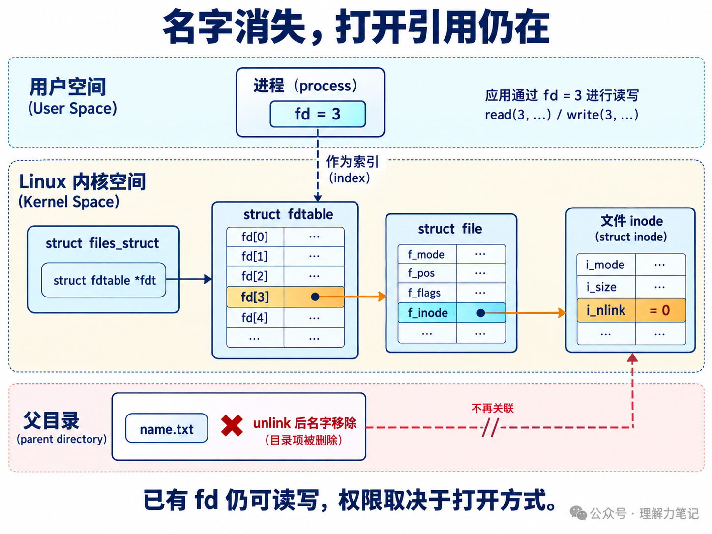
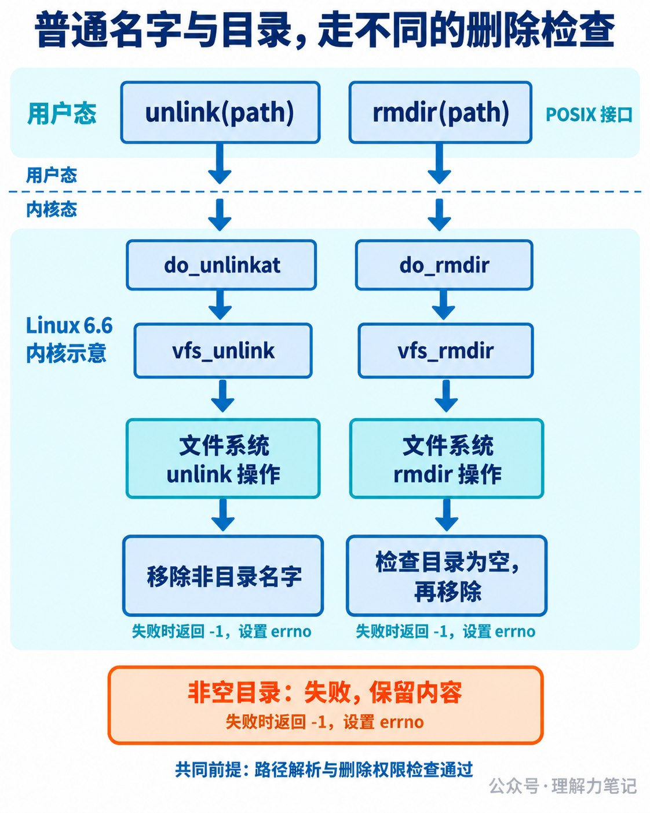

# `unlink` 与 `rmdir`：删除文件和目录为什么要分开？


`unlink("empty")` 删除一个空目录，失败；换成 `rmdir("full")`，目录里还有文件，也失败。写清理程序时，知道目标“存在”还不够，还要决定自己允许删除哪种对象。

> **结论：** 在 Linux 中，删除普通文件、符号链接等非目录对象的名字用 `unlink`，删除空目录用 `rmdir`。两者成功返回 0，失败返回 -1 并设置 `errno`。`rmdir` 不会递归删除内容；`unlink` 移除一个名字，文件数据是否还能访问，要看是否还有其他硬链接或打开引用。

**这篇文章怎么读？**

想选对接口并看错误结果，读第一章；想弄清“名字没了，文件怎么还在”，看第二章的对象图和 fd 实验。

| 你是谁 | 看哪一章 | 会得到什么 |
| --- | --- | --- |
| 搜索者 / 被推荐者 | 第一章 · 先解决问题 | 单文件、空目录和符号链接的删除方式 |
| 学习者 | 第二章 · 机制解释 | 目录项、inode、打开引用各自的生命周期 |
| 编程者 | 第三章 · 工程使用 | 删除权限、失败策略与路径竞态边界 |
| 求职者 | 第四章 · 面试提炼 | 说清非空目录限制与删除后仍可读 |

## 第一章 · 先解决问题：非目录名字用 unlink，空目录用 rmdir

### 用同一个小程序对照两个接口

下面的程序让调用者明确选择操作，不先查询类型再替调用者决定。保存为 `delete_entry.c`，在新建的实验目录里运行，路径都指向下面创建的样本。

```c
#define _POSIX_C_SOURCE 200809L
#include <errno.h>
#include <stdio.h>
#include <stdlib.h>
#include <string.h>
#include <unistd.h>

int main(int argc, char **argv)
{
    if (argc != 3 || (strcmp(argv[1], "unlink") != 0 &&
                      strcmp(argv[1], "rmdir") != 0)) {
        fprintf(stderr, "usage: %s unlink|rmdir PATH\n", argv[0]);
        return EXIT_FAILURE;
    }

    int rc = strcmp(argv[1], "unlink") == 0
           ? unlink(argv[2]) : rmdir(argv[2]);
    if (rc == -1) {
        int saved = errno;
        fprintf(stderr, "%s %s: %s\n", argv[1], argv[2], strerror(saved));
        return EXIT_FAILURE;
    }
    if (printf("%s %s: ok\n", argv[1], argv[2]) < 0 ||
        fflush(stdout) == EOF) {
        perror("stdout");
        return EXIT_FAILURE;
    }
    return EXIT_SUCCESS;
}
```

`unlink` 和 `rmdir` 都是 POSIX 接口，声明在 `<unistd.h>`。`remove` 则是 `<stdio.h>` 中的 C 库接口，后面会说明它在 Linux 上如何统一这两类操作。

### 编译与运行

本次运行环境为 macOS 14.8.8、Darwin 23.6.0 x86_64、Apple clang 16.0.0，严格编译无警告。Linux 行为另用手册和 v6.6 源码核验，没有把本机输出写成 Linux 实测。

```sh
cc -std=c17 -Wall -Wextra -Wpedantic -Wconversion -Wshadow -O0 -g delete_entry.c -o delete_entry
mkdir empty full
printf 'child\n' > full/child
ln -s full dir-link

./delete_entry unlink empty
./delete_entry rmdir full
./delete_entry rmdir dir-link
./delete_entry unlink dir-link
./delete_entry rmdir empty
./delete_entry unlink full/child
./delete_entry rmdir full
```

这些命令包含故意触发的失败，逐条执行即可。不要因为前几条退出非零就提前结束实验。实际输出按执行顺序合并如下：

```text
unlink empty: Operation not permitted
rmdir full: Directory not empty
rmdir dir-link: Not a directory
unlink dir-link: ok
rmdir empty: ok
unlink full/child: ok
rmdir full: ok
```

前三条退出状态为 1，后四条为 0。`unlink empty` 被拒绝，空目录仍存在；`rmdir full` 被拒绝，里面的 `child` 没有变化。先删除 `full/child`，再调用 `rmdir full`，才会成功。

本机 `unlink` 删除目录得到 `EPERM`，对应 `Operation not permitted`；Linux 通常用 `EISDIR`，对应 `Is a directory`。POSIX 对这里的错误规定与 Linux 有差异，因此跨平台测试应区分错误码，不能照抄本机错误文本。

### 指向目录的链接，也用 unlink 删除

`dir-link` 的目标虽然是目录，但这个名字本身是一条符号链接。实验中 `rmdir("dir-link")` 失败，`unlink("dir-link")` 成功，随后 `full/child` 仍然可以删除，目标目录没有被链接删除操作清空。

这里传的是链接本身的路径，**没有末尾斜杠**。`dir-link/` 会引入目录解析要求，不应拿它套用同一个结论。路径中间的符号链接也仍可能被跟随；“`unlink` 删除链接自身”说的是最终命名的链接，不表示整个路径都禁止跟随链接。

空目录允许存在系统定义的 `.` 和 `..` 关系，但 `.keep` 之类的隐藏文件仍是内容。测试里只放一个 `.keep`，`rmdir` 也会失败，不能把“普通列表里看起来没文件”当成空目录。

## 第二章 · 从操作系统视角理解：删名字、减链接计数、释放对象是不同的事

### 目录项连接名字与 inode

父目录中保存名字到文件对象的关联，比如 `note.txt` 对应一个 inode。inode 保存文件类型、权限、链接计数等元数据。`unlink("note.txt")` 移除的是父目录中的这个名字，并减少该文件的硬链接计数。

硬链接计数表示还有多少个硬链接名字关联到文件，不表示有多少个进程打开它。如果还有另一个硬链接，仍能从另一个名字找到同一份数据；硬链接的创建和计数细节会在下一篇展开。

打开文件又形成另一条引用关系。在 Linux 中，进程用 fd 索引描述符表，得到 `struct file *`，这个打开文件对象持有相关 inode 等引用。`unlink` 不会顺便把所有进程的 fd 都关闭。



图中 fd 的数值只是例子，`i_nlink = 0` 表示没有硬链接名字。它不是“引用计数总和为 0”；图里的打开文件对象仍然存在。图用 `f_inode` 展示关键指向，省略了 `f_path` 等字段，不将目录里的名字画成打开文件描述符。

### 实验：名字删掉后，原来的 fd 继续读取

保存为 `unlink_open.c`。这个程序先以只读方式打开样本，再删除它的名字，用 `fstat` 查看同一个 fd 的链接计数，最后读到 EOF 并关闭 fd。它会实际移除传入的路径，只对实验样本使用。

```c
#define _POSIX_C_SOURCE 200809L
#include <errno.h>
#include <fcntl.h>
#include <inttypes.h>
#include <stdio.h>
#include <stdlib.h>
#include <sys/stat.h>
#include <unistd.h>

int main(int argc, char **argv)
{
    if (argc != 2) {
        fprintf(stderr, "usage: %s FILE_TO_UNLINK\n", argv[0]);
        return EXIT_FAILURE;
    }
    int fd = open(argv[1], O_RDONLY);
    if (fd == -1) {
        perror("open");
        return EXIT_FAILURE;
    }
    int status = EXIT_FAILURE;
    if (unlink(argv[1]) == -1) {
        perror("unlink");
        goto done;
    }
    struct stat st;
    if (fstat(fd, &st) == -1) {
        perror("fstat");
        goto done;
    }
    if (printf("after unlink: nlink=%ju\n", (uintmax_t)st.st_nlink) < 0)
        goto output_error;

    char buffer[64];
    for (;;) {
        ssize_t n = read(fd, buffer, sizeof buffer);
        if (n == -1) {
            if (errno == EINTR)
                continue;
            perror("read");
            goto done;
        }
        if (n == 0)
            break;
        if (fwrite(buffer, 1, (size_t)n, stdout) != (size_t)n)
            goto output_error;
    }
    status = EXIT_SUCCESS;
    goto done;
output_error:
    perror("stdout");
done:
    if (close(fd) == -1) {
        perror("close");
        status = EXIT_FAILURE;
    }
    if (fflush(stdout) == EOF) {
        perror("fflush");
        status = EXIT_FAILURE;
    }
    return status;
}
```

编译并创建一个只有一个硬链接的普通文件：

```sh
cc -std=c17 -Wall -Wextra -Wpedantic -Wconversion -Wshadow -O0 -g unlink_open.c -o unlink_open
printf 'hello after unlink\n' > note.txt
./unlink_open note.txt
```

实际输出，退出状态为 0：

```text
after unlink: nlink=0
hello after unlink
```

运行后，测试脚本确认 `note.txt` 路径已经不存在。`fstat` 和 `read` 仍成功，因为它们通过已有 fd 访问打开的对象，不需要重新从父目录查找名字。程序只读打开，所以这里只验证读取；是否能写仍取决于原来的打开方式。

POSIX.1-2024 还把内存映射列入需要考虑的引用：硬链接计数归零后，只要还有 fd 或映射引用，内容的最终移除就要延后。对这个没有其他引用的简单实验，关闭 fd 释放了最后的打开引用；它没有测量磁盘空闲块何时变化，也没有证明存储介质上的旧字节被擦除。

### rmdir 还要维护目录结构

目录的内容本身是一组名字。删除一个非空目录，如果直接抛弃它的名字，会涉及剩余子项应如何处理的问题。`rmdir` 的接口契约把范围限定为空目录：需要删除树形内容时，由调用者显式遍历，先处理子项，再删除目录本身。



Linux v6.6 的 `fs/namei.c` 中，`do_unlinkat` 和 `do_rmdir` 分别进入 `vfs_unlink`、`vfs_rmdir`。VFS 是内核供不同文件系统共用的接口层，它通过 `may_delete` 检查删除权限和对象类型。非目录删除路径遇到目录会返回内核错误 `-EISDIR`，目录删除路径遇到非目录则是 `-ENOTDIR`。

之后调用父目录 inode 的 `i_op->unlink` 或 `i_op->rmdir`，把具体修改交给文件系统。以 ext4 为例，`ext4_rmdir` 在删除目录项前调用 `ext4_empty_dir`；目录非空时返回 `-ENOTEMPTY`。ext4 的文件删除路径则包含删除目录项和降低链接计数等步骤。

这些负错误值是内核内部表示。应用通过 libc 接口观察到的是 **返回 -1，并把错误原因放到 `errno`**，不是函数直接返回 `ENOENT` 或 `ENOTEMPTY`。图中省略了锁、安全模块等细节；空目录检查属于删除操作的一部分，无须先在应用层遍历一遍才调用 `rmdir`。

## 第三章 · 工程上怎么使用：按删除意图选择接口，按失败原因决定下一步

### 可以统一接口，但不能省掉空目录规则

| 调用者的意图 | 接口 | 约束 |
| --- | --- | --- |
| 移除一个非目录名字，含符号链接 | `unlink(path)` | 链接目标不随之删除；中间路径仍会解析 |
| 移除一个空目录 | `rmdir(path)` | 非空则失败，不递归 |
| 在已打开的父目录下删除非目录名字 | `unlinkat(base, name, 0)` | 相对名字以 `base` 为起点 |
| 在已打开的父目录下删除空目录 | `unlinkat(base, name, AT_REMOVEDIR)` | 仍要求目录为空 |
| 允许删文件，也允许删空目录 | Linux/POSIX 环境中的 `remove(path)` | 统一入口，不扩大为递归删除 |

所以“为什么要分开”说的是两种不同的删除语义，并不意味着 C 程序只能暴露两个函数。Linux `remove(3)` 说明它对文件执行 `unlink`、对目录执行 `rmdir`。如果业务只允许删缓存文件，明确选用非目录接口还能在名字意外变成目录时拒绝操作。

不要仅为删除一个空目录而先调用 `readdir` 数子项。另一进程可以在检查结束后创建文件，最终仍以 `rmdir` 的结果为准。递归删除则涉及遍历、链接策略、部分失败等更多问题，本篇的两个示例都没有实现它。

### 能改文件内容，不代表能删它的名字

删除名字需要修改父目录。通常要有父目录的写权限和搜索权限，路径前缀中的目录也要允许搜索；目标普通文件自身是否可写，并不是能否删除其名字的直接判据。

本机还做了两个权限对照：在可写的实验目录中，把样本文件改成 `0444`，`unlink` 成功；把父目录改成 `0555`，再删里面的子文件，得到 `EACCES`，文件保留。这是在非特权进程下执行的真实权限测试。

实际项目还要考虑 sticky bit、ACL、Linux immutable 等属性、只读挂载和安全模块。比如 `/tmp` 常带 sticky bit，即便允许很多用户创建文件，也不能据此推断他们能删除彼此的文件。不要看到 `EPERM` 就把原因一律归为“文件没有写权限”。

### 失败不要自动升级成更强的删除

| 失败原因 | 应如何理解 |
| --- | --- |
| `ENOENT` | 目标或某个路径前缀不存在；是否当成“已经清理”由业务决定 |
| `ENOTEMPTY`，部分平台可为 `EEXIST` | 目录仍有内容；记录并处理，不自动升级成递归删除 |
| `EISDIR` / `ENOTDIR` | 操作类型与当前对象或路径组件不匹配 |
| `EACCES` / `EPERM` | 权限、属性或实现限制；结合路径和操作诊断 |
| `EBUSY` / `EROFS` | 挂载点等系统使用情况，或只读文件系统；盲目重试不能解决 |

不存在是否算成功尤其需要区分业务：临时文件清理可能允许它已经被别的进程删掉；删除一份指定版本的文件则可能需要报告状态改变。即使忽略 `ENOENT`，也不能把它解释成“本次确实删到了那个对象”。

示例在操作失败后立即保存 `errno`，并返回非零状态。它们没有对删除做无条件循环重试：重试时同名对象可能已经由别的进程重建，应先定义幂等性和并发协议，再决定恢复动作。远程文件系统还可能出现服务器已经执行操作、客户端却未收到成功回复的情况，不能简单把所有错误都当作“什么都没发生”。

删除成功后的输出也可能失败。因此示例的非零退出状态既可能来自删除错误，也可能来自结果输出失败，日志会指出阶段。不能只根据进程退出码判断名字一定还在。`unlink_open` 成功打开后，各条出口都会尝试一次 `close`；关闭错误会上报，不对同一个 fd 盲目再次关闭。

### 目录 fd 固定起点，不锁住子项身份

`unlinkat` 适合已经持有父目录 fd 的代码，能避免当前工作目录变化影响相对路径。但即使传入一个不含斜杠的名字，也只固定了父目录，另一个进程仍可在调用前替换这个名字。

用 `lstat` 检查“这是普通文件”，再 `unlink` 原路径，检查与使用之间仍有窗口。拿到文件 fd 后再按原路径删除，也不保证删掉的就是 fd 所指的旧对象。需要对象身份保证的设计，还要约束谁能修改父目录，或者建立合作方都遵守的协议；一个 `stat` 或一个 结尾为`*at`函数接口不能独自提供全部保证。

删除符号链接时不要把用户给的路径顺手补上 `/`，也不要把“最终链接不跟随”误读成“整条路径不跟随”。递归清理工具若把指向目录的链接当成子目录继续深入，可能越过原定清理范围。这里保留单个名字的删除边界，路径安全的完整设计留给后续篇目。

## 第四章 · 面试提炼：从删除名字回答到对象生命周期

**为什么目录不能直接用 `unlink` 删除？** Linux 将它与非目录删除分开，目录删除要走 `rmdir` 的语义和文件系统检查，尤其是空目录限制。可移植程序也应使用 `rmdir`，不要依赖某些历史系统对特权目录 unlink 的支持。

**删了文件名，进程为什么还能读取？** 删除名字降低硬链接计数，已有 fd 仍引用打开的对象。没有名字不等于没有打开引用；最后一个硬链接移除后，仍有 fd 或内存映射引用时，内容移除会延后。

**指向目录的符号链接用哪个接口删？** 对不带末尾斜杠的链接路径用 `unlink`，删的是链接自身。它不会递归删除目标目录；`rmdir` 对这个链接名字会失败。

## 参考资料

- [POSIX.1-2024：unlink、unlinkat](https://pubs.opengroup.org/onlinepubs/9799919799/functions/unlink.html)：目录项、链接计数、fd 与内存映射引用、符号链接语义。
- [POSIX.1-2024：rmdir](https://pubs.opengroup.org/onlinepubs/9799919799/functions/rmdir.html)：空目录要求、符号链接和错误语义。
- [Linux unlink(2)](https://man7.org/linux/man-pages/man2/unlink.2.html)、[rmdir(2)](https://man7.org/linux/man-pages/man2/rmdir.2.html)、[remove(3)](https://man7.org/linux/man-pages/man3/remove.3.html)：接口选择、Linux 错误、sticky bit 与网络文件系统边界。
- [Linux path_resolution(7)](https://man7.org/linux/man-pages/man7/path_resolution.7.html)：路径前缀、搜索权限、符号链接与末尾斜杠。
- Linux v6.6：[fs/namei.c](https://github.com/torvalds/linux/blob/v6.6/fs/namei.c)、[fs/ext4/namei.c](https://github.com/torvalds/linux/blob/v6.6/fs/ext4/namei.c)：`may_delete`、VFS 删除入口、ext4 空目录检查和链接计数变化。
- Linux v6.6：[fdtable.h](https://github.com/torvalds/linux/blob/v6.6/include/linux/fdtable.h)、[fs.h](https://github.com/torvalds/linux/blob/v6.6/include/linux/fs.h)：对象图中的描述符表、`struct file` 和 inode 字段。

## 往期回顾

[C 语言·Linux 系统编程 文件与目录 选题预告](https://mp.weixin.qq.com/s/gz_j5CZMWcnXFcqblTCtGw)

> 本文为公众号「理解力笔记」原创。转载请联系作者，并保留出处。
