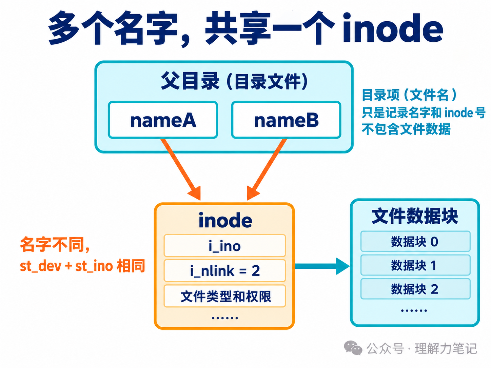
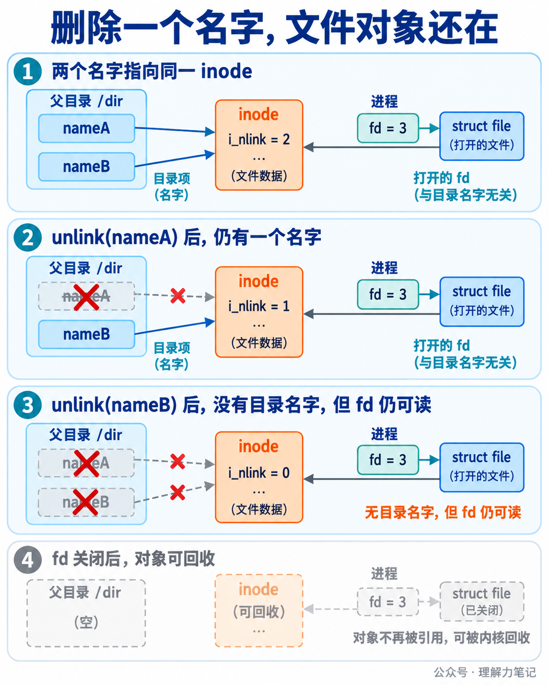
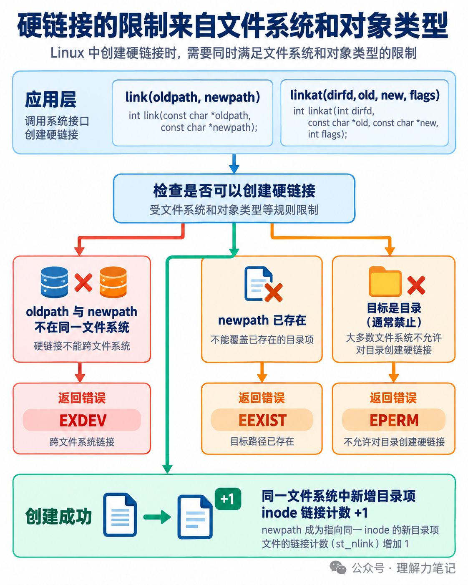

# 硬链接与 inode：多个文件名为什么指向同一个文件？


目录里有两个名字，不代表磁盘上有两份文件。`link("original.txt", "second-name.txt")` 可以为同一个文件增加第二个名字，两个路径用 `stat` 查询时会得到相同的 `st_dev` 和 `st_ino`。

> **结论：** 硬链接增加的是同一文件的目录项，两个名字共享一个 inode 和文件数据，inode 的链接计数加一。`unlink` 只移除一个名字并减少链接计数；只要还有其他硬链接，或进程仍持有打开 fd，文件对象就不会因为这个名字消失而立即不可访问。硬链接通常要求源和目标位于同一文件系统，不能把普通文件内容跨文件系统复制成硬链接。

**这篇文章怎么读？**

第一章先用程序看到两个名字、一个 inode 和删除后的结果；第二章解释目录项、inode、链接计数与 fd 的关系；第三章讲接口限制、错误处理和竞态边界。

| 你是谁 | 看哪一章 | 会得到什么 |
| --- | --- | --- |
| 搜索者 / 被推荐者 | 第一章 · 先解决问题 | 能运行的 `link`、`stat`、`unlink` 实验 |
| 学习者 | 第二章 · 机制解释 | 名字、inode、数据和 fd 的对象关系 |
| 编程者 | 第三章 · 工程使用 | 文件系统限制、错误码与接口选择 |
| 求职者 | 第四章 · 面试提炼 | 硬链接和符号链接的关键区别 |

## 第一章 · 先解决问题：相同 st_dev 和 st_ino 说明两个名字指向同一 inode

### 创建硬链接，再分别查询两个路径

下面的程序在临时目录里创建普通文件，写入一段内容，再调用 `link` 创建第二个名字。创建后立即查询两个路径；随后删除原来的名字，再从第二个名字查询并读取内容。

```c
#define _DARWIN_C_SOURCE
#define _POSIX_C_SOURCE 200809L

#include <errno.h>
#include <fcntl.h>
#include <inttypes.h>
#include <stdio.h>
#include <stdlib.h>
#include <string.h>
#include <sys/stat.h>
#include <unistd.h>

static int write_all(int fd, const char *data, size_t length)
{
    size_t written = 0U;
    while (written < length) {
        ssize_t n = write(fd, data + written, length - written);
        if (n < 0) {
            if (errno == EINTR)
                continue;
            return -1;
        }
        if (n == 0) {
            errno = EIO;
            return -1;
        }
        written += (size_t)n;
    }
    return 0;
}

static int print_stat(const char *label, const char *path)
{
    struct stat st;
    if (stat(path, &st) == -1)
        return -1;
    if (printf("%s: dev=%ju ino=%ju nlink=%ju size=%ju\n",
               label, (uintmax_t)st.st_dev, (uintmax_t)st.st_ino,
               (uintmax_t)st.st_nlink, (uintmax_t)st.st_size) < 0) {
        errno = EIO;
        return -1;
    }
    return 0;
}

static int read_and_print(const char *path)
{
    int fd = open(path, O_RDONLY);
    if (fd == -1)
        return -1;
    char buffer[64];
    int status = -1;
    for (;;) {
        ssize_t n = read(fd, buffer, sizeof buffer);
        if (n < 0) {
            if (errno == EINTR)
                continue;
            goto done;
        }
        if (n == 0) {
            status = 0;
            break;
        }
        if (fwrite(buffer, 1, (size_t)n, stdout) != (size_t)n) {
            errno = EIO;
            goto done;
        }
    }
done:
    {
        int saved_errno = errno;
        if (close(fd) == -1) {
            status = -1;
            saved_errno = errno;
        }
        if (status == -1)
            errno = saved_errno;
    }
    return status;
}

int main(void)
{
    char directory[] = "hardlink-demo-XXXXXX";
    if (mkdtemp(directory) == NULL) {
        perror("mkdtemp");
        return EXIT_FAILURE;
    }

    char original[64];
    char second[64];
    int n1 = snprintf(original, sizeof original, "%s/original.txt", directory);
    int n2 = snprintf(second, sizeof second, "%s/second-name.txt", directory);
    if (n1 < 0 || n2 < 0 || (size_t)n1 >= sizeof original ||
        (size_t)n2 >= sizeof second) {
        fprintf(stderr, "path construction failed\n");
        rmdir(directory);
        return EXIT_FAILURE;
    }

    int status = EXIT_FAILURE;
    int fd = open(original, O_WRONLY | O_CREAT | O_EXCL, 0644);
    if (fd == -1) {
        perror("open");
        goto cleanup_directory;
    }
    const char content[] = "same inode, two names\n";
    if (write_all(fd, content, sizeof content - 1U) == -1) {
        perror("write");
        close(fd);
        goto cleanup_original;
    }
    if (close(fd) == -1) {
        perror("close");
        goto cleanup_original;
    }

    if (link(original, second) == -1) {
        perror("link");
        goto cleanup_original;
    }
    if (print_stat("original", original) == -1 ||
        print_stat("second", second) == -1) {
        perror("stat");
        goto cleanup_second;
    }

    if (unlink(original) == -1) {
        perror("unlink");
        goto cleanup_second;
    }
    if (printf("after unlink original: ") < 0 ||
        print_stat("second", second) == -1) {
        perror("output/stat");
        goto cleanup_second;
    }
    if (printf("content: ") < 0 || read_and_print(second) == -1 ||
        fflush(stdout) == EOF) {
        perror("read/output");
        goto cleanup_second;
    }
    status = EXIT_SUCCESS;

cleanup_second:
    if (unlink(second) == -1 && errno != ENOENT) {
        perror("cleanup second");
        status = EXIT_FAILURE;
    }
cleanup_original:
    if (unlink(original) == -1 && errno != ENOENT) {
        perror("cleanup original");
        status = EXIT_FAILURE;
    }
cleanup_directory:
    if (rmdir(directory) == -1) {
        perror("rmdir");
        status = EXIT_FAILURE;
    }
    return status;
}
```

代码用 `st_dev` 和 `st_ino` 一起打印对象身份。单独看 inode 编号不够，因为不同文件系统可能重复使用相同编号。所有打开、写入、关闭、链接、查询、读取和清理操作都检查了返回值；读取遇到 `EINTR` 会重试。

### 编译与运行

本次在 macOS 14.8.0、Darwin 23.6.0 x86_64 上用 Apple clang 16.0.0 编译：

```sh
cc -std=c17 -Wall -Wextra -Wpedantic -Wconversion -Wshadow -O0 -g hardlink_demo.c -o hardlink_demo
./hardlink_demo
```

实际输出如下，inode 数字和设备号会随系统变化：

```text
original: dev=16777222 ino=66399630 nlink=2 size=22
second: dev=16777222 ino=66399630 nlink=2 size=22
after unlink original: second: dev=16777222 ino=66399630 nlink=1 size=22
content: same inode, two names
```

两个名字的 `dev`、`ino` 相同，创建硬链接后 `nlink=2`；删除 `original.txt` 后，`second-name.txt` 仍然指向同一 inode，链接计数变为 1，内容没有变化。

### 两个容易误判的失败分支

再看两个受控失败：目标名字已经存在，以及源对象是目录。保存为 `link_errors.c`：

```c
#define _DARWIN_C_SOURCE
#define _POSIX_C_SOURCE 200809L

#include <errno.h>
#include <stdio.h>
#include <stdlib.h>
#include <string.h>
#include <sys/stat.h>
#include <fcntl.h>
#include <unistd.h>

static int show_failure(const char *label, int rc, int expected_errno)
{
    if (rc == 0) {
        fprintf(stderr, "%s unexpectedly succeeded\n", label);
        return -1;
    }
    if (errno != expected_errno) {
        fprintf(stderr, "%s: expected %s, got %s\n", label,
                strerror(expected_errno), strerror(errno));
        return -1;
    }
    printf("%s: %s\n", label, strerror(errno));
    return 0;
}

int main(void)
{
    char directory[] = "hardlink-errors-XXXXXX";
    if (mkdtemp(directory) == NULL) {
        perror("mkdtemp");
        return EXIT_FAILURE;
    }
    char source[64];
    char target[64];
    char dir[64];
    int a = snprintf(source, sizeof source, "%s/source", directory);
    int b = snprintf(target, sizeof target, "%s/target", directory);
    int c = snprintf(dir, sizeof dir, "%s/subdir", directory);
    if (a < 0 || b < 0 || c < 0 || (size_t)a >= sizeof source ||
        (size_t)b >= sizeof target || (size_t)c >= sizeof dir) {
        fprintf(stderr, "path construction failed\n");
        return EXIT_FAILURE;
    }
    int fd = open(source, O_WRONLY | O_CREAT | O_EXCL, 0600);
    if (fd == -1) { perror("open"); return EXIT_FAILURE; }
    if (close(fd) == -1) { perror("close"); return EXIT_FAILURE; }
    if (mkdir(dir, 0700) == -1) { perror("mkdir"); return EXIT_FAILURE; }

    int status = EXIT_FAILURE;
    if (show_failure("existing destination", link(source, source), EEXIST) == -1)
        goto cleanup;
    if (show_failure("directory source", link(dir, target), EPERM) == -1)
        goto cleanup;
    status = EXIT_SUCCESS;
cleanup:
    if (unlink(source) == -1) perror("cleanup source");
    if (unlink(target) == -1 && errno != ENOENT) perror("cleanup target");
    if (rmdir(dir) == -1) perror("cleanup directory");
    if (rmdir(directory) == -1) perror("cleanup root");
    return status;
}
```

```sh
cc -std=c17 -Wall -Wextra -Wpedantic -Wconversion -Wshadow -O0 -g link_errors.c -o link_errors
./link_errors
```

本机输出为：

```text
existing destination: File exists
directory source: Operation not permitted
```

`link` 不会覆盖已有目录项，目标已存在时返回 `EEXIST`。普通进程创建目录硬链接通常被禁止，本机返回 `EPERM`；具体错误码还受系统和权限影响。跨文件系统的典型错误是 `EXDEV`，本次没有伪造跨挂载点实验。

## 第二章 · 从操作系统视角理解：目录项是名字，inode 才是文件对象

### 两个名字不是两份数据

目录可以理解为从名字到文件对象的映射。`original.txt` 和 `second-name.txt` 是父目录中的两个目录项，它们都指向同一个 inode。inode 保存文件类型、权限、大小、时间和链接计数等元数据，再指向文件数据块。



`stat` 返回的 `st_dev` 标识文件系统，`st_ino` 标识该文件系统内的 inode。两个字段组合起来，才是这次实验用来判断“同一对象”的依据。文件内容不属于目录项；目录项只保存名字和指向关系。

硬链接没有保存“原路径字符串”。创建第二个名字后，删除 `original.txt` 不会让 `second-name.txt` 变成一条指向原路径的链接，它仍然直接指向同一个 inode。这也是硬链接和符号链接的根本区别之一。

### 链接计数和打开引用是两条关系

`st_nlink` 统计当前有多少个硬链接目录项指向 inode。创建第二个名字后从 1 变成 2，删除一个名字后降回 1。它不统计进程打开了多少次，也不等于 inode 的全部引用数量。

进程调用 `open` 后，fd 是进程描述符表里的索引，槽位指向打开文件对象；打开文件对象再关联 inode。`unlink` 修改父目录和 inode 链接计数，不会遍历所有进程，把它们的 fd 一起关闭。



当最后一个硬链接名字被删除时，如果还有 fd 或内存映射，POSIX 要求文件内容的移除延后到这些引用消失。没有名字时，普通路径无法再次找到它，但持有 fd 的进程仍可读写，具体权限取决于打开方式。fd 关闭后，若没有其他引用，文件系统才可以回收对象和数据空间；“可回收”不等于应用能立刻观察到物理磁盘字节被擦除。

### Linux 内核路径和文件系统操作

Linux 6.6 的系统调用入口把 `link` 和 `unlink` 路径交给 VFS 做路径解析与权限检查，具体文件系统再修改目录项、链接计数和 inode 状态。硬链接创建会要求目标目录项不存在，检查源对象类型和文件系统限制后，把新名字接到已有 inode。

应用层看到的是 `link` 成功返回 0，失败返回 -1 并设置 `errno`。内核源码里的负错误值，例如 `-EEXIST`、`-EPERM` 和 `-EXDEV`，经过系统调用边界后才映射成这个 C 接口约定。应用不应该把系统调用返回值直接当成 errno 数值。

文件系统负责具体的目录格式和持久化细节。ext4 的目录操作会更新目录项，并在 inode 上增加或减少链接计数；这属于 Linux 6.6/ext4 实现，不是 POSIX 对所有文件系统内部布局的保证。

## 第三章 · 工程上怎么使用：硬链接是同一对象的第二个名字

### 什么时候适合硬链接

硬链接适合需要两个等价入口、又希望数据只存一份的场景，比如同一文件在同一文件系统内拥有两个稳定名字。修改任意一个名字打开的对象，另一名字看到的也是同一份数据；它不是快照，也不会在写入时自动复制一份。

如果业务要求“删掉原文件后备份仍然完整”，硬链接可以让备份名字继续存在；但之后通过任一名字写入，两个名字看到的内容都会改变。需要独立副本时应复制内容，不能把硬链接当作备份快照。

### 接口限制和错误处理

| 情况 | 典型结果 | 工程判断 |
| --- | --- | --- |
| 目标名字已经存在 | `EEXIST` | 不覆盖，先明确是否允许替换流程 |
| 源和目标不在同一文件系统 | `EXDEV` | 改为复制，或把目标放到同一文件系统 |
| 源对象是目录 | 通常 `EPERM` | 不依赖特权例外，普通程序拒绝目录硬链接 |
| 目标路径父目录无写权限 | `EACCES` 或 `EPERM` | 检查父目录权限、sticky bit 和安全策略 |
| 路径不存在或前缀不是目录 | `ENOENT` 或 `ENOTDIR` | 保留原始 errno，定位具体路径组件 |
| 路径经过符号链接或对象在并发变化 | 结果依赖解析时刻 | 需要时用 `linkat`、目录 fd 和更严格的路径策略 |

`link` 不会自动创建目标父目录，也不会覆盖已有目标。失败时先保存 `errno` 再做日志或清理；清理动作不能把原始错误覆盖掉。示例的清理阶段允许 `ENOENT`，因为前面的成功路径已经删除了相应名字，其余清理失败会让最终状态变成失败。

### `linkat` 只改变路径起点，不复制对象

`linkat(dirfd, old, new, flags)` 可以把相对路径绑定到已经打开的目录，适合服务程序减少当前工作目录变化的影响。它仍然创建同一个 inode 的新目录项，不会复制文件内容；`AT_EMPTY_PATH`、符号链接跟随等标志是平台和接口层面的额外选择，使用前要核对目标系统手册。

目录 fd 可以固定查找起点，但不能独自保证另一个进程不会在调用前替换名字。用 `stat` 检查源对象后再调用 `link`，也存在检查和使用之间的窗口。对不可信路径，应把允许的根目录、链接策略、权限边界和后续操作一起设计。



### 硬链接和符号链接不要混为一谈

硬链接新增的是指向同一 inode 的目录项，通常不能跨文件系统，也不能指向目录。符号链接则是一个独立 inode，内容是目标路径文本，可以跨文件系统，也可以悬空；访问符号链接时还会进行路径解析。删除符号链接只删链接自身，删除硬链接名字则减少目标 inode 的链接计数。

如果程序只是要比较两个路径当前是否指向同一对象，应查询并比较 `st_dev` 与 `st_ino`，不要比较路径字符串。查询结果仍是某个时刻的状态，后续打开或删除要继续检查返回值。

## 第四章 · 面试提炼：名字、inode 和 fd 要分开回答

**硬链接复制了文件内容吗？** 没有。它新增一个目录项，两个名字指向同一个 inode 和数据，链接计数加一。

**删除原文件后硬链接为什么还能用？** `unlink` 删除的是一个名字。只要还有另一个硬链接，路径仍能找到 inode；即使最后一个名字也删除了，已有 fd 或内存映射仍可能保持对象可访问。

**硬链接和符号链接的区别是什么？** 硬链接直接共享 inode，通常要求同一文件系统且不允许普通目录；符号链接有自己的 inode，保存目标路径文本，可以跨文件系统，也可能悬空。

**如何判断两个路径是不是同一个文件？** 用 `stat` 查询两个路径，比较 `st_dev` 和 `st_ino`。只比较 `st_ino` 可能把不同文件系统中的两个对象误认为相同。

## 参考资料

- [POSIX.1-2024：link、linkat](https://pubs.opengroup.org/onlinepubs/9799919799/functions/link.html)：创建硬链接的语义、返回值、错误和相对目录 fd。
- [POSIX.1-2024：stat](https://pubs.opengroup.org/onlinepubs/9799919799/functions/stat.html)：`st_dev`、`st_ino`、`st_nlink` 等状态字段。
- [Linux link(2)](https://man7.org/linux/man-pages/man2/link.2.html)、[stat(2)](https://man7.org/linux/man-pages/man2/stat.2.html)、[unlink(2)](https://man7.org/linux/man-pages/man2/unlink.2.html)：Linux 接口、错误码和删除后的引用语义。
- [Linux inode(7)](https://man7.org/linux/man-pages/man7/inode.7.html)：inode、硬链接计数、文件对象和文件系统边界。
- Linux v6.6：[fs/namei.c](https://github.com/torvalds/linux/blob/v6.6/fs/namei.c)、[include/linux/fs.h](https://github.com/torvalds/linux/blob/v6.6/include/linux/fs.h)、[fs/ext4/namei.c](https://github.com/torvalds/linux/blob/v6.6/fs/ext4/namei.c)：路径解析、VFS 链接操作和 ext4 目录项/链接计数更新。

## 往期回顾

[C 语言·Linux 系统编程 文件与目录 选题预告](https://mp.weixin.qq.com/s/gz_j5CZMWcnXFcqblTCtGw)

> 本文为公众号「理解力笔记」原创。转载请联系作者，并保留出处。
