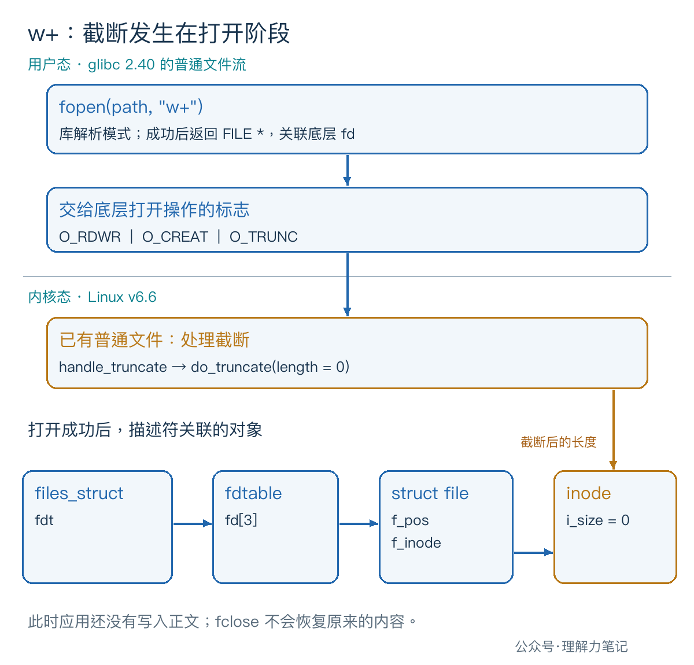

# fopen 模式怎么选，才不会误清空文件？


一个文件里原本写着 `OLD`。程序只是用 `fopen` 打开它，还没执行写入，文件长度就变成了 0。问题可能出在模式字符串里的那个 `w`。

> **对已存在且成功打开的普通文件，`w` 和 `w+` 都会在打开阶段把长度截为 0。** 想读写原内容，用 `r+`；想把内容接到末尾，用 `a` 或 `a+`。`+` 表示可以读写，不会取消首字母规定的截断或追加行为。

“截断为 0”就是把文件的逻辑长度清零，原内容无法再通过普通文件读取取得。选模式前，先明确是否允许丢弃这些内容。

**这篇文章怎么读？**

| 你是谁 | 看哪一章 | 会得到什么 |
| --- | --- | --- |
| 搜索者 / 被推荐者 | 第一章 · 先解决问题 | 六种模式对照表和打开即清空的实测 |
| 学习者 | 第二章 · 机制解释 | 从模式字符串找到截断、创建和追加的来源 |
| 编程者 | 第三章 · 工程使用 | 区分保留、覆盖、追加和只许新建 |
| 求职者 | 第四章 · 面试提炼 | 回答 +、b 和 a+ 的常见追问 |

## 第一章 · 先解决问题：w 和 w+ 都会清空已有文件

### 把“能读写什么”和“怎样处理旧文件”分开看

下表针对普通文件，假设路径有效、权限允许。创建只针对最后一级文件名，`fopen` 不会替你建立缺失的父目录。

| 模式 | 允许操作 | 文件已存在 | 文件不存在 | 写入位置 |
| --- | --- | --- | --- | --- |
| `r` | 读 | 保留内容 | 失败 | 不允许写 |
| `r+` | 读、写 | 保留内容 | 失败 | 当前流位置 |
| `w` | 写 | 截断为 0 | 创建 | 当前流位置 |
| `w+` | 读、写 | 截断为 0 | 创建 | 当前流位置 |
| `a` | 写 | 保留内容 | 创建 | 当时的文件末尾 |
| `a+` | 读、写 | 保留内容 | 创建 | 当时的文件末尾 |

`r`、`w`、`a` 决定打开策略；加上 `+`，才允许在同一个流上既读又写。比如 `w+` 适合从空内容开始读写，不能用它保留原文件。

### 不写一个字节，也能看到截断

下面的探针先调用 `fopen`，紧接着用 `fstat` 查询文件长度并打印。没有可选的 `text` 参数时，它不会向目标文件写入任何内容；这个参数留给后面的可写模式实验。

请新建一个空实验目录，把代码保存为 `mode_probe.c`，只使用目录里的测试文件：

```c
#define _POSIX_C_SOURCE 200809L

#include <inttypes.h>
#include <stdio.h>
#include <stdlib.h>
#include <sys/stat.h>

int main(int argc, char **argv)
{
    if (argc != 3 && argc != 4) {
        fprintf(stderr, "usage: %s mode path [text]\n", argv[0]);
        return EXIT_FAILURE;
    }

    FILE *fp = fopen(argv[2], argv[1]);
    if (fp == NULL) {
        perror("fopen");
        return EXIT_FAILURE;
    }

    int status = EXIT_FAILURE;
    int fd = fileno(fp);
    struct stat st;
    if (fd == -1) {
        perror("fileno");
        goto cleanup;
    }
    if (fstat(fd, &st) == -1) {
        perror("fstat");
        goto cleanup;
    }
    if (!S_ISREG(st.st_mode)) {
        fprintf(stderr, "experiment requires a regular file\n");
        goto cleanup;
    }
    if (printf("mode=%s opened_size=%jd\n",
               argv[1], (intmax_t)st.st_size) < 0) {
        perror("printf");
        goto cleanup;
    }

    if (argc == 4) {
        if (fseek(fp, 0L, SEEK_SET) != 0) {
            perror("fseek");
            goto cleanup;
        }
        if (fputs(argv[3], fp) == EOF) {
            perror("fputs");
            goto cleanup;
        }
    }
    status = EXIT_SUCCESS;

cleanup:
    if (fclose(fp) == EOF) {
        perror("fclose");
        status = EXIT_FAILURE;
    }
    if (fflush(stdout) == EOF) {
        perror("fflush stdout");
        status = EXIT_FAILURE;
    }
    return status;
}
```

`fileno` 取出流关联的 fd，`fstat` 查询该 fd 对应文件的元数据，`st_size` 是长度。打印发生在可选写入之前，因此 `opened_size=0` 能区分“打开时截断”和“后续写入改变内容”。这两个查询接口属于 POSIX，`fopen` 本身是 C 标准库接口。

这里检查普通文件的代码在 `fopen` **之后**执行，它只是限定实验对象，不能撤销此前的截断，更不能拿来保护重要文件。

本次实测环境：**macOS 14.8.8、x86_64、Apple clang 16.0.0**。没有在 Linux 主机实跑；Linux/glibc 的机制另用源码核对。

```sh
cc -std=c17 -Wall -Wextra -Wpedantic -Wconversion -Wshadow -O0 -g mode_probe.c -o mode_probe
```

每轮都重新写入三个字节 `OLD`，再测试一种模式：

```sh
for mode in r r+ w w+ a a+; do
    printf OLD > sample.txt
    ./mode_probe "$mode" sample.txt
done
```

实际输出：

```text
mode=r opened_size=3
mode=r+ opened_size=3
mode=w opened_size=0
mode=w+ opened_size=0
mode=a opened_size=3
mode=a+ opened_size=3
```

同一份程序还对每种模式测试了独立的、不存在的文件名：`r`、`r+` 都报 `fopen: No such file or directory`，退出状态为 1；`w`、`w+`、`a`、`a+` 都成功创建空文件，退出状态为 0。结果与上表一致。

## 第二章 · 从操作系统视角理解：截断由打开标志决定

### + 只改变访问方式，不移除 O_TRUNC

POSIX 规定了 `fopen` 模式和底层 `open` 标志的对应关系。看三种带 `+` 的模式，就能找到差别：

- `r+` 对应 `O_RDWR`：允许读写，没有要求创建或截断。
- `w+` 对应 `O_RDWR | O_CREAT | O_TRUNC`：允许读写，需要时创建，已有普通文件则截断。
- `a+` 对应 `O_RDWR | O_CREAT | O_APPEND`：允许读写，需要时创建，写入强制追加。

不带 `+` 时，`r` 使用只读的 `O_RDONLY`，`w`、`a` 使用只写的 `O_WRONLY`；创建、截断、追加的标志仍由首字母决定。

glibc 2.40 的 `fileops.c` 也按这个顺序解析：遇到 `w`，记下 `O_CREAT | O_TRUNC`；再遇到 `+`，把访问方式改成 `O_RDWR`。解析 `+` 的代码没有清除 `O_TRUNC`。

### 文件在 fopen 返回成功前就已经被截断



Linux v6.6 的普通文件打开路径会处理截断请求。在相应分支中，`handle_truncate` 调用 `do_truncate`，传入目标长度 0；后者通过文件系统属性更新路径处理这个长度变更。

成功打开后，进程的描述符表关联 `struct file`，它记录文件偏移量 `f_pos`，并通过 `f_inode` 关联 inode。**改变的是文件对象的长度，不只是这一次打开的读写位置。** 所以关掉流再打开，旧内容也不会恢复。

图中字段属于指定版本的 Linux 实现。用户能依赖的公开语义是：普通文件成功以 `w` 或 `w+` 打开后，原长度已被截为 0。实验观察的也是这个结果，没有跟踪 Linux 内核调用。

### a 的追加约束不随 fseek 消失

追加模式要求后续写入落在当时的文件末尾。它不等于“打开时先定位到末尾，以后就随便写”。即使程序执行过 `fseek(fp, 0L, SEEK_SET)`，之后的写入仍然追加。

`a+` 可以定位后读取已有内容，但不能靠定位把它改成原地覆盖模式。需要从开头读取时，应显式定位并检查结果，不依赖不同平台对 `a+` 初始读取位置的安排。

## 第三章 · 工程上怎么使用：不截断，不代表不会覆盖

### r+ 改的是当前位置，a+ 写的是文件末尾

探针带 `text` 参数时，会先定位到开头，再写入这个字符串。仍然让每轮从 `OLD` 开始：

```sh
for mode in r+ w+ a+; do
    printf OLD > sample.txt
    ./mode_probe "$mode" sample.txt X
    cat sample.txt
    printf '\n'
done
```

实际输出：

```text
mode=r+ opened_size=3
XLD
mode=w+ opened_size=0
X
mode=a+ opened_size=3
OLDX
```

`r+` 写入一个 `X`，覆盖了首字节，剩下的 `LD` 留着。`w+` 在打开时已经清空，所以最终只有 `X`。`a+` 保留 `OLD`，并把 `X` 接在末尾。

如果用 `r+` 把一段长内容改成较短内容，尾部不会因为你少写了几个字节就自动消失。程序必须另外决定如何处理这段尾部；“不在打开时截断”与“整份内容替换”是两个需求。


### 只允许新建时，让打开操作自己检查冲突

导出文件如果要求“同名文件已经存在就拒绝”，可以在目标 C 库支持时使用 `wx`。`x` 指定独占创建：已有文件时失败，没有时创建；在 POSIX 下对应加入 `O_EXCL`。

本次测试中，`wx` 打开已有 `sample.txt` 报 `fopen: File exists`，退出状态为 1，原来的 `OLD` 保持不变；用它创建新文件并写入 `X` 则成功。

不要先用 `access` 或 `stat` 判断不存在，再用 `w` 打开。检查和打开之间，其他进程可能创建同名文件。`O_CREAT | O_EXCL` 把存在性检查和创建合在一个操作里。这个保证针对创建冲突，不代表给后续读写加了互斥锁。

同样，`r+` 打开失败时，不要直接退回 `w+`。失败可能来自权限、路径或资源不足；即使第一次确实因为文件不存在，第二次打开前也可能出现新文件。选择失败后的行为，需要继续遵守“不覆盖已有内容”的业务要求。

### 模式选对后，仍要检查写入和关闭

示例在 `fopen` 失败后立即报告错误；取得流后，查询、定位或写入失败都走同一个清理出口。`fputs` 返回 `EOF` 表示失败，`fclose` 的返回值也单独检查，因为缓冲中的数据可能在关闭时才提交。

验收时还把测试子进程允许写出的文件大小限制为 0：目标文件可以打开，但最终报告 `fclose: File too large`，程序以失败状态退出。打开成功不能代替整次输出成功；关闭失败后也不能再次使用该流或重试 `fclose`。

这里是单线程、普通文件实验，发生错误就报告并退出，没有实现信号中断恢复或并发写入协议。`a` 保证追加位置，不保证一次标准 I/O 调用形成完整、不可交错的业务记录，也不保证数据已持久化。

## 第四章 · 面试提炼：+ 不防截断，b 不防覆盖

**`r+` 与 `w+` 都能读写，区别在哪？** 前者要求文件存在，打开时保留内容；后者可以创建文件，但已有普通文件会被截断为 0。

**`wb` 比 `w` 更安全吗？** `b` 表示二进制模式，在 Linux 等 POSIX 系统中不改变这里的打开行为，`wb` 仍然截断。跨平台处理二进制数据时有必要明确 `b`，但它不是防覆盖选项。

**加了 `+`，就能任意交替读写吗？** 不能。更新流仍有读写切换规则：通常从读切到写需要定位操作，从写切到读需要刷新或定位操作，另有读到 EOF 的例外。本篇的写入实验没有交替读写，具体切换规则留到后续专篇。

## 参考资料

- [POSIX.1-2024：fopen](https://pubs.opengroup.org/onlinepubs/9799919799/functions/fopen.html)：模式语义、创建与截断、追加约束、`b`、`x` 和更新流边界。
- [POSIX.1-2024：open](https://pubs.opengroup.org/onlinepubs/9799919799/functions/open.html)：`O_CREAT`、`O_TRUNC`、`O_APPEND`、`O_EXCL` 及原子创建条件。
- [POSIX.1-2024：fputs](https://pubs.opengroup.org/onlinepubs/9799919799/functions/fputs.html)、[fclose](https://pubs.opengroup.org/onlinepubs/9799919799/functions/fclose.html)：写入和关闭的返回值及关闭后资源状态。
- [glibc 2.40：fileops.c](https://github.com/bminor/glibc/blob/glibc-2.40/libio/fileops.c)：`_IO_new_file_fopen` 的模式解析与 `_IO_file_open`。
- Linux v6.6：[fs/namei.c](https://github.com/torvalds/linux/blob/v6.6/fs/namei.c)、[fs/open.c](https://github.com/torvalds/linux/blob/v6.6/fs/open.c)、[fdtable.h](https://github.com/torvalds/linux/blob/v6.6/include/linux/fdtable.h)、[fs.h](https://github.com/torvalds/linux/blob/v6.6/include/linux/fs.h)：截断路径和图中的对象关系。
- [Linux fopen(3) 手册源码](https://github.com/mkerrisk/man-pages/blob/master/man3/fopen.3)：`a+` 初始读取位置的平台差异和二进制标记的说明。

> 本文为公众号「理解力笔记」原创。转载请联系作者，并保留出处。
