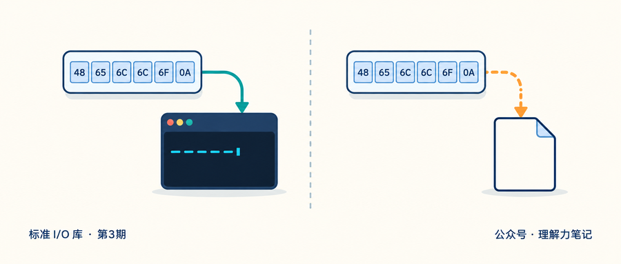
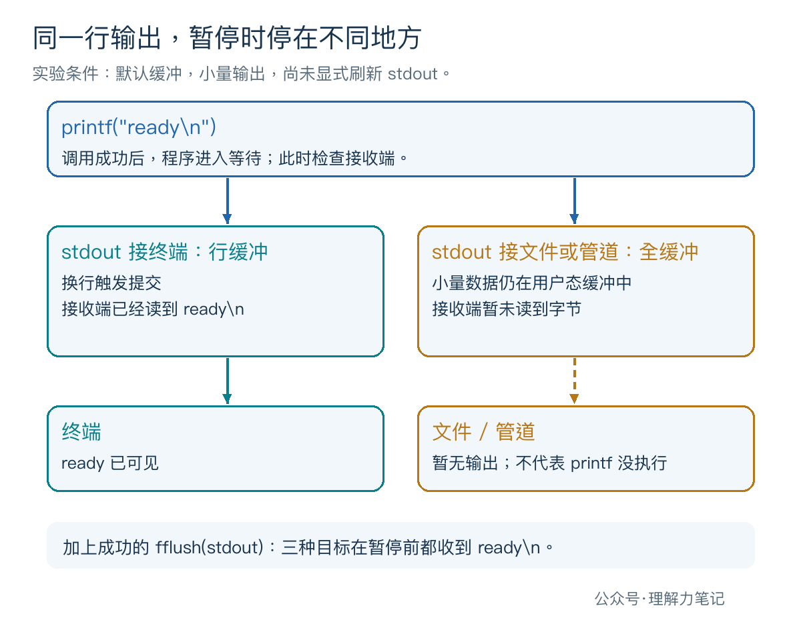
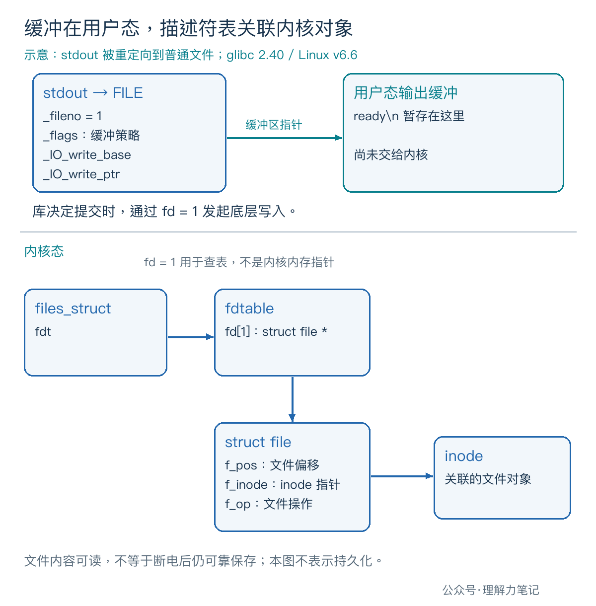

# printf 加了换行，重定向后为什么还是没输出？



程序在终端里会及时打印进度，加上 `> out.txt` 以后，文件却迟迟没有内容。检查代码，`printf` 已经执行，字符串末尾也有 `
`。

> **在 Linux/glibc 的默认配置下，stdout 接终端通常是行缓冲，接普通文件或管道通常是全缓冲。** 换行可以触发行缓冲的输出，却不会普遍地刷新全缓冲。需要在某个时间点提交输出，应调用 `fflush(stdout)` 并检查返回值。

这一次，先看字节有没有离开 C 库的用户态缓冲。文件是否持久化，是后面另一层的问题。

**这篇文章怎么读？**

| 你是谁 | 看哪一章 | 会得到什么 |
| --- | --- | --- |
| 搜索者 / 被推荐者 | 第一章 · 先解决问题 | 复现终端、文件和管道的输出差异 |
| 学习者 | 第二章 · 机制解释 | 分清三种缓冲和三个标准流 |
| 编程者 | 第三章 · 工程使用 | 在需要及时输出的位置刷新并处理失败 |
| 求职者 | 第四章 · 面试提炼 | 说清换行、stderr 和正常退出的边界 |

## 第一章 · 先解决问题：换行没有让重定向输出立即可见

### 在程序继续运行前，先检查输出

下面的程序先输出 `ready`，再打印一条检查点提示，等待回车。等待期间就能观察目标里有没有数据，不必猜测计算耗时。

它有三个选项：`newline` 输出带换行的文本；`partial` 输出不带换行的 `ready> `；`flush` 在带换行的输出后立即调用 `fflush(stdout)`。

保存为 `stdout_buffer.c`：

```c
#define _POSIX_C_SOURCE 200809L

#include <errno.h>
#include <stdio.h>
#include <stdlib.h>
#include <string.h>
#include <unistd.h>

int main(int argc, char **argv)
{
    if (argc != 2 || (strcmp(argv[1], "newline") != 0 &&
                      strcmp(argv[1], "partial") != 0 &&
                      strcmp(argv[1], "flush") != 0)) {
        fprintf(stderr, "usage: %s newline|partial|flush\n", argv[0]);
        return EXIT_FAILURE;
    }

    int status = EXIT_FAILURE;
    const char *text = strcmp(argv[1], "partial") == 0
                       ? "ready> " : "ready\n";
    if (printf("%s", text) < 0) {
        perror("printf ready");
        goto cleanup;
    }
    if (strcmp(argv[1], "flush") == 0 && fflush(stdout) == EOF) {
        perror("fflush checkpoint");
        goto cleanup;
    }
    if (fprintf(stderr, "[checkpoint] press Enter\n") < 0 ||
        fflush(stderr) == EOF) {
        perror("stderr checkpoint");
        goto cleanup;
    }

    char ch;
    ssize_t n;
    do {
        n = read(STDIN_FILENO, &ch, 1);
    } while (n == -1 && errno == EINTR);
    if (n == -1) {
        perror("read gate");
        goto cleanup;
    }
    if (n == 0) {
        fprintf(stderr, "stdin ended before release\n");
        goto cleanup;
    }
    if (printf("done\n") < 0) {
        perror("printf done");
        goto cleanup;
    }
    status = EXIT_SUCCESS;

cleanup:
    if (fflush(stdout) == EOF) {
        perror("fflush final");
        status = EXIT_FAILURE;
    }
    return status;
}
```

检查点写到 **stderr**，随后明确刷新 stderr。它只用来表示程序已经执行到等待位置，不能把这条提示当成 stdout 已经输出的证据。

等待使用 POSIX `read`，并重试 `EINTR`，也就是读取被信号中断的情况。这里没有用 `scanf` 或 `getchar`，是为了避开标准 I/O 读取输入时可能附带的行缓冲刷新，让实验只比较 stdout 的行为。

### 编译与复现

本次实测环境为 **macOS 14.8.8、x86_64、Apple clang 16.0.0**。自动验收用 PTY，也就是伪终端，作为终端输出目标；Linux/glibc 行为通过源码另行核对。

在实验目录编译，再逐条运行下面的命令。重定向会创建或清空同名 `out.txt`，请使用测试文件。

```sh
cc -std=c17 -Wall -Wextra -Wpedantic -Wconversion -Wshadow -O0 -g stdout_buffer.c -o stdout_buffer
./stdout_buffer newline
./stdout_buffer newline > out.txt
./stdout_buffer newline | cat
```

每次看到 `[checkpoint] press Enter` 后，先观察，再按回车让程序结束。重定向那一轮，可以在另一个终端、同一目录里运行 `cat out.txt`，查看暂停期间的内容。

把参数换成 `partial` 和 `flush`，就能重复另外两组对照。自动验收在收到检查点后读取目标字节，再通过独立的输入管道放行程序。下表记录的是**放行之前的 stdout 内容**，不包含 stderr 提示；`
` 表示实际的换行字节。

| 输出方式 | 接终端（PTY） | 接普通文件 | 接管道 |
| --- | --- | --- | --- |
| `newline`：带换行 | `"ready\n"` | 无字节 | 无字节 |
| `partial`：不带换行 | 无字节 | 无字节 | 无字节 |
| `flush`：带换行后显式刷新 | `"ready\n"` | `"ready\n"` | `"ready\n"` |

放行后，程序输出 `done`，检查最终的 `fflush(stdout)`，然后返回。`newline` 和 `flush` 的最终 stdout 都是：

```text
ready
done
```

`partial` 的最终内容是 `ready> done` 后接换行。这说明此前缺少的是输出时机，并不能据此判断那次 `printf` 没有执行。



实验只用了几个字节，没有把缓冲区装满，也没有测量系统调用次数。较大的输出可能在函数返回前就触发底层写入，不能从这个小实验推出“重定向后一律等到退出才输出”。

## 第二章 · 从操作系统视角理解：缓冲策略由流及其目标决定

### 行缓冲、全缓冲和无缓冲分别等什么

**行缓冲**把换行作为一个常见的提交时机。缓冲区用满、显式刷新、关闭流等情况也可能让数据输出，因此“没有换行就永远不会输出”同样不对。

**全缓冲**允许库把一批字符积累起来再提交。小量输出中的换行通常只是一个普通字符，不会单独触发提交；缓冲空间不足、显式刷新、关闭或正常退出等才会让这些字节继续向下走。全缓冲也不意味着所有写入都必须先攒满固定容量。

**无缓冲**尽快把输出交给底层，不等待凑出一整行或一批数据。它描述的是标准 I/O 库的策略，不能理解成绕过所有内核缓冲，也不能推出每个字符必然对应一次系统调用。

### 三个标准流，不能套同一句默认规则

程序启动时，`stdin` 用于常规输入，`stdout` 用于常规输出，`stderr` 用于诊断输出。在 POSIX 程序启动时，它们分别关联 fd 0、1、2。

POSIX 对默认缓冲的表述是：**stderr 不应是全缓冲；stdin 和 stdout 在被确定为非交互设备时是全缓冲。** “不全缓冲”不等于规范要求所有实现都必须“完全无缓冲”。glibc 的实现则把 stderr 初始化为无缓冲。

对于 stdout，glibc 2.40 的 `filedoalloc.c` 会在分配文件缓冲时检查设备类型；发现它关联终端，就设置行缓冲标志。`stdfiles.c` 负责标准流初始对象和标志。这里是实现说明，不意味着 C 标准规定每个库都必须用这些字段或这条检测路径。

在 shell 中启动 `./program > out.txt` 或 `./program | consumer` 时，stdout 已经接到了文件或管道。你虽然仍在终端敲命令，程序的 stdout 却不再是终端。IDE 输出面板也可能通过管道收集文本，不能只按窗口外观判断目标类型。

### 字节还在 FILE 的缓冲里，文件自然读不到



以重定向到普通文件为例，用户态 `FILE` 记录缓冲策略、待写区域和关联的 fd。库决定提交时，才通过这个 fd 进入底层写入路径。

在 Linux 内核中，`files_struct` 关联描述符表，`fdtable` 的 `fd[1]` 槽位保存 `struct file` 指针；打开文件对象再通过 `f_inode` 关联 inode，并维护文件偏移 `f_pos`。stdio 的缓冲区与这些内核对象分处两层。

glibc 的 `fileops.c` 在行缓冲输出中检查换行，并在需要时进入底层写入；普通文件写路径最终使用流的 `_fileno`。本篇没有实测 Linux 的调用次数，图中字段依据 glibc 2.40 和 Linux v6.6 源码。

实验暂停时文件还是空的，不能直接归因于“数据已经到内核，只是磁盘太慢”。显式刷新后，另一个进程能读到文件内容，也不等于已经完成持久化。

## 第三章 · 工程上怎么使用：在交互边界刷新，检查错误

### 把“现在就需要看到”写进程序

提示用户输入、报告一个重要阶段已经结束，都是明确的输出时机。可以先输出内容，再调用 `fflush(stdout)`，成功后才继续等待输入或执行长时间计算。示例的 `flush` 分支就在输出 `ready` 后、进入等待前做这件事。

需要整个流采用不同策略时，可以考虑 `setvbuf`，但必须遵守它的设置时机和缓冲区生命周期要求，后续专篇再展开。本篇没有调用它，比较的是默认行为。

不要仅靠增加 `
` 修复重定向延迟；也不必为让进度及时出现，把所有正常结果都改写到 stderr。两者有不同用途。`> out.txt` 通常只重定向 stdout，所以你仍可能看到 stderr 上的提示，这不代表文件输出已经完成。

### fflush 的失败也是输出失败

`printf` 成功时，字符可能仍在用户态缓冲。真正提交时，空间或写入限制等问题才可能暴露。因此既要检查 `printf`，也要检查 `fflush`；后者失败返回 `EOF`，在 POSIX 下还会设置 `errno`。

验证时，把测试子进程的可写文件大小限制为 0，stdout 接到普通文件。`newline` 模式能先到达检查点，却在最终刷新时报出 `fflush final: File too large`，退出状态为 1。`flush` 模式则在检查点之前就报告刷新失败。

示例发生错误后保留失败状态，并在退出前尝试提交剩余 stdout 数据；持续的底层故障可能因此报告两次刷新错误。它没有实现非阻塞输出、断开的管道或业务重试协议，不能直接当成这些场景的完整处理框架。

### 正常退出会刷新，但不适合作为进度通知机制

从 `main` 正常返回或调用 `exit`，会进入标准流的正常退出处理，刷新尚未写出的数据。这能解释某些程序为什么一直没输出，结束时才一口气出现。

但刷新发生在退出阶段，就无法承担运行期间的进度通知；依赖退出自动刷新，也难以把那时发生的写入错误反馈成正确的成功或失败状态。本例因此在返回前显式检查最终刷新。异常终止也不能当作已经完成正常退出刷新。

管道还可能串着多个程序。生产者的 `fflush(stdout)` 只处理自己的输出流，消费程序若又缓冲了一层，屏幕上仍可能延迟出现结果。排查时要确认延迟发生在哪一段。

## 第四章 · 面试提炼：换行和“无缓冲”都有适用范围

**为什么终端及时输出，重定向后却延迟？** 默认 stdout 的缓冲方式受输出目标影响：终端通常行缓冲，文件和管道通常全缓冲；同一个换行在两种策略下作用不同。

**stderr 一定无缓冲吗？** glibc 默认这样实现；C/POSIX 的要求是它不全缓冲。不要把某个库的默认值说成所有实现都必须相同。

**fflush 成功，就说明落盘了吗？** 不能这样推导。它处理流中未写出的数据，持久化还涉及更下层的保证；本篇的实验只验证接收端何时能读到字节。

## 参考资料

- [POSIX.1-2024：stdin、stdout、stderr](https://pubs.opengroup.org/onlinepubs/9799919799/functions/stdin.html)：标准流用途、初始描述符与默认缓冲规则。
- glibc 2.40 手册：[Buffering Concepts](https://sourceware.org/glibc/manual/2.40/html_node/Buffering-Concepts.html)、[Flushing Buffers](https://sourceware.org/glibc/manual/2.40/html_node/Flushing-Buffers.html)：三种策略、显式刷新和自动刷新时机。
- [POSIX.1-2024：fflush](https://pubs.opengroup.org/onlinepubs/9799919799/functions/fflush.html)、[exit](https://pubs.opengroup.org/onlinepubs/9799919799/functions/exit.html)：刷新语义、错误返回与正常退出处理。
- glibc 2.40：[filedoalloc.c](https://github.com/bminor/glibc/blob/glibc-2.40/libio/filedoalloc.c)、[stdfiles.c](https://github.com/bminor/glibc/blob/glibc-2.40/libio/stdfiles.c)、[fileops.c](https://github.com/bminor/glibc/blob/glibc-2.40/libio/fileops.c)、[struct_FILE.h](https://github.com/bminor/glibc/blob/glibc-2.40/libio/bits/types/struct_FILE.h)：终端识别、标准流初始状态、输出缓冲和底层写入。
- [Linux stdio(3) 手册源码](https://github.com/mkerrisk/man-pages/blob/master/man3/stdio.3)；Linux v6.6：[fdtable.h](https://github.com/torvalds/linux/blob/v6.6/include/linux/fdtable.h)、[fs.h](https://github.com/torvalds/linux/blob/v6.6/include/linux/fs.h)：Linux 标准 I/O 说明与内核对象关系。

> 本文为公众号「理解力笔记」原创。转载请联系作者，并保留出处。
