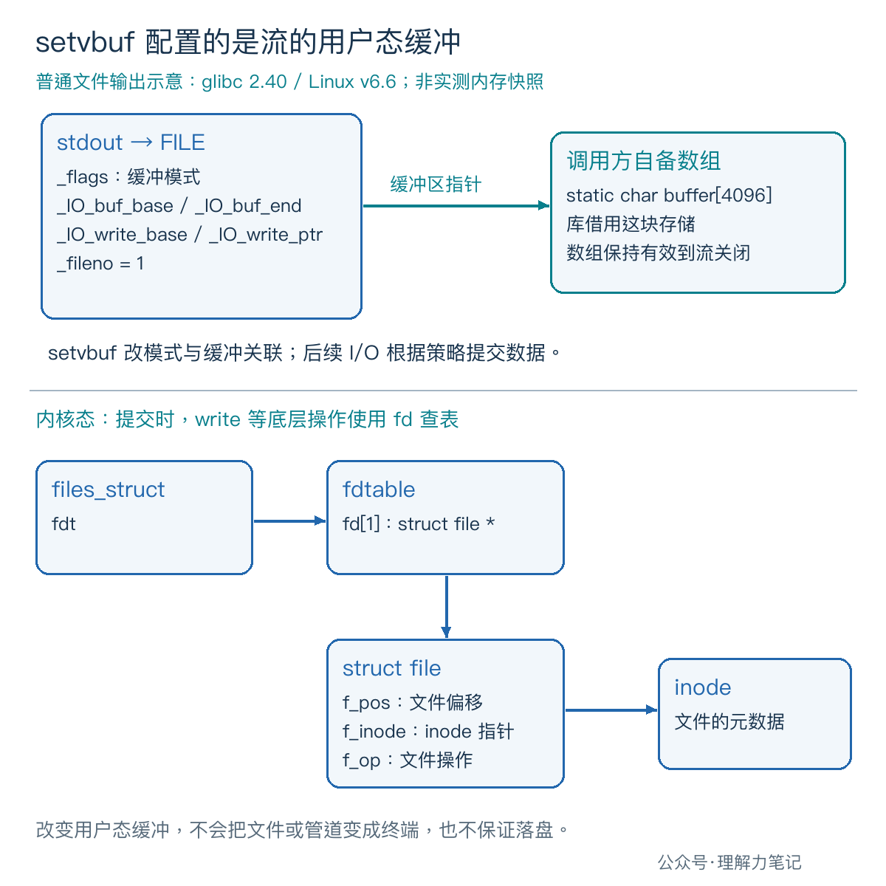
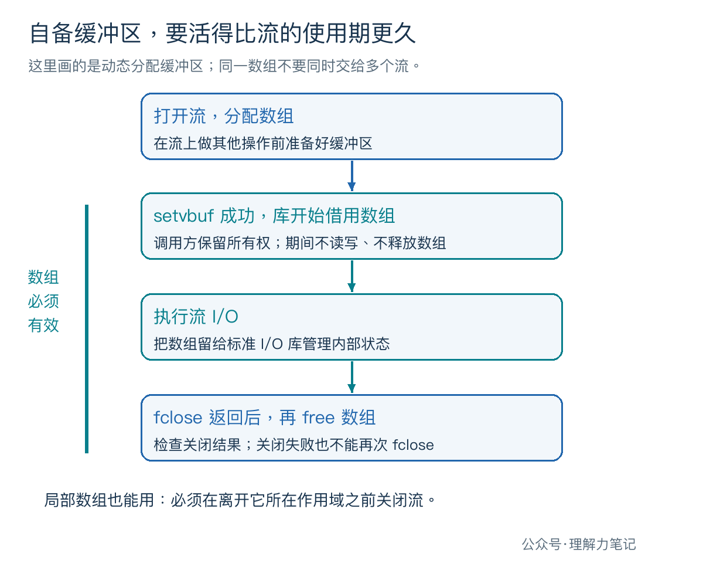

# setvbuf 怎么设置缓冲，才不会留下悬空指针？


把输出重定向到文件以后，想让每一行日志及时出现，可以给 `stdout` 显式设置行缓冲。但如果把配置放在第一次 `printf` 后面，或者把辅助函数里的局部数组交给流，代码就埋下了另外的问题。

> **在流上做其他操作之前，用 `setvbuf` 选择缓冲方式，并检查返回值。若提供自己的数组，它必须持续有效到流关闭。** 只关心模式时可传 `NULL`，把缓冲存储交给库安排；需要管理存储时，再提供数组及其真实大小。

**这篇文章怎么读？**

| 你是谁 | 看哪一章 | 会得到什么 |
| --- | --- | --- |
| 搜索者 / 被推荐者 | 第一章 · 先解决问题 | 对比显式配置后的三种输出行为 |
| 学习者 | 第二章 · 机制解释 | 看懂流对象怎样关联缓冲区 |
| 编程者 | 第三章 · 工程使用 | 管好配置时机、数组寿命和关闭错误 |
| 求职者 | 第四章 · 面试提炼 | 解释为什么局部数组可能留下悬空指针 |

## 第一章 · 先解决问题：显式配置可以改变重定向后的缓冲

`setvbuf(stream, buf, mode, size)` 的四个参数依次指定流、可选的自备数组、模式和大小。模式使用 `<stdio.h>` 的宏：`_IOFBF` 全缓冲、`_IOLBF` 行缓冲、`_IONBF` 无缓冲。

下面的程序把三种模式写成 `full`、`line`、`none`。前两种提供 4096 字节的静态数组；无缓冲使用 `NULL` 和 0。输出后程序暂停，先观察字节是否已经到达目标，再允许它关闭流。

**实际环境是 macOS 14.8.8 x86_64、Apple clang 16.0.0，未在 Linux 主机实测。** 接口约束依据 POSIX.1-2024 中与 ISO C 对齐的定义；第二章的 Linux/glibc 细节另由版本化源码核对。

保存为 `setvbuf_probe.c`：

```c
#define _POSIX_C_SOURCE 200809L

#include <errno.h>
#include <stdio.h>
#include <stdlib.h>
#include <string.h>
#include <unistd.h>

int main(int argc, char **argv)
{
    int mode;
    if (argc != 3 ||
        (strcmp(argv[2], "newline") != 0 &&
         strcmp(argv[2], "partial") != 0)) {
        fprintf(stderr, "usage: %s full|line|none newline|partial\n",
                argv[0]);
        return EXIT_FAILURE;
    }
    if (strcmp(argv[1], "full") == 0) mode = _IOFBF;
    else if (strcmp(argv[1], "line") == 0) mode = _IOLBF;
    else if (strcmp(argv[1], "none") == 0) mode = _IONBF;
    else {
        fputs("unknown buffering mode\n", stderr);
        return EXIT_FAILURE;
    }

    static char buffer[4096];
    char *storage = mode == _IONBF ? NULL : buffer;
    size_t capacity = mode == _IONBF ? 0 : sizeof buffer;
    int status = EXIT_FAILURE;

    /* No earlier operation has used stdout. */
    if (setvbuf(stdout, storage, mode, capacity) != 0) {
        fputs("setvbuf failed\n", stderr);
        goto cleanup;
    }
    const char *text = strcmp(argv[2], "newline") == 0
                       ? "ready\n" : "ready> ";
    if (fputs(text, stdout) == EOF) {
        perror("fputs stdout");
        goto cleanup;
    }
    if (fputs("[checkpoint] press Enter\n", stderr) == EOF ||
        fflush(stderr) == EOF) {
        perror("checkpoint");
        goto cleanup;
    }

    /* POSIX read avoids an extra stdio input-triggered flush. */
    char key;
    ssize_t count;
    do {
        count = read(STDIN_FILENO, &key, 1);
    } while (count < 0 && errno == EINTR);
    if (count < 0) {
        perror("read stdin");
        goto cleanup;
    }
    if (count == 0) {
        fputs("stdin ended before release\n", stderr);
        goto cleanup;
    }
    status = EXIT_SUCCESS;

cleanup:
    if (fclose(stdout) == EOF) {
        perror("fclose stdout");
        status = EXIT_FAILURE;
    }
    return status;
}
```

编译后，在第一个终端运行：

```sh
cc -std=c17 -Wall -Wextra -Wpedantic -Wconversion -Wshadow -O0 -g setvbuf_probe.c -o setvbuf_probe
./setvbuf_probe line newline > out.txt
```

看到 `[checkpoint] press Enter` 后先别按回车，在同一目录的另一个终端执行 `od -An -tx1 out.txt`，检查是否已有字节。检查完再回车。把两个参数换成其他组合，分别用新进程运行；接管道时可用 `./setvbuf_probe line newline | cat` 观察。

自动核验同样在检查点暂停，用文件读取和管道读取取出实际字节。三种模式乘两种文本，再分别接普通文件与管道，共 12 组。两个目标的暂停时结果一致：

| 显式配置 | 输出 `ready\n`，暂停时 | 输出 `ready> `，暂停时 |
| --- | --- | --- |
| `full`：全缓冲 | 无字节 | 无字节 |
| `line`：行缓冲 | `ready\n` | 无字节 |
| `none`：无缓冲 | `ready\n` | `ready> ` |

表中的 `\n` 表示换行字节。放行后，12 组都完整输出各自的文本，退出码均为 0。**这里由显式 `fclose(stdout)` 提交剩余输出，不能把它当成“程序退出时自动刷新”的实验。**

等待用的是 POSIX `read`，并处理 `EINTR`；它避免了额外的标准 I/O 输入操作可能触发的行缓冲刷新。实验只观察这几字节何时可见，不测吞吐量，也不推断每次系统调用写多少字节。

## 第二章 · 从操作系统视角理解：库记录模式，也保存缓冲区指针

### 配置作用在 FILE 对象上

在 glibc 2.40 中，`setvbuf` 对应的 `_IO_setvbuf` 会调整 `FILE` 内部的模式标志。配置全缓冲会清除行缓冲、无缓冲标志；配置行缓冲会置上 `_IO_LINE_BUF`；配置无缓冲则置上 `_IO_UNBUFFERED`。

对普通文件流，提供数组后，设置路径会把数组边界记到 `_IO_buf_base`、`_IO_buf_end` 等字段，后续输出再维护写指针。库保留的是这块存储的地址，因此函数调用结束后，数组仍有用途。这些字段是 glibc 实现细节，应用代码不要直接修改它们。



图中 `_fileno = 1` 是用于查表的描述符编号。库需要提交数据时，才沿底层写入路径进入内核，通过描述符表找到 `struct file`。`setvbuf` 不会改变重定向目标的类型，也不会调整内核页缓存大小。

行缓冲会在遇到换行时提交输出；无缓冲尽快传递输出；全缓冲允许库积攒数据后成块提交。本次小量输出正好显出三种策略的差别，但“全缓冲必须等到装满才写”“无缓冲等于一次调用一个系统调用”都不是接口保证。

### size 不是每次写入的字节数

`buf` 非空时，`size` 描述所提供数组的大小，不能大于实际可用空间；POSIX 也明确提醒，库不一定把全部空间都用于缓冲。`buf` 为 `NULL` 时，库可以根据 `size` 安排存储，却不保证实际容量严格等于这个数字。

glibc 2.40 的 `buf == NULL` 分支就没有把传入的 `size` 当成精确容量要求；行缓冲分支还可能把分配留到后续操作。涉及“马上分配多少内存”的结论，应核对具体实现。

即使提供 4096 字节数组，输出也可能因换行、显式刷新或关闭而提前提交；glibc 对大块写入还可能直接提交部分数据。缓冲大小不能用来划分管道消息，也不能据此承诺写入原子性或数据已经落盘。

## 第三章 · 工程上怎么使用：把缓冲配置当成流的初始化

### 先配置，再把流交出去

规范要求在流关联到打开的文件之后、对它做其他操作之前调用 `setvbuf`，例外是此前失败的 `setvbuf` 调用。对 `fopen` 得到的流，紧接着配置；对 `stdout`，在第一次使用它之前配置，也要留意初始化代码是否已经打印过内容。

先 `printf`、再 `fflush`、最后改缓冲，不会重新满足这个时机要求。即便某个库允许，也不能作为可移植写法。多线程程序应在其他线程拿到流之前完成初始化，不能靠流内部的锁把晚配置变成合规操作。

批量写文件可以保留默认全缓冲；逐行日志可以选行缓冲；少量、没有换行也要及时提交的输出可以考虑无缓冲。若只需要几个特定时刻提交，检查 `fflush` 的返回值通常更合适。无缓冲可能增加底层写入次数，并不天然更快。

### 自备数组归谁管，就由谁负责活到最后

一个辅助函数在局部声明 `char buf[4096]`，把它交给 `setvbuf` 后返回，而流继续使用，这是典型错误：数组生命周期已经结束，流保存的地址失效。即使暂时还能输出，也不能依赖它。



主实验用 `static` 数组，存储持续到程序结束，并且主动关闭 `stdout`。普通局部数组也能用，前提是在离开作用域之前关闭流，连错误分支也必须做到。

如果用 `malloc` 分配，检查分配结果，并由同一个资源管理者持有流和数组：先 `fclose`、检查关闭结果，再 `free`。配置失败时也走清理路径。库借用数组期间，不要手动改它、读它来猜待输出内容，或把同一数组同时交给另一个流。

glibc 用 `_IO_USER_BUF` 区分自备存储，关闭时不会替调用方释放这块数组。只想改变模式而不想管理这份资源时，传 `NULL` 更省事。

### 配置成功与输出成功分开检查

`setvbuf` 成功返回 0，失败返回非零，不应只判断是否等于 `EOF`。POSIX 允许失败时设置 `errno`，但不保证必定设置，因此主实验打印明确的配置失败提示，不直接依赖 `perror`。独立探针也已验证，本机库会拒绝非法模式。

输出仍要检查写入和关闭结果。把子进程的 `RLIMIT_FSIZE` 设为 0，并仅在该子进程中忽略 `SIGXFSZ` 后，摘取错误行并按模式标注：

```text
full: fclose stdout: File too large
none: fputs stdout: File too large
```

两次退出码都是 1。全缓冲下，前面的写入被库接受了，真正提交时才失败。输入提前结束、非法参数等失败路径也已核验，主实验的清理分支会关闭已配置的流；关闭可能提交此前缓冲的数据，并不等于撤销输出。

`fclose` 返回后，流就不能再用，即使返回失败也不要再次关闭。本例在进程结束前关闭 `stdout`；项目若有退出处理函数还要向它输出，须等最后一次使用后再关闭。示例只演示单线程、阻塞输出，不提供非阻塞流部分提交后的恢复协议。

## 第四章 · 面试提炼：为什么加一个 static 会改变对错？

可以这样回答：`setvbuf` 可能让流持续使用调用方的数组，局部自动数组随着作用域结束而失效，静态数组则持续存在。正确性取决于数组是否覆盖流的使用期；局部数组只要在作用域内先关闭流，也可以安全使用。

若被追问“传 `NULL`、大小写 4096，是否一定得到 4096 字节缓冲”，答案是不保证，要区分标准允许的行为和具体库实现。

## 参考资料

- [POSIX.1-2024：setvbuf](https://pubs.opengroup.org/onlinepubs/9799919799/functions/setvbuf.html)：配置时机、返回值、大小及自动数组的使用约束。
- [glibc 2.40：Controlling Buffering](https://sourceware.org/glibc/manual/2.40/html_node/Controlling-Buffering.html) 与 [Buffering Concepts](https://sourceware.org/glibc/manual/2.40/html_node/Buffering-Concepts.html)：模式选择、数组管理和输出策略。
- glibc 2.40 源码：[iosetvbuf.c](https://github.com/bminor/glibc/blob/glibc-2.40/libio/iosetvbuf.c)、[genops.c](https://github.com/bminor/glibc/blob/glibc-2.40/libio/genops.c)、[fileops.c](https://github.com/bminor/glibc/blob/glibc-2.40/libio/fileops.c)、[struct_FILE.h](https://github.com/bminor/glibc/blob/glibc-2.40/libio/bits/types/struct_FILE.h)：模式标志、数组关联及写入路径。
- Linux v6.6：[fdtable.h](https://github.com/torvalds/linux/blob/v6.6/include/linux/fdtable.h)、[fs.h](https://github.com/torvalds/linux/blob/v6.6/include/linux/fs.h)：图中的描述符表及文件对象。
- [POSIX.1-2024：fclose](https://pubs.opengroup.org/onlinepubs/9799919799/functions/fclose.html)：关闭时提交输出及关闭后的流状态。

本文为公众号「理解力笔记」原创。转载请联系作者，并保留出处。
