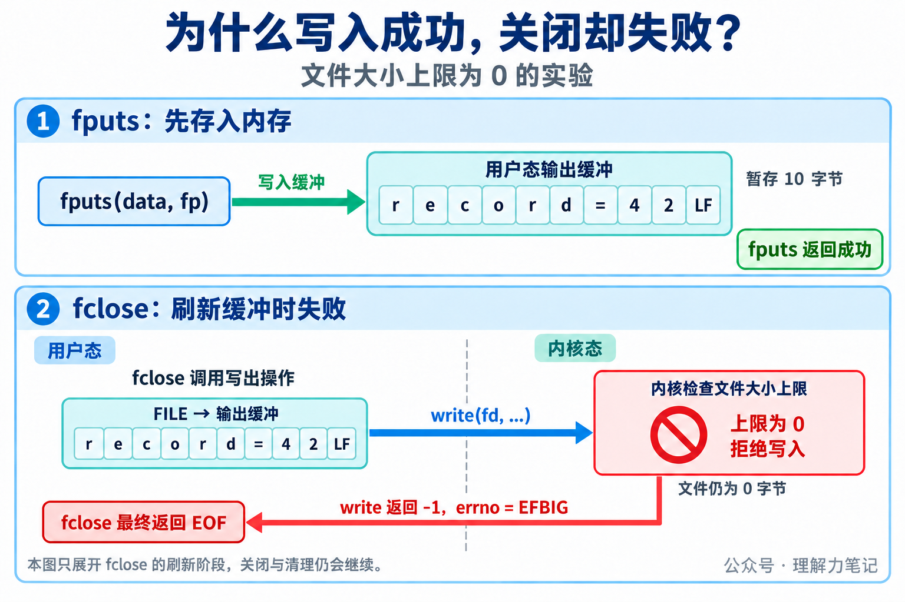
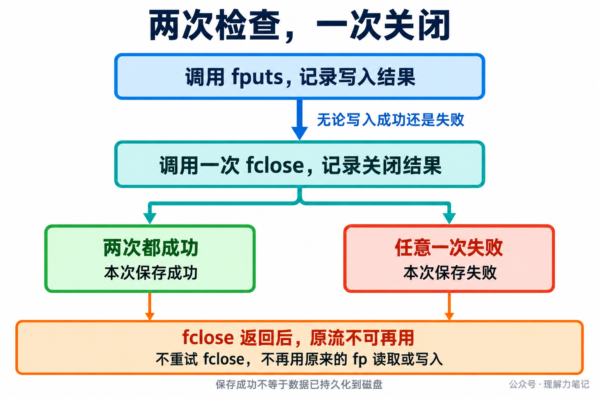

# 写入成功了，为什么 fclose 还会失败？

`fputs` 返回成功，程序接着关闭文件，却收到 `fclose: File too large`。错误为什么到最后一步才出现？

> **结论：写入成功可能只表示标准 I/O 库接受了数据；`fclose` 会尝试刷新尚未写出的内容，底层错误可能到这时才暴露。必须检查关闭结果，而且无论返回 0 还是 `EOF`，都不能再次使用原来的流。**


**这篇文章怎么读？**

先用实验观察报错发生在哪一步，再看关闭过程中发生了什么，以及失败后怎样结束资源使用。

| 你是谁 | 看哪一章 | 会得到什么 |
| --- | --- | --- |
| 搜索者 / 被推荐者 | 第一章 · 先解决问题 | 复现写入成功、关闭失败 |
| 学习者 | 第二章 · 机制解释 | 理解缓冲接收与实际写出的先后关系 |
| 编程者 | 第三章 · 工程使用 | 一次关闭、保留错误、不再访问旧流 |
| 求职者 | 第四章 · 面试提炼 | 解释为何关闭报错也不能重试原流 |

## 第一章 · 先解决问题：关闭时才提交的数据，也会在关闭时报错

本次实测环境是 **macOS 14.8.8 x86_64、Apple clang 16.0.0，未在 Linux 主机实测**。Linux/glibc 的机制另外依据规范与源码核对。

实验只做两件事：把 10 字节的 `record=42\n` 写入缓冲，再关闭输出流。用终端重定向把 `stdout` 接到文件，就能省去参数解析和文件打开代码，直接观察报错发生在哪一步。

保存为 `fclose_short.c`。中文注释标出了缓冲的使用期和流的失效位置：

```c
#include <stdio.h>

int main(void)
{
    char buffer[4096];
    int failed = 0;
    /* 小记录先进入用户态缓冲，stdout 重定向到文件 */
    if (setvbuf(stdout, buffer, _IOFBF, sizeof buffer) != 0) {
        fputs("setvbuf failed\n", stderr); fclose(stdout); return 1;
    }
    if (fputs("record=42\n", stdout) == EOF) {
        perror("fputs"); failed = 1;
    } else if (fputs("fputs: accepted\n", stderr) == EOF) failed = 1;
    /* 关闭会刷新缓冲；返回后不再使用 stdout */
    if (fclose(stdout) == EOF) {
        perror("fclose"); failed = 1;
    } else if (fputs("fclose: success\n", stderr) == EOF) failed = 1;
    if (fflush(stderr) == EOF) failed = 1;
    return failed;
}
```

正常对照，在实验目录执行：

```sh
cc -std=c17 -Wall -Wextra -Wpedantic \
  -Wconversion -Wshadow -O0 -g fclose_short.c -o fclose_short
(set -C; ./fclose_short > normal.txt)
```

`set -C` 防止重定向覆盖已有文件；重复运行请换新文件名。记录写进文件，以下诊断写到终端的标准错误，退出状态为 0：

```text
fputs: accepted
fclose: success
```

### 故意让文件写不进去，看错误在哪一步出现

上面的正常实验中，`fputs` 和 `fclose` 都成功了，还看不出为什么要分别检查它们。现在保持 C 程序不变，只改一个条件：**把测试进程的文件大小上限设为 0，让它不能向文件写入任何字节。**

这个限制只拦截真正的文件写出，不阻止程序把数据放进自己的内存缓冲。因此，我们可以观察：`fputs` 是当场报错，还是先返回成功，等 `fclose` 刷新时才报错？

编译好前面的程序后，在同一目录执行以下终端命令。`limited.txt` 必须是尚不存在的新文件：

```sh
(
    set -C                 # 不覆盖已有的实验文件
    trap '' XFSZ           # 写出失败时返回错误，不让信号终止程序
    ulimit -f 0 || exit 1   # 只在这个子 shell 中禁止文件增长
    ./fclose_short > limited.txt
)
```

括号把限制放在子 shell 中，不会改变当前终端的限制。`trap` 那一行让程序有机会检查失败返回值，否则文件大小超限的信号可能直接终止程序。

本机实际输出为：

```text
fputs: accepted
fclose: File too large
```

这两行要连起来看：

1. `fputs: accepted`：10 字节先被内存缓冲接收，还没有触碰文件大小限制，因此写入函数返回成功。
2. `fclose: File too large`：关闭时刷新缓冲，真正写文件的操作被限制拒绝，因此关闭函数返回失败。

进程退出状态为 1，`limited.txt` 大小为 0。这里的 `File too large` 表示超过了我们设置的大小上限，即使只想写一个字节也不允许，并不是说磁盘已经写满。

**实验要说明的就是：前面的写入成功，不保证后面的缓冲刷新成功；只检查 `fputs`，会漏掉 `fclose` 才发现的错误。**

补充实验还比较了无缓冲和提前 `fflush` 两种用法：无缓冲时，写出错误提早出现在 `fputs`，后面的 `fclose` 可以成功；显式刷新则可能在 `fflush` 处先报错。因此，既要检查写入，也要检查关闭，不能用最后一次成功覆盖先前的失败。

## 第二章 · 机制解释：数据先留在缓冲里，关闭时才真正写出

### fputs 成功，成功的是哪一步？

实验中的 `stdout` 是一个流指针，指向 C 库管理的 `FILE` 对象；下图把流指针写作 `fp`。`FILE` 管理输出缓冲区，也记录关联的文件描述符 fd。缓冲区在进程内存中，fd 是程序访问已打开文件时使用的编号。

前面的实验显式启用了全缓冲。`fputs` 把 10 字节放进缓冲区，便返回成功。此时没有要求内核把这 10 字节写进文件，文件大小上限自然不会在这一步触发。

调用 `fclose` 后，C 库需要把缓冲里尚未写出的数据交给内核。Linux/glibc 的普通文件路径会通过 `write` 等底层操作写出数据；内核根据 fd 找到打开的文件，检查写入是否允许。

在大小上限为 0 的条件下，写出被拒绝：底层 `write` 返回 -1，`errno` 为 `EFBIG`。C 库据此发现刷新失败，最终让 `fclose` 返回 `EOF`。所以，**“写入缓冲成功”和“写入文件成功”是两个时刻，检查前者不能代替检查后者。**



图中的 `LF` 表示字符串末尾的换行字节。

### 刷新失败，为什么不能再关一次？

因为 `fclose` 不只负责刷新，还负责结束这个流的使用。glibc 2.40 的普通文件关闭流程会保存刷新结果，继续关闭关联的 fd，并清理流资源。刷新失败不会让原来的流继续留给应用使用。

POSIX 也明确规定：无论 `fclose` 成功还是失败，原流都不能再用。`EOF` 通知调用方“关闭过程出了错”，不表示“流仍然有效，可以重试”。

底层关闭本身也可能报告错误。因此，提前调用 `fflush` 即使成功，之后仍要检查 `fclose`。以上调用路径依据 Linux/glibc 文档和源码，第一章的运行结果来自 macOS，两者没有混作同一次执行。

## 第三章 · 工程使用：分别检查写入和关闭，失败就报告保存失败

### 用一段短流程记住正确顺序

下面是 **C 语言伪代码，不能直接编译**。假定 `fp` 对应的流已经打开，当前流程负责关闭，`data` 是准备写入的字符串。伪代码省略类型声明和具体日志实现，只保留与本篇有关的判断。

```c
// C 语言伪代码：fp 已打开，由当前流程负责关闭
写入结果 = fputs(data, fp);
if (写入结果 == EOF)
    立即记录写入错误();
关闭结果 = fclose(fp);       // 写入失败也要关闭，只关一次
if (关闭结果 == EOF)
    立即记录关闭错误();
fp = NULL;                  // 不再使用原流
return 写入结果 != EOF && 关闭结果 != EOF;
```

“立即记录错误”在 POSIX 环境中意味着：相关调用失败后，及时保存 `errno` 或输出诊断，再执行后续操作。不要先调用 `fclose`，然后才去查之前的写入为什么失败，关闭过程可能改变错误码。

最后一行要求写入和关闭都成功。即使 `fclose` 成功，也不能抹掉之前的写入失败；即使写入已经失败，仍然要执行一次关闭，结束流的使用。



### 关闭失败后，处理文件结果，不再操作旧流

`fclose` 返回后，不再用原来的 `fp` 调用 `ferror`、`fflush` 或第二次 `fclose`。把 `fp` 设为 `NULL` 可以减少误用，但其他指针副本不会自动变成 `NULL`，也不能继续使用。关闭前应确保其他使用者已经停止访问这个流。

文件也不会因关闭失败自动恢复原状。补充实验把文件大小上限设为 4 字节时，文件只留下 `reco`，而不是完整的 `record=42\n`。应用应报告保存失败，再决定删除不完整文件还是重新生成内容。需要重试时，先处理部分结果，再重新打开文件。

最后，写入和关闭都成功，也不等于数据已持久化到磁盘。有持久化要求时，需要在关闭前安排刷新、文件同步及相应的错误检查。

## 第四章 · 面试提炼：关闭报错与资源寿命是两个问题

“写入成功为什么关闭还会失败？”可以从缓冲回答：写入可能只进入用户态，关闭时刷新才触发底层错误；即便之前已经刷新成功，底层关闭也仍可能失败。

“报错后再关一次行不行？”需要补上资源规则：`fclose` 返回后，原流无论成败都不可再用。应保存错误并向上传递，而不是根据 `EOF` 推断资源还在。

若追问“只检查关闭够不够”，补充的无缓冲实验给出了反例：写入失败、关闭成功，整体仍然失败。

## 第五章 · 参考资料：关闭语义与实现路径

- [POSIX.1-2024：fclose](https://pubs.opengroup.org/onlinepubs/9799919799/functions/fclose.html)、[fputs](https://pubs.opengroup.org/onlinepubs/9799919799/functions/fputs.html)、[fopen](https://pubs.opengroup.org/onlinepubs/9799919799/functions/fopen.html)：流的创建、写入与关闭语义。
- [POSIX.1-2024：getrlimit / setrlimit](https://pubs.opengroup.org/onlinepubs/9799919799/functions/getrlimit.html)：文件大小限制、`SIGXFSZ` 与 `EFBIG`。
- [glibc 2.40：Closing Streams](https://sourceware.org/glibc/manual/2.40/html_node/Closing-Streams.html)：延迟错误与退出时关闭。
- glibc 2.40 源码：[iofclose.c](https://github.com/bminor/glibc/blob/glibc-2.40/libio/iofclose.c)、[fileops.c](https://github.com/bminor/glibc/blob/glibc-2.40/libio/fileops.c)、[genops.c](https://github.com/bminor/glibc/blob/glibc-2.40/libio/genops.c)：刷新、底层关闭和缓冲清理。
- Linux 手册：[fclose(3)](https://man7.org/linux/man-pages/man3/fclose.3.html)、[close(2)](https://man7.org/linux/man-pages/man2/close.2.html)：错误、关闭后的使用限制及 fd 复用。

本文为公众号「理解力笔记」原创。转载请联系作者，并保留出处。
