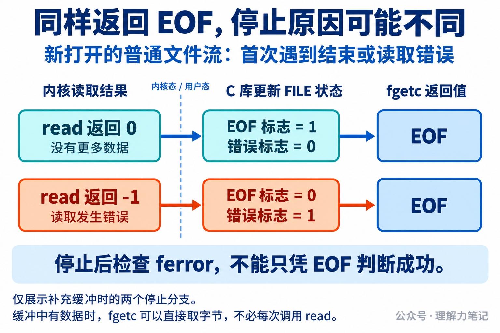

# while (!feof(fp)) 错在哪里？

文件只剩一个字节，程序已经把这个字节读出来了，`feof` 却仍然是 0。继续用 `while (!feof(fp))` 判断，循环还会进入下一轮。此时真的还有数据可处理吗？

> **`feof` 查询的是“这个流是否已经记录过文件结束”，不能预测下一次能否读到数据。先读取，取得有效数据才处理；读取停止后，再检查是否发生错误。**


**这篇文章怎么读？**

| 你是谁 | 看哪一章 | 会得到什么 |
| --- | --- | --- |
| 搜索者 / 被推荐者 | 第一章 · 先解决问题 | 用一个字节看清循环为什么还会进入 |
| 学习者 | 第二章 · 机制解释 | 分清返回值、流标志和内核读取结果 |
| 编程者 | 第三章 · 工程使用 | 可编译的复制函数和调用示例 |
| 求职者 | 第四章 · 面试提炼 | 解释正常结束与读取错误的区别 |

## 第一章 · 先解决问题：读到最后一个字节，还没有发现结束

实测环境是 **macOS 14.8.8 x86_64、Apple clang 16.0.0，未在 Linux 主机实测**。Linux/glibc 的机制另用规范和源码核对。

下面的短程序从标准输入读取，打印读取前、每次成功读取后和停止时的状态。`ch` 用 `int` 保存，才能同时容纳有效字节值和 `EOF`。保存为 `feof_short.c`：

```c
#include <stdio.h>

int main(void)
{
    int ch, failed = 0;
    if (printf("start: eof=%d error=%d\n",
               feof(stdin) != 0, ferror(stdin) != 0) < 0) return 1;
    while ((ch = fgetc(stdin)) != EOF) { /* 读成功才处理 */
        if (printf("byte=%d eof=%d error=%d\n",
                   ch, feof(stdin) != 0, ferror(stdin) != 0) < 0)
            return 1;
    }
    /* EOF 也可能来自错误，先诊断，再输出状态 */
    if (ferror(stdin)) { perror("fgetc"); failed = 1; }
    if (printf("stop: EOF eof=%d error=%d\n",
               feof(stdin) != 0, ferror(stdin) != 0) < 0) failed = 1;
    if (fflush(stdout) == EOF) { perror("fflush"); failed = 1; }
    return failed;
}
```

在实验目录编译，然后准备一个只有 `A`、没有换行的文件：

```sh
cc -std=c17 -Wall -Wextra -Wpedantic \
  -Wconversion -Wshadow -O0 -g feof_short.c -o feof_short
printf A > one.txt
./feof_short < one.txt
```

本机实际输出如下，退出状态为 0。代码中的 `!= 0` 把标志统一显示为 0 或 1；接口本身只保证零或非零。

```text
start: eof=0 error=0
byte=65 eof=0 error=0
stop: EOF eof=1 error=0
```

第二行已经读到了文件唯一的字节，`65` 是本机的 `A`，但结束标志仍为 0。第三行对应下一次读取：这次确实没有字节可取，`fgetc` 才返回 `EOF` 并设置结束标志。


所以，`!feof(fp)` 成立时，下一次读取仍可能失败。如果进入循环后不检查 `fgetc` 的返回值，就会把 `EOF` 当成有效数据处理。

正确循环同样需要最后一次读取尝试。区别在于，示例先判断返回值，只有 `ch != EOF` 才进入循环体。

还验证了空文件、换行、二进制数据和读取错误。结果如下，表中的字节值均为十进制：

| 输入 | 成功交给循环体的字节 | 停止时的状态 |
| --- | --- | --- |
| 空文件 | 无 | `feof=1，ferror=0` |
| 只有 `A` | 65 | `feof=1，ferror=0` |
| `A` 后跟换行 | 65、10 | `feof=1，ferror=0` |
| 二进制 `00 FF` | 0、255 | `feof=1，ferror=0` |
| 目录（本机错误路径） | 无 | `feof=0，ferror=1` |

普通文件四组均退出为 0。目录组退出为 1，并报告 `fgetc: Is a directory`；目录的打开与读取行为依平台而异，这里只把目录当作本机已验证的错误输入。

## 第二章 · 机制解释：feof 只查标志，读取函数才会发现结束

### FILE 里的标志从哪里来？

实验中的 `stdin` 指向 C 库管理的 `FILE` 对象。输入缓冲区和流的状态都由 C 库管理；`feof` 查询结束标志，`ferror` 查询错误标志。查询标志不会读取新字节，也不会根据文件大小预测还有多少内容。

以 Linux/glibc 的普通文件读取为例：缓冲区还有字节时，`fgetc` 可以直接取出一个字节返回。需要补充缓冲且尚未记录结束时，C 库才通过底层 `read` 等操作读取文件。

内核通过文件描述符 fd 找到打开的文件，返回本次实际读到的字节数。读到数据就返回正数；没有更多数据时返回 0；读取发生错误时返回 -1。C 库根据底层结果更新 `FILE` 状态，再决定 `fgetc` 返回什么。



这就解释了一个容易混淆的地方：**内核 `read` 返回 0，与 C 库 `fgetc` 返回 `EOF`，不是同一个接口的结果。`fgetc` 返回 `EOF` 既可能表示结束，也可能表示读取错误。**

### 为什么只查 feof 还可能停不下来？

表中的目录输入就是例子：读取失败后，错误标志为真，结束标志仍为假。此时 `!feof` 依然成立，程序若只看这个条件，就可能反复读取同一个错误输入。带三次上限的补充探针验证了这一现象，测试没有运行无界循环。

图中展示的是新打开流的两种停止原因。标志会保留历史状态，不能推广为任何时候都恰好一个为真。`clearerr` 可以清除标志，却不会移动文件位置或修复读取故障。

上述缓冲路径依据 glibc 2.40 源码，图是机制示意，不是 macOS 实验的内部执行记录。

## 第三章 · 工程使用：先读成功再处理，停止后检查错误

### 一个真实的复制函数

把实验中的“打印字节值”换成“写入目标流”，就得到下面的函数。保存为 `copy_stream.c`，可以直接编译使用。

函数借用两个独立的流：`src` 可读且没有遗留错误，`dst` 可写；调用期间由当前流程独占读写。复制普通文件时，输入和输出不能是同一文件，以免覆盖或干扰读取。

```c
#include <stdio.h>

int copy_stream(FILE *src, FILE *dst)
{
    int ch;
    while ((ch = fgetc(src)) != EOF) { /* 只复制有效字节 */
        if (fputc(ch, dst) == EOF)
            return -1; /* 写入错误立即向上传递 */
    }
    if (ferror(src))
        return -1;     /* 不能把读取错误当成正常结束 */
    return fflush(dst) == EOF ? -1 : 0; /* 还要检查输出刷新 */
}
```

`while` 只把有效字节交给 `fputc`。循环因 `EOF` 停止后，`ferror(src)` 为真就报告读取失败；在上述前提下，没有读取错误就可以按正常结束处理，无须在每次读取前查询 `feof`。

`fputc` 和最终的 `fflush` 也必须检查。否则输入虽然读完，目标流仍可能没有完整写出。函数返回 0 表示复制及输出刷新成功，返回 -1 表示失败；失败前可能已经输出一部分数据，函数不会回滚。

### 怎样调用，以及谁负责关闭

下面是完整的调用入口，保存为 `copy_main.c`，与前面的 `copy_stream.c` 一起编译。两个代码块共同组成完整程序，编译时把两个源文件同时交给编译器。

```c
/* 与 copy_stream.c 一起编译，失败时立即诊断 */
#include <stdio.h>
int copy_stream(FILE *, FILE *);
int main(void)
{
    if (copy_stream(stdin, stdout) == -1) {
        perror("copy_stream"); return 1;
    }
    return 0;
}
```

这里使用预先打开的标准输入和标准输出，没有额外打开文件。在 POSIX 环境中，失败后应立即保存或诊断 `errno`；对有效流调用 `ferror` 不会改变 `errno`，因此复制函数可以先查标志，再让调用方报告原因。

如果调用方自己通过 `fopen` 创建输入、输出流，调用方还需要在复制结束后分别关闭，并检查关闭结果。复制函数只借用流，不负责关闭；关闭成功也不能抹掉复制失败。

实测中，空输入和包含全部 256 种字节的输入均正确复制。读取目录、输出文件大小上限为 0 两种失败也都返回错误。示例选择报告错误，不自动重试；输出刷新成功不等于磁盘持久化。

### 换成其他读取接口，也先看返回值

`fgets` 按是否返回非空指针判断有没有字符串可处理，`fread` 按实际返回的元素数量处理。尤其要注意：`fgets` 可能返回末尾有效字符串，同时设置 EOF 标志。不能把本篇 `fgetc` 实验的时机套到所有输入函数上。

## 第四章 · 面试提炼：用两个输入解释这个循环

单字节文件说明：读到最后一个字节后，`feof` 仍可能为 0，下一次读取才发现结束。读取错误说明：没有得到字节，也不一定会设置结束标志。

因此，读取返回值决定有没有数据可处理，流的状态标志解释为什么停止。不能只靠 `!feof` 决定循环是否继续。

## 第五章 · 参考资料：接口语义与缓冲实现

- POSIX.1-2024：[fgetc](https://pubs.opengroup.org/onlinepubs/9799919799/functions/fgetc.html)、[feof](https://pubs.opengroup.org/onlinepubs/9799919799/functions/feof.html)、[ferror](https://pubs.opengroup.org/onlinepubs/9799919799/functions/ferror.html)：读取结果、流标志及错误码。
- POSIX.1-2024：[fputc](https://pubs.opengroup.org/onlinepubs/9799919799/functions/fputc.html)、[fflush](https://pubs.opengroup.org/onlinepubs/9799919799/functions/fflush.html)：复制函数中的输出检查。
- POSIX.1-2024：[clearerr](https://pubs.opengroup.org/onlinepubs/9799919799/functions/clearerr.html)、[fgets](https://pubs.opengroup.org/onlinepubs/9799919799/functions/fgets.html)、[fread](https://pubs.opengroup.org/onlinepubs/9799919799/functions/fread.html)：清除标志与其他输入接口的边界。
- [glibc 2.40：EOF and Errors](https://sourceware.org/glibc/manual/2.40/html_node/EOF-and-Errors.html)：结束与错误状态的区别。
- glibc 2.40 源码：[feof.c](https://github.com/bminor/glibc/blob/glibc-2.40/libio/feof.c)、[ferror.c](https://github.com/bminor/glibc/blob/glibc-2.40/libio/ferror.c)、[struct_FILE.h](https://github.com/bminor/glibc/blob/glibc-2.40/libio/bits/types/struct_FILE.h)、[fileops.c](https://github.com/bminor/glibc/blob/glibc-2.40/libio/fileops.c)：状态查询和缓冲读取路径。

本文为公众号「理解力笔记」原创。转载请联系作者，并保留出处。
