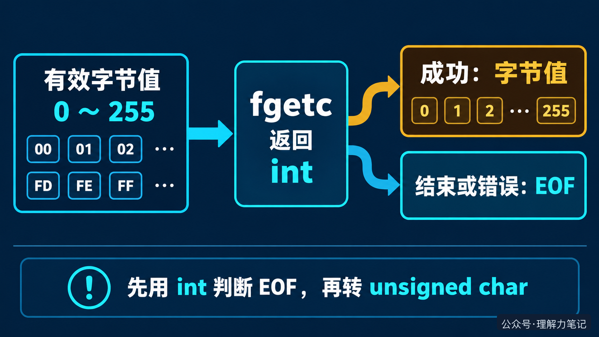

# 以 fgetc 的返回值，解释标准 I/O 的返回值

看到 `fgetc` 的声明，很多人会问：明明只读一个字节，为什么返回类型是 `int`？这个问题正好能说明标准 I/O 返回值的一条基本规律：**返回值不只传递数据，还要传递这次操作的状态。**

> **结论：**`fgetc` 成功时返回字节值，读到末尾或发生错误时返回 `EOF`。先用 `int` 保存并判断返回值，确认读到字节后，再按需转换成 `unsigned char`。

文中的实验运行在 macOS 14.8.8 x86_64、Apple clang 16.0.0，未在 Linux 主机实测；接口契约依据 C17 和 POSIX 文档核对。


## 先把 `fgetc` 用对

工程代码通常不需要先研究 `FILE` 的内部结构，只要遵守返回值契约：

```c
#include <stdio.h>

int copy_bytes(FILE *src, FILE *dst)
{
    int ch;
    while ((ch = fgetc(src)) != EOF) {
        /* 已排除 EOF，此时才能按需缩窄成字节 */
        unsigned char byte = (unsigned char)ch;
        if (fputc(byte, dst) == EOF)
            return -1; /* 输出失败也要向调用者报告 */
    }
    if (ferror(src))
        return -1;     /* 返回 EOF 也可能是读取错误 */
    return fflush(dst) == EOF ? -1 : 0;
}
```

`ch` 必须是 `int`。循环条件先判断 `EOF`，成功分支里的 `ch` 才是一个有效字节，此时转换成 `unsigned char` 是安全的。输入结束后还要检查 `ferror`，因为 `fgetc` 返回 `EOF` 既可能是正常结束，也可能是读取失败。

这段函数只借用调用者传入的两个流，不负责打开和关闭文件。它把输入流中的字节写到输出流，遇到输入或输出错误返回 `-1`，成功刷新输出后返回 `0`。完整程序已经用 `00` 到 `FF` 的 256 个字节和空输入做过往返验证。

## 为什么标准 I/O 的返回值是 `int`

在常见的 8 位字节环境里，一个字节有 256 种取值，范围是 `0` 到 `255`。`fgetc` 还需要表达一个额外结果：这次没有读到字节，返回 `EOF`。

可以把它看成取号窗口：窗口既要告诉你拿到的号码，也要告诉你“今天不再发号”或“窗口出故障”。如果只留下号码，调用者就无法判断后续该继续处理还是停止。

这里的对应关系很简单：字节值是窗口发出的号码，`EOF` 是窗口给出的状态，`int` 是能同时容纳两类结果的返回类型。类比只用于建立直觉，实际接口仍以 `fgetc` 的标准契约为准。



`fgetc` 成功时，标准要求把取得的字符按 `unsigned char` 的值转换为 `int` 返回；结束或错误时返回 `EOF`。因此在 8 位字节环境中，正常字节值与负的 `EOF` 可以区分开。

如果先把结果存进 `char`，信息可能在这一步丢失。下面的实验把一个真正的 `FF` 字节读两次，第一次是有效数据，第二次才是结束：

```c
#include <stdio.h>

int main(void)
{
    for (int i = 0; i < 2; ++i) { /* 只观察两次，不运行错误循环 */
        int ch = fgetc(stdin);   /* 先保留原始返回值 */
        if (ferror(stdin)) { perror("fgetc"); return 1; }
        char small = (char)ch;   /* 故意缩窄，观察丢失的信息 */
        if (printf("int=%d char=%d eof=%d\n",
                   ch, (int)small, feof(stdin) != 0) < 0) {
            perror("printf"); return 1;
        }
    }
    if (fflush(stdout) == EOF) { perror("fflush"); return 1; }
    return 0;
}
```

有符号 `char` 的实测输出是：

```text
int=255 char=-1 eof=0
int=-1 char=-1 eof=1
```

无符号 `char` 的实测输出是：

```text
int=255 char=255 eof=0
int=-1 char=255 eof=1
```

两种写法都会把“有效的 255”和“结束的 EOF”压缩成同一个 `char` 值，只是碰撞的数值不同。后面再把 `char` 转回 `int`，只是扩大已经丢失信息的结果，无法恢复原来的含义。

## `EOF` 到底代表什么

`EOF` 是返回值中的状态标记，不是文件里真的存在一个特殊字节。它只说明这次 `fgetc` 没有返回有效字节。判断 `ch == EOF` 后，调用 `ferror(fp)` 检查是否发生读取错误；没有错误时，再用 `feof(fp)` 确认是否正常到达文件末尾。

不要把 `EOF` 写成固定的 `-1`，应比较 `<stdio.h>` 提供的 `EOF` 宏。也不要用 `unsigned char` 直接接收尚未判断的返回值。正确顺序只有一句话：**先用 `int` 接收，先判断 `EOF`，再保存字节。**

本期没有继续展开用户态缓冲区、系统调用或内核对象，因为这些机制不会改变 `fgetc` 对调用者的返回值契约。理解标准 I/O，先把这个契约用对。

## 参考资料

- POSIX.1-2024：[fgetc](https://pubs.opengroup.org/onlinepubs/9799919799/functions/fgetc.html)、[ferror](https://pubs.opengroup.org/onlinepubs/9799919799/functions/ferror.html)：函数声明、返回值和流状态。
- glibc 2.40：[Character Input](https://sourceware.org/glibc/manual/2.40/html_node/Character-Input.html)、[EOF and Errors](https://sourceware.org/glibc/manual/2.40/html_node/EOF-and-Errors.html)：字符输入和 EOF 的使用说明。
- C17 整数转换规则：[SEI CERT INT31-C](https://wiki.sei.cmu.edu/confluence/display/c/INT31-C.+Ensure+that+integer+conversions+do+not+result+in+lost+or+misinterpreted+data)。

本文为公众号「理解力笔记」原创。转载请联系作者，并保留出处。
