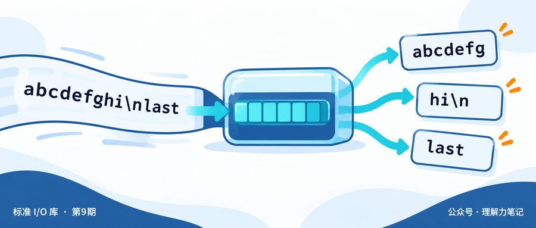
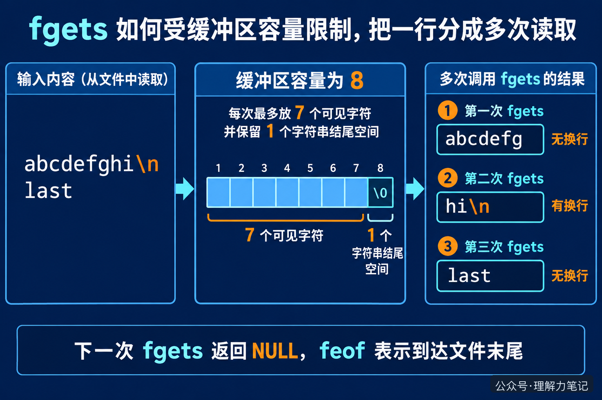

# fgets 读一行，为什么一次不一定读完整？

很多人第一次用 `fgets` 时，会把它理解成“读一整行”。于是缓冲区只有 8 个字节，却拿它去读几百字节的配置项，看到的结果就会和预期不一样：字符串没有出错，换行符却还没出现，下一次读取又从中间接上了。

> **结论：**`fgets` 每次最多读取 `n - 1` 个字符，并为字符串结尾的 `\0` 留出一个位置。它遇到换行就停止并保留换行符，遇到容量上限也会停止。所以一行很长时，必须多次调用 `fgets`，直到读到换行或确认到达文件末尾。

这篇文章的实验运行在 macOS 14.8.8、Apple clang 16.0.0，未在 Linux 主机实测；接口规则按 C17 和 POSIX 文档核对。



**这篇文章怎么读？** 先看 8 字节缓冲区的实际输出，再看为什么没有换行符时不能急着认为这一行已经结束。

## 先看一个很小的缓冲区

把一行文字想成一条很长的水流，`fgets` 手里的字符数组就是一个小杯子。杯子装满时，`fgets` 先把这一杯交给调用者；水流还没结束，下一次再接着舀。这个类比只说明“容量会造成分段”，实际判断仍然要看字符串里有没有换行符。

下面的程序把缓冲区设成 8 字节。它不打印整段文本，只报告每次拿到多少字符，以及这次是否拿到了换行，方便观察边界。

```c
#include <stdio.h>
#include <string.h>

int main(void)
{
    char buf[8];
    int part = 0;

    while (fgets(buf, sizeof buf, stdin) != NULL) {
        size_t n = strlen(buf);
        int newline = n > 0 && buf[n - 1] == '\n';
        if (printf("part=%d len=%zu newline=%d\n",
                   ++part, n, newline) < 0)
            return 1;
    }
    if (ferror(stdin)) {
        perror("fgets");
        return 1;
    }
    return printf("done parts=%d eof=%d\n", part, feof(stdin) != 0) < 0;
}
```

编译并输入一行很长、最后一行没有换行符的内容：

```sh
cc -std=c17 -Wall -Wextra -Wpedantic -Wconversion -Wshadow -O0 -g \
  fgets_probe.c -o fgets_probe
printf 'abcdefghi\nlast' | ./fgets_probe
```

实际输出：

```text
part=1 len=7 newline=0
part=2 len=3 newline=1
part=3 len=4 newline=0
done parts=3 eof=1
```

第一块是 `abcdefg`，正好占满 7 个字符，最后一个位置留给 `\0`，所以还没有读到换行。第二次才读到 `hi\n`。最后的 `last` 没有换行符，第三次返回它；再调用一次时，`fgets` 返回 `NULL`，`feof` 变成真。



## 判断一行是否真的结束

`fgets` 返回非空指针，只能说明这次读到了一段字符串，不能说明完整的一行已经结束。判断一段内容是否结束，要看缓冲区最后一个字符是不是 `\n`：

- 有 `\n`，这一行在本次调用中结束；
- 没有 `\n`，可能是行还没读完，也可能是文件最后一行本来就没有换行符；
- 只有下一次 `fgets` 返回 `NULL` 后，才能结合 `feof` 确认文件已经读完；如果 `ferror` 为真，则是读取失败。

因此，固定缓冲区读取长行时，调用者需要把没有换行的片段继续拼接起来。如果业务要求“一次得到完整的一行”，可以使用 POSIX 的 `getline`，让库负责扩容；这属于下一篇的主题，本篇只先把 `fgets` 的边界看清楚。

还有一个容易漏掉的细节：`fgets` 会把读到的换行符放进数组。后续代码如果不希望字符串末尾带换行，需要在确认读到换行后自行删除它；删除换行和判断一行是否读完，是两个不同动作。

## 参考资料

- POSIX.1-2024：[fgets](https://pubs.opengroup.org/onlinepubs/9799919799/functions/fgets.html)：读取上限、换行保留、返回值和流状态。
- GNU C Library：[Line Input](https://sourceware.org/glibc/manual/2.40/html_node/Line-Input.html)：固定缓冲区读取与 `getline` 的区别。

本文为公众号「理解力笔记」原创。转载请联系作者，并保留出处。
