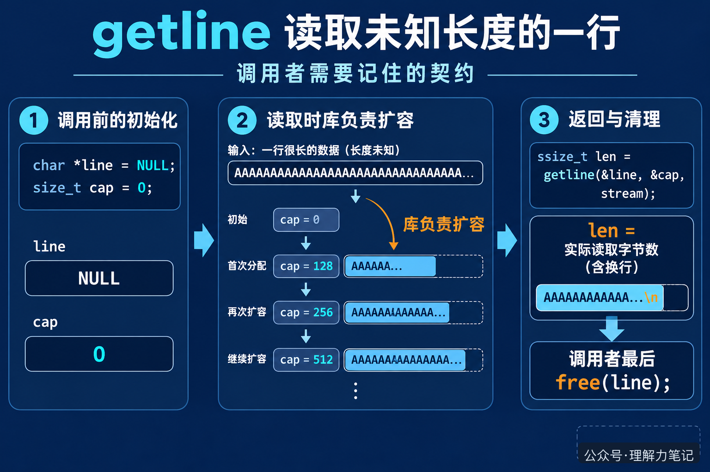

# getline 读长行，为什么不用自己猜缓冲区大小？

`fgets` 需要调用者先准备一个固定大小的字符数组。数组太小，一行就会被拆成几段；数组开得很大，又只能靠猜。配置文件、日志和用户输入的长度往往事先不知道，这个猜测很容易变成边界 bug。

POSIX 提供了 `getline`。它会在缓冲区不够时扩大缓冲区，把这一行放进去，再把实际读取的字节数返回给调用者。代码因此可以从“我应该分配多大的数组”转向“这一行实际有多长”。

> **先记住一句话：**`getline` 成功时返回读到的字节数，换行符算在里面，结尾的 `\0` 不算；读到文件末尾且没有读到任何字节，或发生错误时，返回 `-1`。

这篇文章的实验运行在 macOS 14.8.8、Apple clang 16.0.0，未在 Linux 主机实测。`getline` 是 POSIX 接口，不属于 ISO C 标准；需要在只承诺 ISO C 的环境中移植时，不能默认它一定存在。


**这篇文章怎么读？**先看一段完整实验，再把 `line`、`cap` 和返回值对上，最后看循环结束后为什么还要 `free(line)`。

## 先把三个参数看懂

最常见的初始化方式只有两行：

```c
char *line = NULL;
size_t cap = 0;
```

然后把它们的地址交给 `getline`：

```c
ssize_t len = getline(&line, &cap, stdin);
```

这里有三个角色。`line` 指向存放字符的缓冲区，`cap` 记录这块缓冲区当前有多大，`len` 接收本次实际读了多少字节。

第一次调用时，`line` 是空指针，`cap` 是 0。库会分配一块能用的空间，把地址写回 `line`，并把空间大小写回 `cap`。如果下一行更长，库会用类似 `realloc` 的方式扩容，必要时更新 `line`，再继续读取。把 `line` 和 `cap` 保留在循环外，后面的调用就能复用已经分配的空间。

这像搬家时准备一个可以加长的箱子：箱子不够大时由搬家公司换成更大的箱子，箱子的地址可能变了，所以搬家公司要把新地址交还给你。你只需要一直使用最新的 `line`，不要保存旧指针。

这个类比只用来说明“空间会变大，地址可能变化”。真实程序中，内存仍然由 `malloc`、`realloc` 和 `free` 的规则管理，不能把 `line` 当成永远不变的数组名。



## 返回值为什么用 ssize_t

把 `getline` 的返回值直接当作字符串长度，容易漏掉两个细节。

第一，成功返回的是本次写入的字节数，包含换行符，但不包含最后自动补上的 `\0`。例如输入 `short\n`，返回值是 6，`line` 中的内容是 `short\n\0`。如果最后一行没有换行符，返回值就只统计实际字符。

第二，失败或“已经到文件末尾且没有读到字节”时，返回 `-1`。所以返回值不能放进 `size_t` 再和 `-1` 比较，应该使用能够表示负数的 `ssize_t`。这也是示例里同时包含 `<sys/types.h>` 的原因。

有了返回值，程序不必再调用 `strlen(line)` 猜长度。它还能分辨输入中的空字符：`strlen` 会把第一个 `\0` 当成字符串结尾，而 `getline` 返回的是从流中实际读出的字节数。

## 一次实验看清扩容和换行

下面的程序只打印观察结果，不把整行重新打印一遍。`cap` 用来观察缓冲区是否扩大，`newline` 用来判断本次读取是否拿到了换行符。

```c
#define _POSIX_C_SOURCE 200809L
#include <stdio.h>
#include <stdlib.h>
#include <sys/types.h>

int main(void)
{
    char *line = NULL;
    size_t cap = 0;
    ssize_t len;
    int count = 0;

    while ((len = getline(&line, &cap, stdin)) != -1) {
        int newline = len > 0 && line[len - 1] == '\n';
        if (printf("line=%d len=%zd cap=%zu newline=%d\n",
                   ++count, len, cap, newline) < 0) {
            free(line);
            return 1;
        }
    }
    if (ferror(stdin)) {
        perror("getline");
        free(line);
        return 1;
    }
    if (printf("done lines=%d eof=%d\n", count, feof(stdin) != 0) < 0) {
        free(line);
        return 1;
    }
    free(line);
    return 0;
}
```

输入三行，第二行故意写得更长，最后一行不加换行符：

```text
short
this-is-a-long-line-without-a-fixed-limit
last
```

程序输出：

```text
line=1 len=6 cap=8 newline=1
line=2 len=42 cap=64 newline=1
line=3 len=4 cap=64 newline=0
done lines=3 eof=1
```

第一行读完后，这次运行显示的缓冲区容量是 8。第二行需要更多空间，容量扩大到 64。第三行继续使用这块空间，所以容量没有缩回去。`cap` 的具体数值由实现决定，程序不能把 8 或 64 当成接口承诺。`len=4` 说明最后一行有 4 个字符，`newline=0` 说明输入中没有换行符。循环下一次调用时返回 `-1`，此时 `feof(stdin)` 为真。

## 用完以后谁负责释放

`getline` 负责分配和扩大缓冲区，调用者负责释放。无论循环是因为 EOF 结束，还是因为发生错误结束，只要 `line` 曾经由 `getline` 分配过，最后都应该执行：

```c
free(line);
```

即使一次字节也没读到，某些实现也可能已经分配了缓冲区，所以不要只在“成功读到至少一行”时释放。示例把 `free(line)` 放在每个提前返回的错误路径和正常结束路径上，就是为了让所有出口都遵守同一个所有权规则。

如果需要保存一行到下一次循环之后，应该复制它的内容，而不是把 `line` 指针交给长期数据结构。下一次 `getline` 可能复用并改写这块内存，扩容时还可能让指针失效。

`getline` 解决的是“行有多长”的问题，不会替你决定这一行是否符合业务格式，也不会替你去掉换行符。读到完整一行后，是否删除 `\n`、是否限制最大长度，仍然是调用者的选择。

## 参考资料

- POSIX.1-2024：[getline](https://pubs.opengroup.org/onlinepubs/9799919799/functions/getline.html)：参数约束、自动分配与扩容、返回值和错误条件。
- GNU C Library：[Line Input](https://sourceware.org/glibc/manual/2.40/html_node/Line-Input.html)：`getline` 的缓冲区使用方式和返回值说明。

