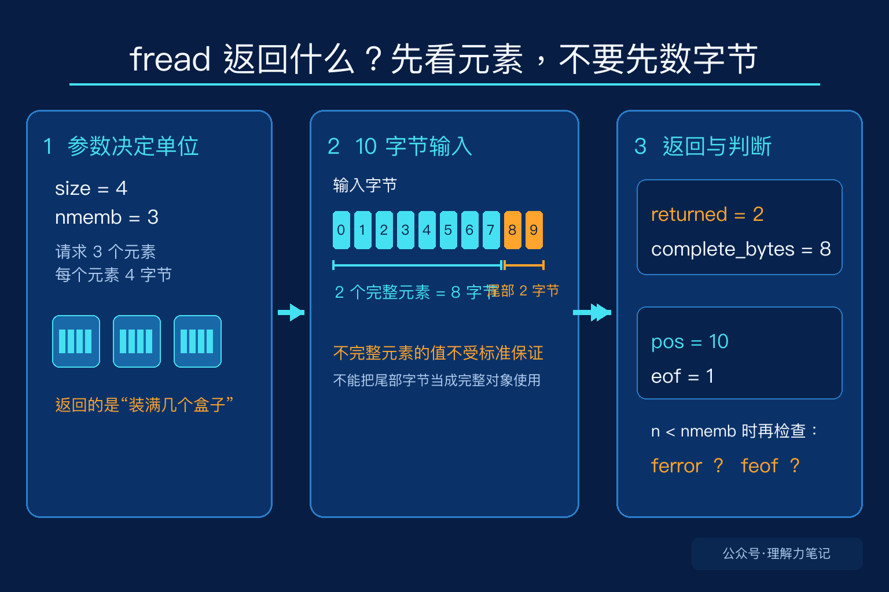

# fread 返回 2，到底读了几个字节？

看到 `fread` 的返回值时，最容易产生一个误会：把它当成“读了多少字节”。其实它返回的是**成功读取的元素数**。元素的大小由第二个参数 `size` 决定，元素的数量由第三个参数 `nmemb` 决定。

所以这句代码：

```c
size_t n = fread(buf, 4, 3, fp);
```

表达的是“最多读取 3 个元素，每个元素 4 字节”。如果 `n` 等于 2，能确定的是有 2 个完整元素被成功读取，也就是至少 8 个字节属于完整元素。`n` 本身不是字节数。

> **先记住一句话：**`fread` 返回元素数，不返回字节数。`n < nmemb` 时，要再检查 `ferror` 和 `feof`，才能知道是读取错误，还是已经到了文件末尾。

这篇文章的实验运行在 macOS 14.8.8、Apple clang 16.0.0，未在 Linux 主机实测。`fread` 是 ISO C 标准接口，POSIX 也对它补充了流状态和部分读取的说明。


**这篇文章怎么读？**先看同一份 10 字节输入在两种参数下的结果，再把“元素数”和“字节数”分开，最后看短读应该怎样判断原因。

## `size` 和 `nmemb` 各自表示什么

把输入想成一堆积木，把一个元素想成一个固定大小的盒子。`size=4`、`nmemb=3` 就是准备 3 个盒子，每个盒子能装 4 个字节。`fread` 返回的是装满了几个盒子，而不是搬过来的积木总数。

这个类比只用来说明返回值的单位。真正的程序里，元素可以是结构体、整数或任意对象，`fread` 按字节复制对象表示，不会理解结构体字段，也不会替你做字节序转换。

如果读取字节流，通常把 `size` 设为 1：

```c
size_t bytes = fread(buf, 1, sizeof buf, fp);
```

这时一个元素就是一个字节，返回值恰好可以当作字节数。也正因为如此，很多代码看起来像是在用 `fread` 返回字节数，实际上只是选择了 `size=1`。



## 10 个字节，为什么返回 2

实验先写入 10 个字节，再用两组参数从头读取。第一组请求 3 个 4 字节元素，第二组请求 10 个 1 字节元素。

```c
#include <stdio.h>

int main(void)
{
    unsigned char src[10] = {0, 1, 2, 3, 4, 5, 6, 7, 8, 9};
    unsigned char buf[12] = {0};
    FILE *fp = tmpfile();
    if (fp == NULL)
        return 1;
    if (fwrite(src, 1, sizeof src, fp) != sizeof src) {
        fclose(fp);
        return 1;
    }

    rewind(fp);
    size_t n = fread(buf, 4, 3, fp);
    long pos = ftell(fp);
    if (pos < 0 || printf("size=4 nmemb=3 returned=%zu complete_bytes=%zu pos=%ld eof=%d\n",
                          n, n * 4, pos, feof(fp) != 0) < 0) {
        fclose(fp);
        return 1;
    }

    rewind(fp);
    n = fread(buf, 1, sizeof src, fp);
    pos = ftell(fp);
    if (pos < 0 || printf("size=1 nmemb=10 returned=%zu complete_bytes=%zu pos=%ld eof=%d\n",
                          n, n, pos, feof(fp) != 0) < 0) {
        fclose(fp);
        return 1;
    }

    fclose(fp);
    return 0;
}
```

输出如下：

```text
size=4 nmemb=3 returned=2 complete_bytes=8 pos=10 eof=1
size=1 nmemb=10 returned=10 complete_bytes=10 pos=10 eof=0
```

第一轮请求 12 个字节，但输入只有 10 个。前 8 个字节组成了 2 个完整元素，所以返回 2。实验中的文件位置已经到了 10，说明剩下的 2 个字节也被读过了，只是它们不足以组成第三个完整元素，不能算进返回值。

这里还有一个容易被忽略的边界：标准不保证“不完整元素”在目标对象中的值。不要因为某次运行看到了那 2 个字节，就把它们当成一个可以直接使用的结构体或整数。需要可靠处理尾部数据时，应该把元素大小设为 1，按字节读取，或者先设计好自己的拼接逻辑。

第二轮把每个元素设成 1 字节，因此返回 10 就是读到的字节数。它刚好读完请求的数量，函数没有因为这次调用遇到 EOF，所以 `feof` 仍然是 0。EOF 是在继续读取时才会被设置，不是“位置刚好到了文件末尾”就立刻设置。

## 短读以后先查什么

`fread` 返回值小于 `nmemb`，原因只有两类：遇到了 EOF，或者发生了读取错误。代码不能只写成“少读了就是文件结束”，也不能只看 `feof`。

读取一批结构体时，可以这样处理：

```c
size_t got = fread(records, sizeof *records, count, fp);
if (got < count) {
    if (ferror(fp))
        perror("fread");
    else if (feof(fp))
        fprintf(stderr, "文件提前结束\n");
}
```

`got` 表示完整读入的元素数。若业务要求必须得到 `count` 个完整元素，就应该把 `got < count` 当成失败或不完整输入，而不是继续使用数组中没有读满的部分。

还要记住两个边界：`size` 或 `nmemb` 为 0 时，`fread` 返回 0，不读取数据；如果一次调用已经返回了完整的 `nmemb` 个元素，并不能据此判断后面是否还有数据，只有下一次读取才会暴露 EOF。

`fread` 的接口并不复杂，容易混淆的是返回值的单位。先问自己“我把什么当成一个元素”，再解释返回值，短读和文件末尾的行为就不会混在一起。

## 参考资料

- ISO C17 草案：[7.21.8.1 The fread function](https://www.sigbus.info/n1570#7.21.8.1)：`fread` 的参数、返回值和部分元素规则。
- POSIX.1-2024：[fread](https://pubs.opengroup.org/onlinepubs/9799919799/functions/fread.html)：元素计数、文件位置和 EOF、错误状态。
- GNU C Library：[Block Input/Output](https://sourceware.org/glibc/manual/2.40/html_node/Block-Input_002fOutput.html)：块读取接口的使用说明。
