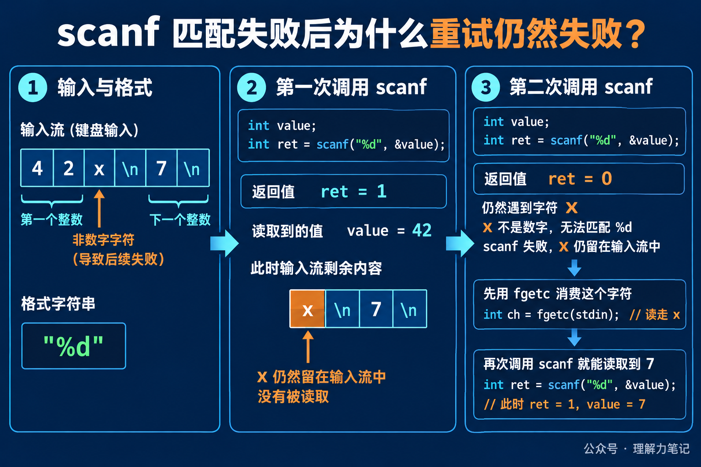

# scanf 读入失败后，为什么重试仍会卡住？

用户输入 `42x`，程序用 `scanf("%d", &value)` 读取整数。第一次调用能拿到 42，接着读取就失败了。很多代码会在失败后直接再调用一次 `scanf`，结果程序像卡住了一样，还是失败。

原因不在于 `scanf` 没有继续工作，而在于那个 `x` 还留在输入流里。`%d` 不接受它，匹配失败会返回 0，并把冲突字符留在流中。下一次调用面对的仍然是同一个 `x`，自然会得到同样的结果。

> **先记住一句话：**`scanf` 返回 0 是匹配失败，不是“什么也没发生”。失败字符通常仍在流中，重试之前必须先消费它，或者放弃这次 token，改为按行读取再解析。

这篇文章的实验运行在 macOS 14.8.8、Apple clang 16.0.0，未在 Linux 主机实测。`scanf` 是 ISO C 标准接口；示例用 `fscanf` 读取临时流，行为与从 `stdin` 调用 `scanf` 的匹配规则相同。


**这篇文章怎么读？**先看 `42x\n7\n` 如何让第二次 `%d` 返回 0，再看失败字符怎样被消费，最后区分匹配失败和真正的 EOF。

## 返回 0 到底表示什么

`scanf` 家族的返回值是成功匹配并完成赋值的项目数。读入一个整数成功，返回 1；第一个转换就遇到不符合格式的字符，返回 0；在第一次转换前就遇到 EOF，返回 `EOF`，也就是一个负值。

这三个结果不能混为一谈。返回 0 说明输入还在，但它不符合当前格式；返回 `EOF` 说明没有可用输入，或者读流时发生了输入错误。若返回 `EOF`，还要结合 `feof` 和 `ferror` 判断是文件结束还是读取错误。

把输入流想成传送带，`%d` 是只接收数字的分拣口。传送带送来 `42` 时，分拣口取走它；下一个物品是 `x` 时，分拣口拒收，但物品仍停在入口。再次启动同一个分拣口，看到的还是 `x`。这个类比只说明“冲突字符没有自动消失”，实际程序仍要根据返回值决定如何恢复。



## 一段输入重现整个过程

下面的程序把 `42x\n7\n` 写进临时流，然后连续执行两次 `%d`。第二次失败后，用 `fgetc` 消费掉冲突字符，再进行第三次转换。

```c
#include <stdio.h>

int main(void)
{
    FILE *fp = tmpfile();
    int value = -1;
    int first;
    int second;
    int after_second;
    int blocked;
    int recovered;

    if (fp == NULL || fputs("42x\n7\n", fp) == EOF)
        return 1;
    rewind(fp);

    first = fscanf(fp, "%d", &value);
    second = fscanf(fp, "%d", &value);
    after_second = value;
    blocked = fgetc(fp);
    recovered = fscanf(fp, "%d", &value);
    if (printf("first=%d value=42\nsecond=%d value=%d\nblocked=%c\nrecovered=%d value=%d\n",
               first, second, after_second, blocked, recovered, value) < 0) {
        fclose(fp);
        return 1;
    }
    if (fclose(fp) == EOF)
        return 1;
    return 0;
}
```

输出如下：

```text
first=1 value=42
second=0 value=42
blocked=x
recovered=1 value=7
```

第一次转换成功，`value` 得到 42。第二次返回 0，`value` 仍然是 42，因为这次转换没有完成赋值；`x` 也没有被 `%d` 消费。程序随后用 `fgetc` 取走 `x`，第三次转换遇到换行后跳过空白，成功读到 7。

这里的 `fgetc` 不是 `scanf` 的自动修复机制，而是调用者根据已知输入格式做的恢复动作。如果冲突内容可能是一整段字符串，只取走一个字符就不够，程序还要继续消费到换行，或者直接丢弃当前行。

## 工程代码怎样避免卡住

最小的判断框架是先保存返回值，再决定下一步：

```c
int rc = scanf("%d", &value);
if (rc == 1) {
    /* 使用 value */
} else if (rc == 0) {
    /* 消费坏 token，或丢弃当前行 */
} else {
    /* 检查 feof(stdin) 和 ferror(stdin) */
}
```

这段代码里，`rc == 0` 分支不能留空。对于交互式输入，更稳妥的做法通常是先用 `fgets` 读完整行，再用 `strtol`、`strtod` 等函数解析，这样一次失败只影响当前行，不会让未消费的字符反复触发同一个转换。

格式串里的空白也容易造成误解。`"%d %d"` 中的空格会跳过任意数量的空白，但不会跳过 `x` 这样的非空白冲突字符；它解决不了匹配失败后的输入恢复。

`scanf` 适合格式非常稳定、输入来源可信的场景。面对用户随时可能输入字母、空行或多余字符的情况，按行读取再解析，通常更容易给出明确的错误提示，也更容易控制一次失败消耗多少输入。

## 参考资料

- ISO C17 草案：[7.21.6.2 The fscanf function](https://www.sigbus.info/n1570#7.21.6.2)：转换规则、匹配失败和返回值。
- POSIX.1-2024：[fscanf](https://pubs.opengroup.org/onlinepubs/9799919799/functions/fscanf.html)：输入失败、匹配失败和冲突字符保留规则。
- GNU C Library：[Formatted Input](https://sourceware.org/glibc/manual/2.40/html_node/Formatted-Input.html)：格式化输入的使用说明。
