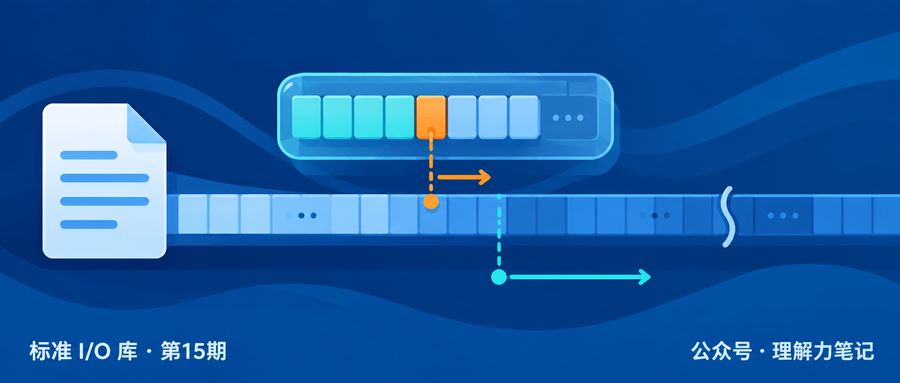
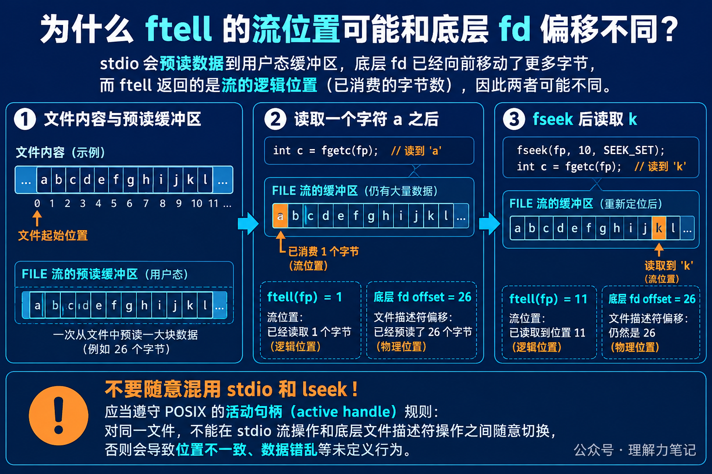

# ftell 返回 1，底层 fd 为什么已经到 26？

程序只用 `fgetc` 读了一个字符，`ftell(fp)` 返回 1，这很直观。可是如果通过 POSIX 的 `fileno` 和 `lseek` 去观察同一个文件描述符，可能会看到偏移量已经到了文件末尾。

这不是两个函数算错了，而是它们观察的层次不同。`ftell` 关心 `FILE *` 这条标准 I/O 流下一次应该从哪里继续读；底层 fd 的偏移量还要受到流内部预读缓冲的影响。

> **先记住一句话：**`ftell` 返回的是流的位置指示器。标准 I/O 可能一次从内核多取一些数据放进用户态缓冲区，所以底层 fd 的偏移量可以领先于 `ftell`。

这篇文章的实验运行在 macOS 14.8.8、Apple clang 16.0.0，未在 Linux 主机实测。实验使用 `tmpfile` 创建普通可定位文件；`fileno` 和 `lseek` 是 POSIX 辅助接口，只用于观察底层偏移，不是日常混用标准 I/O 和系统调用的推荐写法。



**这篇文章怎么读？**先看只读一个字符时的两个位置，再看 `fseek` 如何让流位置回到明确的字节偏移，最后说明为什么不能随意混用 `fread`、`read` 和 `lseek`。

## `ftell` 说的是流的位置

在普通二进制文件上，`ftell` 成功时返回流的位置指示器，通常可以理解为从文件开头算起的字节位置。读完一个字符后，流的逻辑位置自然是 1。

但 `FILE *` 不一定每次只向内核请求一个字节。为了减少系统调用次数，库可能一次读入一整块数据。对程序来说，缓冲区里已经有一批“待消费字符”；对内核维护的文件描述符来说，整批数据可能已经被读走。

把它想成图书馆的借阅台：你只拿走了第 1 页，借阅员却提前把后面的 25 页也搬到柜台。你手里的阅读位置是第 2 页，仓库登记的取书位置已经到了第 27 页。这个类比只说明“逻辑消费位置”和“底层取数据位置”可以不同，实际偏移仍由流实现和内核共同维护。



## 一次实验看见预读

程序向临时文件写入 26 个字母，回到开头后只调用一次 `fgetc`。`lseek(fileno(fp), 0, SEEK_CUR)` 只用于观察底层 fd 当前偏移。

```c
#define _POSIX_C_SOURCE 200809L
#include <stdio.h>
#include <unistd.h>

int main(void)
{
    const char text[] = "abcdefghijklmnopqrstuvwxyz";
    FILE *fp = tmpfile();
    if (fp == NULL || fwrite(text, 1, sizeof text - 1, fp) != sizeof text - 1)
        return 1;
    fflush(fp);
    rewind(fp);

    int ch = fgetc(fp);
    long logical = ftell(fp);
    off_t raw = lseek(fileno(fp), 0, SEEK_CUR);
    if (printf("read=%c ftell=%ld fd_offset=%lld\n",
               ch, logical, (long long)raw) < 0)
        return 1;

    if (fseek(fp, 10, SEEK_SET) != 0)
        return 1;
    ch = fgetc(fp);
    logical = ftell(fp);
    raw = lseek(fileno(fp), 0, SEEK_CUR);
    if (printf("after_fseek=%c ftell=%ld fd_offset=%lld\n",
               ch, logical, (long long)raw) < 0)
        return 1;

    return fclose(fp) == EOF;
}
```

输出如下：

```text
read=a ftell=1 fd_offset=26
after_fseek=k ftell=11 fd_offset=26
```

第一次只消费了 `a`，所以 `ftell` 是 1。库的预读把 26 个字节都取到了用户态，底层 fd 的偏移因此显示为 26。这个数值取决于实现的缓冲策略，不能写进业务逻辑当成固定规律。

接着调用 `fseek(fp, 10, SEEK_SET)`，流的位置被设置到第 10 个字节。下一次 `fgetc` 读到 `k`，所以 `ftell` 变成 11。为了满足这次读取，库又可能从第 10 个字节开始预读到文件末尾，底层 fd 于是再次显示 26。

## 普通代码应该怎样定位

只使用标准 I/O 流时，用 `ftell` 获取位置，用 `fseek` 改变位置：

```c
long pos = ftell(fp);
if (pos < 0)
    return 1;
if (fseek(fp, 0, SEEK_SET) != 0)
    return 1;
```

如果文件可能很大，POSIX 环境可以考虑 `ftello` 和 `fseeko`，避免 `long` 表示范围不足。对于管道、终端等不可定位的流，`ftell` 和 `fseek` 可能失败，不能把所有 `FILE *` 都当成普通磁盘文件。

`fileno` 把流关联的 fd 暴露出来，`lseek` 则直接改变底层文件偏移。两套接口共享同一个打开文件描述，但不共享同一层缓冲状态。需要在同一对象上混用它们时，必须遵守 POSIX 的活动句柄协调规则；否则预读数据、写缓冲和文件位置可能互相覆盖。日常代码里，最简单的做法是选定一套接口完成一段操作。

`ftell` 解决的是“这条流认为自己读到哪里”的问题，不是“内核最近一次系统调用把偏移推进到了哪里”。把这两个位置分开看，预读和定位行为就不会显得矛盾。

## 参考资料

- ISO C17 草案：[7.21.9.4 The ftell function](https://www.sigbus.info/n1570#7.21.9.4)：流位置指示器和失败返回。
- POSIX.1-2024：[ftell](https://pubs.opengroup.org/onlinepubs/9799919799/functions/ftell.html)：位置单位和错误条件。
- POSIX.1-2024：[lseek](https://pubs.opengroup.org/onlinepubs/9799919799/functions/lseek.html)：底层文件偏移。
- GNU C Library：[File Positioning](https://sourceware.org/glibc/manual/2.40/html_node/File-Positioning.html)：`ftell`、`ftello` 和 `fseek` 的使用说明。
