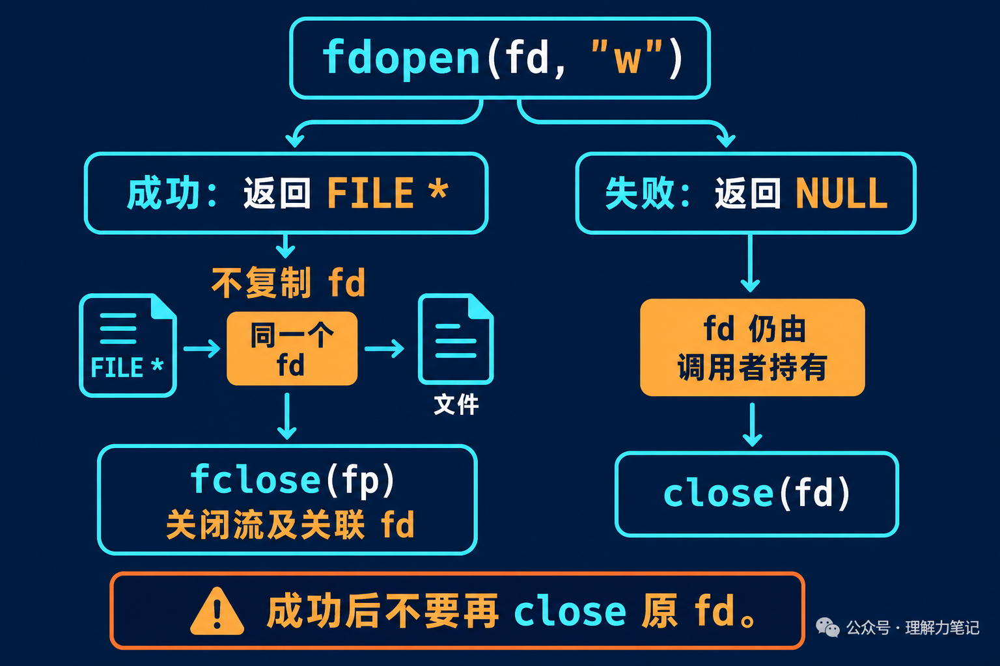

# fdopen 之后，fd 到底该由谁关闭？

用 `open` 拿到了一个 fd，后面的代码却希望用 `fprintf` 写日志，或者用 `fgets` 读文本。这时可以调用 `fdopen`，给已有的文件描述符关联一条标准 I/O 流。

麻烦通常出现在收尾：既然手里有 `fd`，又有 `FILE *fp`，是不是两个都要关？

**成功调用 `fdopen` 后，最后用 `fclose(fp)` 收尾。它会关闭关联的 fd，不要再补一次 `close(fd)`。如果 `fdopen` 返回 `NULL`，fd 仍由调用者负责。**

`fdopen` 是 POSIX 接口，不属于 ISO C 标准。本篇实验运行于 macOS 14.8.8、Apple clang 16.0.0，未在 Linux 主机实测；接口规则按 POSIX 和 Linux 手册核对。


**这篇文章怎么读？**先看 fd 有没有被复制，再看模式该怎么选，最后给出一段成功、失败都能正确收尾的真实 C 函数。

## 多了一层接口，没有多一个 fd

`fdopen` 建立 `FILE` 流的管理状态，让代码可以使用标准 I/O 的缓冲、格式化和错误指示器。底层使用的仍是传进去的 fd，既没有重新按路径打开文件，也没有替你执行 `dup`。

可以把 fd 想成一把仓库钥匙，`fdopen` 则是把钥匙交给代管柜台。以后通过柜台办事，撤销代管时由柜台交还钥匙。如果代管没有办成，钥匙还在你手里。这个类比只说明关闭责任，实际程序里没有额外复制一把“备用钥匙”。



实验先用 `mkstemp` 创建临时文件，写入 `abc`，定位回开头。下面两段是同一个完整程序 `fdopen_probe.c` 的连续片段，准备文件的部分省略：

```c
FILE *fp = fdopen(fd, "r+");         // 包装已有 fd，没有复制
if (fp == NULL) { close(fd); return 1; }
int same = fileno(fp) == fd;
int first = fgetc(fp);
if (fclose(fp) == EOF) return 1;     // 此处同时关闭关联 fd
```

成功关闭后，程序立即用 `fcntl` 查询旧 fd，期间没有打开新文件，避免号码被重新分配而干扰观察：

```c
errno = 0;
int invalid = fcntl(fd, F_GETFD) == -1 && errno == EBADF;
return printf("same_fd=%d first=%c\nclosed_fd=%d\n",
              same, first, invalid) < 0;
```

实际输出：

```text
same_fd=1 first=a
closed_fd=1
```

`same_fd=1` 表明流关联的就是原 fd；`closed_fd=1` 表明关闭流后，旧 fd 已经无效。这个查询只用于实验，业务代码不需要照做。

提前 `close(fd)` 同样有问题：流还存在，底层描述符却已经失效；如果数字被后续 `open` 重用，流再执行读写或关闭，甚至可能碰到另一个文件。调用成功后，把读写和关闭都交给流，责任就清楚了。

## 模式要兼容，"w" 不会重新清空文件

`fdopen` 的模式描述的是这条流准备怎样使用已有 fd，不能替原 fd 增加访问权限。

| 原 fd 的打开方式 | 兼容的常用流模式 |
| --- | --- |
| `O_RDONLY` | `"r"` |
| `O_WRONLY` | `"w"` |
| `O_RDWR` | `"r"`、`"w"`、`"r+"` |

这张表只列读写权限的常见组合。不能拿只读 fd 包装成可写流，再期待它能正常写入。

还有一个与 `fopen` 不同的地方：**`fdopen(fd, "w")` 不会截断文件，也不会自动回到文件开头。**新流的位置承接已有 fd 的偏移。

配套实验先写入 `abc` 并定位到开头，再用下节函数包装为 `"w"` 流，只写入一个 `X`。关闭后重新打开文件，读回的是：

```text
content=Xbc closed_fd=1
```

`X` 覆盖了第一个字节，`bc` 还在。如果业务需要清空文件，应在最初打开时明确使用 `O_TRUNC` 等操作，不能指望 `fdopen` 替你清空。

## 工程里把关闭责任写进函数约定

下面的 `save_fd` 接收一个有效、可写的 fd，在当前位置写入文本。它采用一个简单约定：**函数接管 fd，无论成功失败，调用者返回后都不再使用它。**

完整实现是 `save_fd.c`，包含 `<errno.h>`、`<stdio.h>` 和 `<unistd.h>`，并在头文件前定义 `_POSIX_C_SOURCE 200809L`。为方便阅读，函数拆成两段，按顺序连接就是完整函数。

第一段处理包装失败。保存 `errno`，避免清理动作覆盖原来的错误：

```c
int save_fd(int fd, const char *text)
{
    FILE *fp = fdopen(fd, "w");
    if (fp == NULL) {
        int saved = errno;
        close(fd);                     // 包装失败，仍由本函数清理 fd
        errno = saved;
        return -1;
    }
```

包装成功后只通过流写入，用 `fclose` 完成最后的刷新和关闭。即使 `fputs` 已经失败，也要执行这次清理：

```c
    int failed = fputs(text, fp) == EOF;
    int saved = errno;
    if (fclose(fp) == EOF) {            // 负责刷新和关闭；失败也不再 close(fd)
        if (!failed) saved = errno;
        failed = 1;
    }
    if (failed) errno = saved;
    return failed ? -1 : 0;
}
```

函数返回 0 表示写入和关闭均未报告错误，返回 -1 时通过 `errno` 报告原因。它不承诺持久化，文件落盘要求仍要单独处理。

配套测试验证了普通文件写入、设备写入和关闭后的 fd 状态。另一个测试构建把 `fdopen` 替换为返回 `ENOMEM` 的测试函数，确认失败分支也关闭 fd，并保留原错误。这是故障注入测试，不是假装真的耗尽了系统内存。

如果原 fd 必须继续由别处持有，可以先 `dup`，再把复制得到的 fd 交给 `fdopen`。但两个描述符仍共享打开文件描述和文件偏移；`dup` 只分开了描述符的关闭责任，没有创造独立的读写位置，两边操作仍要协调。

## 参考资料

- POSIX.1-2024：[fdopen](https://pubs.opengroup.org/onlinepubs/9799919799/functions/fdopen.html)，模式兼容、初始位置和不截断规则。
- Linux man-pages：[fopen / fdopen](https://man7.org/linux/man-pages/man3/fdopen.3.html)，明确说明 fd 不被复制，关闭流会关闭关联 fd。
- POSIX.1-2024：[fclose](https://pubs.opengroup.org/onlinepubs/9799919799/functions/fclose.html)，刷新、关闭及流解除关联规则。
