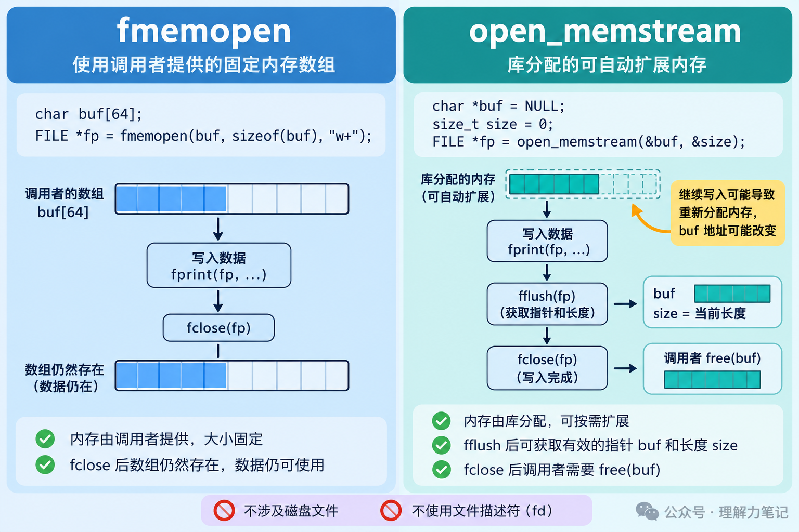

# 内存流：让 fprintf 直接写进字符串

假设项目里已经有一个生成报告的函数，参数是 `FILE *out`，内部用 `fprintf` 输出。以前把文件流传进去就能保存报告，现在调用者想直接拿到一段字符串。

不用把函数里的每一处输出都改成字符串拼接。**给它传一个内存流，原来的标准 I/O 输出就会写进内存。**

本篇介绍两个 POSIX 接口：已有数组、容量固定时用 `fmemopen`；希望库按需分配并扩大输出空间时用 `open_memstream`。它们不属于 ISO C 标准，移植时需要确认平台支持。

实验运行于 macOS 14.8.8、Apple clang 16.0.0，未在 Linux 主机实测。


**这篇文章怎么读？**先分清两种缓冲区由谁提供，再看动态流什么时候能取结果，最后把已有输出函数接到固定数组上。

## FILE 接口不变，输出目标换成内存

`FILE *` 是流接口，不意味着背后一定有磁盘文件。内存流仍然接受 `fprintf`、`fputs` 等调用，库把输出送到关联的内存区域。

这有点像报表软件里的“打印”和“预览”：排版逻辑相同，输出目标不同。内存流接住了原本要写入文件的内容，报表函数因此可以继续用。不过，装这些内容的内存有多大、最后由谁释放，还得分清楚。

| 接口 | 空间从哪里来 | 关闭后怎样处理 |
| --- | --- | --- |
| `fmemopen(buf, cap, "w")` | 调用者提供固定数组 | 数组仍归调用者，流不释放它 |
| `open_memstream(&text, &len)` | 库动态分配并扩容 | 成功关闭后，调用者 `free(text)` |

本篇的 `fmemopen` 都传入现成数组。接口也支持传入 `NULL` 让库分配固定容量的内部空间，那种空间在关闭时自动释放，不能套用表中“调用者数组”的归属规则。



图中展示的是顺序写入且刷新、关闭均成功的路径；调用失败时不能继续使用结果。图里的数组容量仅作示意。

## open_memstream：先刷新，再取结果

动态流需要两个由调用者持有的变量：一个接收缓冲区地址，一个接收长度。它们必须在流存续期间一直有效。以下是 `memory_probe.c` 中的连续片段，头文件和固定数组实验省略：

```c
char *text = NULL;
size_t len = 0;
FILE *fp = open_memstream(&text, &len);
if (fp == NULL) return 1;
int failed = 1;
```

接下来写入 `hello`，成功刷新后再打印结果，然后继续写入 `, C`：

```c
if (fputs("hello", fp) == EOF || fflush(fp) == EOF)
    goto finish;
if (printf("flushed len=%zu text=%s\n", len, text) < 0)
    goto finish;
if (fputs(", C", fp) == EOF)
    goto finish;
failed = 0;
```

最后关闭流，取最终结果并释放：

```c
finish:
    if (fclose(fp) == EOF) return 1; // 本实验进程直接结束，不再使用失败结果
    if (!failed && printf("closed len=%zu text=%s\n", len, text) < 0)
        failed = 1;
    free(text);                     // 成功关闭后，结果缓冲区由调用者释放
    return failed;
```

实际输出中的这两行是：

```text
flushed len=5 text=hello
closed len=8 text=hello, C
```

成功的 `fflush` 或 `fclose` 会更新 `text` 和 `len`。本例一直顺序写入，所以 `len` 就是已生成的内容长度，不包括末尾的 `\0`。如果中途定位回前面，刷新后报告的长度还与当前位置有关，不能把这个例子直接套到任意随机写入上。

刷新后拿到的是当时的结果。继续写入可能触发扩容，旧地址可能失效；再次查看内容前，应重新成功刷新，并使用最新的 `text` 和 `len`。即使地址偶然没变，也不能把旧快照当成接口保证。

这里 `fflush` 的作用是让内存结果可获取，不涉及磁盘落盘。内存流也没有可供 `fsync` 使用的底层文件描述符。

## fmemopen：数组固定，容量仍要检查

如果调用者已经有一个数组，可以把数组直接关联到流。数组必须一直有效，直到流关闭；不能在流还开着时让局部数组离开作用域。

下面是已有的报表函数，它只关心输出格式：

```c
int render_report(FILE *out, size_t count)
{
    return fprintf(out, "count=%zu\n", count);
}
```

传普通文件流时，报告写入文件；要写进数组，就加一层适配。以下两段连起来是 `report.c` 中完整的 `report_to_memory` 函数：

```c
int report_to_memory(char *buf, size_t cap, size_t count)
{
    if (cap == 0) { errno = EINVAL; return -1; }
    FILE *fp = fmemopen(buf, cap, "w");
    if (fp == NULL) return -1;
    int n = render_report(fp, count);
    int failed = n < 0 || (size_t)n >= cap; // 给结尾空字符留一格
    int saved = n < 0 ? errno : ENOSPC;
```

写完后总是关闭流，检查最后一次刷新有没有失败：

```c
    if (fclose(fp) == EOF) {               // 刷新并关闭，不释放 buf
        if (!failed) saved = errno;
        failed = 1;
    }
    if (failed) { errno = saved; return -1; }
    return 0;
}
```

调用者传入可写的 `cap` 字节数组。函数返回 0 才能把结果当字符串使用；返回 -1 时读取 `errno`，不要使用数组中的部分结果。容量不足时的 `ENOSPC` 是这个适配函数主动定义的错误约定，不是要求所有平台的 `fmemopen` 都用同一个错误码。

示例用 16 字节数组生成报告，实际输出为：

```text
fixed=count=3
```

`count=3\n` 占 8 字节，还要给终止符留一格，所以容量 9 足够，容量 8 就不够作为完整 C 字符串。配套测试验证了这两个边界，以及更小容量和零容量。

`fmemopen` 不会自动扩大调用者数组。写入可能先进入流缓冲，空间不足的错误到刷新或关闭时才出现，因此不能只检查 `fprintf`。显式检查输出长度，也能避免误把“内容占满容量、没有终止符”当成成功字符串。

最后别把两种接口的内存归属记反：传给 `fmemopen` 的栈数组不需要 `free`；`open_memstream` 成功关闭后留下的动态结果需要释放。关闭的是流，是否释放结果内存，要看接口约定。

## 参考资料

- POSIX.1-2024：[fmemopen](https://pubs.opengroup.org/onlinepubs/9799919799/functions/fmemopen.html)，固定容量、模式和缓冲区归属。
- POSIX.1-2024：[open_memstream](https://pubs.opengroup.org/onlinepubs/9799919799/functions/open_memstream.html)，刷新与关闭后的指针、长度和有效期。
- Linux man-pages：[fmemopen](https://man7.org/linux/man-pages/man3/fmemopen.3.html)、[open_memstream](https://man7.org/linux/man-pages/man3/open_memstream.3.html)，终止符、刷新报错及无底层 fd 的说明。
