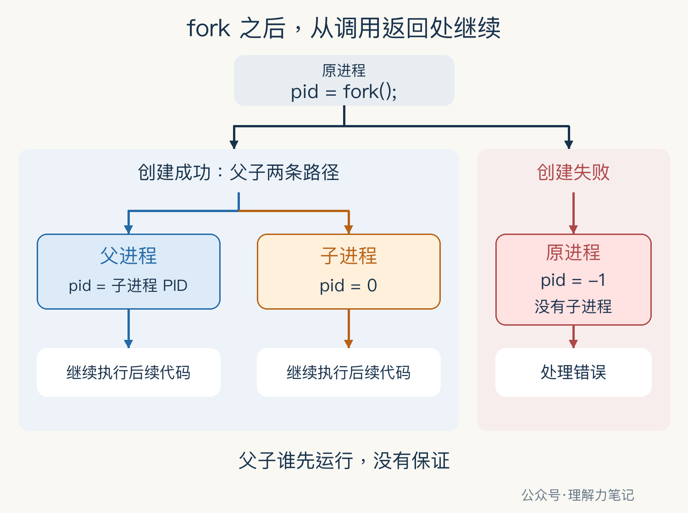

# fork 之后，父子进程从哪里继续执行？


代码只调用了一次 `fork()`，后面的打印却执行了两遍。子进程是重新跑了一次 `main`，还是从中间接着跑？

**`fork` 成功后，父子进程都从这次调用返回的位置继续执行。父进程得到子进程的 PID，子进程得到 0。**失败时，原进程得到 -1，没有子进程产生。

PID 就是进程编号。本篇用一个单线程 C 程序，把“谁在执行”和“拿到了什么返回值”一起打印出来。`fork` 属于 POSIX 接口，ISO C 本身不规定它；Linux 支持这一接口。

**这篇文章怎么读？**

| 你想知道什么 | 看哪一章 | 会得到什么 |
| --- | --- | --- |
| 后面的代码到底谁在执行 | 第一章 · 先解决问题 | 用 PID 和返回值认出父子进程 |
| 同一句调用为何有两条执行路径 | 第二章 · 机制解释 | 看清创建前后的执行位置 |
| 怎样写对父子分支 | 第三章 · 工程使用 | 失败处理、子进程退出与回收 |
| 面试怎样说明白 | 第四章 · 面试提炼 | 返回值与执行顺序的准确说法 |

## 第一章 · 先解决问题：同一处代码，由两个进程继续执行

实验先打印创建前的进程编号，再调用 `fork`。下面是 `fork_demo.c` 中的真实片段，完整程序还包含输出设置、退出和回收代码。

```c
pid_t pid = fork();
if (pid == -1) {
    perror("fork");
    return EXIT_FAILURE;
}

int output_ok = printf("after: self=%ld fork_return=%ld\n",
                       (long)getpid(), (long)pid) >= 0;
```

`getpid()` 取得当前正在执行的进程编号，`pid` 保存当前进程收到的 `fork` 返回值。打印前转为 `long`，与 `%ld` 匹配。

为避免标准 I/O 缓冲干扰观察，程序在第一次操作 `stdout` 之前，用 `setvbuf(stdout, NULL, _IONBF, 0)` 将其设为无缓冲，并检查设置结果。完整程序也检查每次打印是否成功。

本次实测环境为 **macOS 14.8.8 x86_64、Apple clang 16.0.0**。以下是 POSIX 示例的真实结果，未在 Linux 主机实测；接口结论同时核对了 POSIX 与 Linux 手册。

编译、运行配套的完整源文件：

```sh
cc -std=c17 -Wall -Wextra -Wpedantic -Wconversion -Wshadow \
   -O0 -g fork_demo.c -o fork_demo
./fork_demo
```

一次实际输出如下，进程最终退出状态为 0：

```text
before: self=35439
after: self=35439 fork_return=35440
after: self=35440 fork_return=0
```

创建前，进程编号是 35439。创建后，35439 仍是父进程，拿到返回值 35440；新进程 35440 拿到的返回值是 0。

**子进程中的 0 是 `fork` 返回值，子进程自己的 PID 是 35440。**把这两件事分开，父子分支就容易读了。

`before` 只执行一次，`after` 所在的代码则由父子进程各执行一次。本次输出恰好父进程在前。附带的 20 次运行也都观察到相同顺序，但这不能证明父进程总先运行；验证时只核对身份与返回值的对应关系，不要求两条 `after` 的顺序固定。无缓冲也不保证多进程打印的整行不会交错，本例的短行输出不应被当作通用日志同步方案。

## 第二章 · 机制解释：复制当前执行状态，从调用返回处接着走

可以把程序想成一份正在照着执行的操作清单。走到 `fork` 时，成功创建了另一位执行者；两人拿着同样的清单，从当前标记处往下做。先前已经做过的步骤，不会因为多了一位执行者再从头做一遍。

清单对应程序代码，执行者对应进程，当前标记对应执行位置。类比只帮助理解“从哪里继续”，进程的内存与文件资源如何继承，还需要分别讨论。

回到代码，`pid_t pid = fork();` 包含调用和赋值。父子进程各自取得返回值、完成各自的赋值，然后继续判断 `pid`。所以，“继续执行”更准确地说是**从调用返回处继续**，不必机械理解成源文件的下一行。



父子执行的是同一份程序逻辑，但它们是不同的进程，各有进程身份和执行状态。`if` 负责根据各自的返回值选择分支，创建子进程这件事已经由 `fork` 完成。

成功路径上的两个进程可以独立运行。操作系统调度哪个进程先获得运行机会，会影响你看到的输出顺序。图中左右位置不表示先后；给其中一方加 `sleep` 也不能建立可靠的同步关系。

还有一个容易漏看的地方：父子分支结束后，如果双方都继续往下走，分支外的公共代码也会被双方执行。想让子进程到此结束，就必须给它明确的退出路径。

## 第三章 · 工程使用：先处理失败，再分清退出与回收

不要只把返回值当成真假来判断。-1 和正数在 C 的条件表达式里都是真，直接写 `if (pid)` 容易把创建失败混进父进程的正常路径。前面的示例先排除 -1，再处理 0，剩下的才是父进程路径。

`fork` 失败时读取 `errno` 才有意义，示例立即用 `perror` 输出原因。Linux 上进程数量限制可能导致 `EAGAIN`，内存不足可能导致 `ENOMEM`。不要看到失败就无间隔地重复创建。

打印完成后，示例先检查输出错误，再结束子进程：

```c
if (!output_ok)
    perror("printf after");

if (pid == 0) {
    /* stdout 已无缓冲；子进程到此结束。 */
    _exit(output_ok ? EXIT_SUCCESS : EXIT_FAILURE);
}
```

这里的 `_exit` 结束当前子进程，不再继续执行后面的父进程逻辑，也不执行标准 I/O 的退出刷新。本例已经把 `stdout` 设成无缓冲；若改回缓冲输出，不能照搬“打印后直接 `_exit`”而不检查刷新。

父进程还要回收子进程。这个短函数只负责等待指定子进程，遇到信号中断 `EINTR` 时重试，其他错误交给调用者：

```c
static int wait_child(pid_t child, int *status)
{
    pid_t result;
    do {
        result = waitpid(child, status, 0);
    } while (result == -1 && errno == EINTR);
    return result == -1 ? -1 : 0;
}
```

调用位置在子进程的 `_exit` 之后，只有父进程会到达：

```c
int status;
if (wait_child(pid, &status) == -1) {
    perror("waitpid");
    return EXIT_FAILURE;
}
if (!WIFEXITED(status) || WEXITSTATUS(status) != 0)
    return EXIT_FAILURE;
return output_ok ? EXIT_SUCCESS : EXIT_FAILURE;
```

先确认子进程正常结束，再读取退出码；不能直接把 `status` 当作退出码。即使父进程自己的打印失败，也会先走到等待回收，再报告失败。

这里假设没有其他代码抢先回收同一子进程，也没有把 `SIGCHLD` 显式设为忽略或开启自动回收。`waitpid` 放在父进程打印之后，因此只能保证成功返回时子进程已经结束，不能倒过来保证前面的父子打印顺序。

配套验证覆盖了普通文件重定向和输出失败，并用测试替身注入 `fork` 的 `EAGAIN`、`waitpid` 的 `EINTR` 与 `ECHILD`，确认失败返回、重试和错误传递。这些是故障注入，不是实际耗尽系统资源的结果。

本例限定单线程程序。多线程程序调用 `fork` 后，子进程在成功执行 `exec` 前只能执行异步信号安全操作，也就是规范明确允许在这类受限上下文中使用的操作；`printf` 不在这个范围内，不能把本例直接搬过去。

## 第四章 · 面试提炼：一次调用后，两个进程各自返回

“`fork` 调用一次、返回两次”描述的是成功情形：原来的父进程和新建的子进程，各自从调用处返回一次。失败时只有原进程返回 -1。

父进程的返回值是子进程 PID，便于随后指定等待对象；子进程得到 0，可以据此识别自己的执行分支，需要自己的 PID 时调用 `getpid()`。父子谁先运行没有保证，需要先后关系就使用明确的同步或等待机制。

## 参考资料

- [POSIX.1-2024：fork](https://pubs.opengroup.org/onlinepubs/9799919799/functions/fork.html)：父子身份、返回位置、返回值和多线程限制。
- [Linux man-pages：fork(2)](https://man7.org/linux/man-pages/man2/fork.2.html)：Linux 接口行为与失败原因。
- [POSIX.1-2024：wait、waitpid](https://pubs.opengroup.org/onlinepubs/9799919799/functions/waitpid.html)：指定子进程、等待中断与退出状态解释。
- [POSIX.1-2024：_exit](https://pubs.opengroup.org/onlinepubs/9799919799/functions/_exit.html)：进程终止与标准 I/O 刷新边界。
- [POSIX.1-2024：2.5.1 文件描述符与标准 I/O 流的交互](https://pubs.opengroup.org/onlinepubs/9799919799/functions/V2_chap02.html#tag_16_05_01)：`fork` 后的句柄协调及无缓冲流规则。
